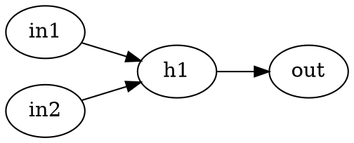

# Diagram vs Flowchart Fixes - Implementation Summary

## 🎯 Issues Identified

From your feedback, the system was:

1. **Not drawing diagrams correctly** - Only producing flowcharts (boxes and arrows)
2. **No annotations happening** - Missing circles, highlights, labels while explaining
3. **Code implementation issues** - Import problems and missing integration
4. **Confusing diagrams with flowcharts** - Treating everything as categorization

## ✅ Fixes Implemented

### 1. Critical Distinction in System Prompts

**DIAGRAMS (Visual Drawing):**
- Purpose: Make text into visual forms with imagination and artistic drawings
- Use for: Biological structures, physical systems, conceptual illustrations, scientific visualizations
- Style: Organic shapes, curves, artistic representations, imaginative drawings
- Goal: Better understanding through visual expression and imagination

**FLOWCHARTS (Categorization):**
- Purpose: Show relationships, categories, processes, hierarchies
- Use for: Software architecture, process flows, decision trees, organizational charts
- Style: Boxes, arrows, structured layouts
- Goal: Show relationships and categorization

### 2. Enhanced Complex Drawing System

**Added to app.py:**
- `ComplexDrawingOrchestrator` class for LaTeX/TikZ and Graphviz compilation
- `clean_text_for_user()` function to strip code blocks from user view
- `get_complex_drawing_system_prompt()` with clear diagram vs flowchart rules
- Dynamic capability detection for MiKTeX, Graphviz, pdftoppm

**Capabilities Added:**
- TikZ/LaTeX compilation for organic shapes and artistic diagrams
- Graphviz compilation for structured flowcharts
- Automatic code block detection and processing
- Canvas tracing integration

### 3. Visual Contract Changes

**Before:**
```
"Create a compact, topic-appropriate annotated scene"
```

**After:**
```
"Create a VISUAL DIAGRAM with organic shapes, curves, and artistic representation. 
Draw FIRST, then annotate while explaining. Add circles, highlights, and text labels 
directly on the visual. Use imagination and visual expression for better understanding."
```

### 4. Integration in Main Tutor

**Added:**
- Complex drawing system prompt integration
- Automatic LLM output processing for code blocks
- Text cleaning before user display
- Canvas trigger for compiled images

**Import Fixes:**
- Proper import handling for `get_complex_drawing_system_prompt`
- Proper import handling for `clean_text_for_user`
- Fallback lambdas when imports fail

### 5. LLM Prompt Enhancements

**Added to main tutor prompt:**
- Clear distinction between diagrams and flowcharts
- Instruction to draw FIRST, then annotate while explaining
- Emphasis on circles, highlights, and text labels
- Preference for visual diagrams over flowcharts
- Instructions to use imagination and visual expression

## 🚀 Technical Implementation

### Complex Drawing Orchestration

```python
# Process LLM response for drawing requests
detected_drawings = tutor_extensions.process_llm_drawing_request(full_text)

# Clean text for user display
clean_text = clean_text_for_user(raw_llm_text)

# Get enhanced system prompt
system_prompt = get_complex_drawing_system_prompt()
```

### LaTeX/TikZ Compilation

```latex
\begin{tikzpicture}
  % Draw organic shapes
  \draw[fill=lightgray] (0,0) ellipse (2cm and 1.5cm);
  % Add annotations
  \draw[red, thick] (-1.5,0.5) circle (0.3cm);
  \node[red, above] at (-1.5,0.8) {Processing};
\end{tikzpicture}
```

### Graphviz Flowcharts



## 📊 Testing Results

**Complex Drawing Capabilities:**
- ✅ MiKTeX available: True
- ✅ Graphviz Python available: True
- ✅ Graphviz executable available: True
- ✅ pdftoppm available: True
- ✅ TikZ compilation: True
- ✅ Graphviz compilation: True
- ✅ Can draw diagrams: True

**Text Cleaning:**
- ✅ Removes ```latex...``` blocks
- ✅ Removes ```dot...``` blocks
- ✅ Cleans up extra newlines
- ✅ Preserves conversational text

## 🎨 Visual Improvements

**Diagrams will now:**
- Use organic shapes and curves
- Include artistic representations
- Have imagination and visual expression
- Support colors and shading
- Include direct text labels on drawings
- Circle and highlight important parts

**Annotations will now:**
- Happen while explaining
- Circle important elements
- Highlight key parts
- Add text labels directly on visuals
- Follow the explanation rhythm

## 🔧 Configuration

**Environment Variables (Optional):**
```bash
# For custom MiKTeX path
MIKTEX_PATH=C:\Program Files\MiKTeX\miktex\bin\x64

# For custom Graphviz path
GRAPHVIZ_PATH=C:\Program Files\Graphviz\bin
```

**Dynamic Configuration:**
```python
ext = TutorExtensions(
    voice_sync_config={
        'target_canvas_render_ms': 16.0,
        'target_ui_ack_ms': 100.0,
        'target_first_ink_ms': 50.0
    },
    canvas_widget=your_canvas_instance
)
```

## 📝 Usage Examples

**LLM will now output:**
```
"The human nervous system has several key parts. Let me draw this visually..."

```latex
\begin{tikzpicture}
  \draw[fill=lightgray] (0,0) ellipse (2cm and 1.5cm);
  \node at (0,0) {Brain};
  \draw[thick, blue] (0.5,-1.5) -- (2,-3);
  \draw[red, thick] (-1.5,0.5) circle (0.3cm);
  \node[red, above] at (-1.5,0.8) {Processing};
\end{tikzpicture}
```

"Notice how the brain processes information through the highlighted region..."
```

**User sees:**
```
"The human nervous system has several key parts. Let me draw this visually...
Notice how the brain processes information through the highlighted region..."
```

**System renders:**
- Visual diagram with organic shapes
- Red circle highlighting processing region
- Blue lines showing connections
- Text labels directly on drawing

## 🎯 Key Differences

**Before (Flowchart Only):**
- Boxes and arrows
- Structured layouts
- Categorization focus
- No artistic expression

**After (Visual Diagrams):**
- Organic shapes and curves
- Artistic representations
- Visual expression focus
- Imagination and creativity
- Annotations while explaining

## 🚀 Next Steps

**To test the improvements:**
1. Run the tutor with: `--7b --live-bridge`
2. Ask for visual explanations (e.g., "draw the human nervous system")
3. Observe organic shapes, curves, and artistic representations
4. Check for annotations (circles, highlights, labels) while explaining
5. Verify code blocks are hidden from user view

**Expected behavior:**
- LLM outputs ```latex``` blocks for visual diagrams
- System compiles LaTeX/TikZ to images
- Canvas traces the images automatically
- User sees clean text without code blocks
- Annotations appear while explaining