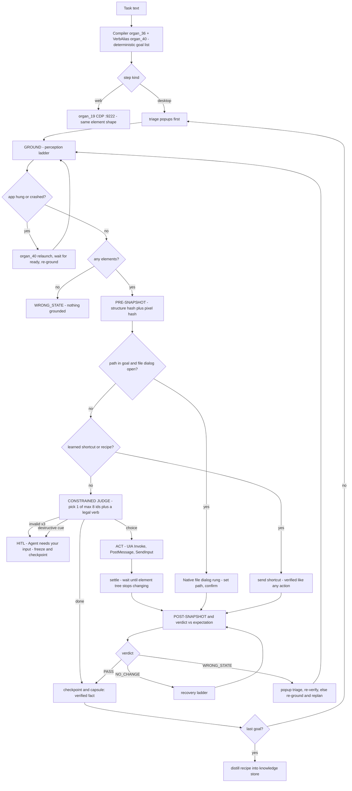
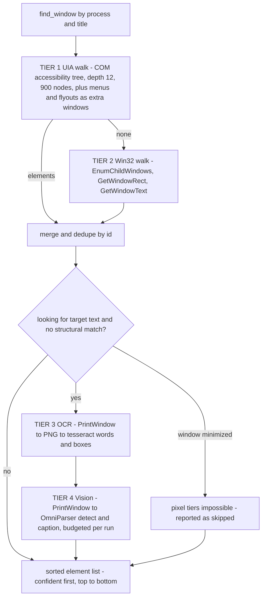
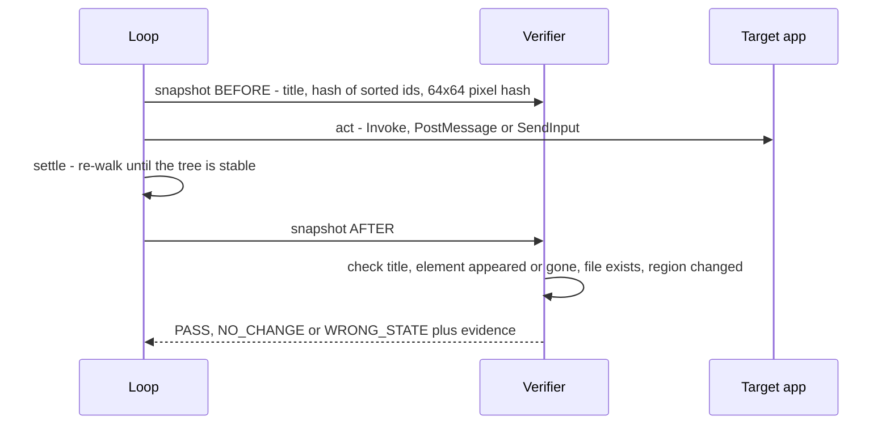
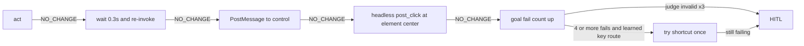
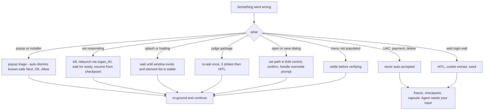
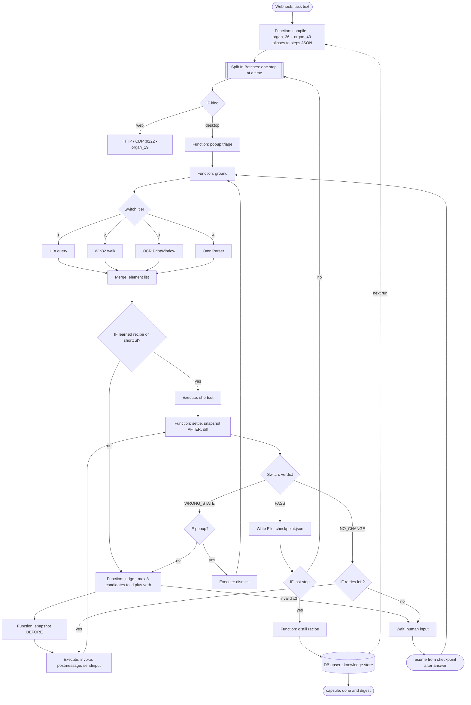
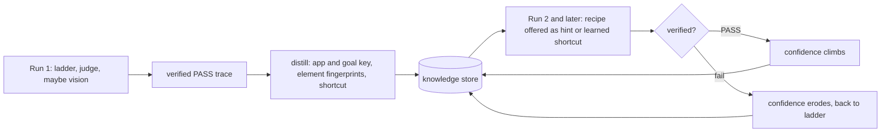

# Perception Flow Atlas

How the desktop automation should work physically: see, decide, act, verify, heal, learn. Matches `desktop_grounding.py` as it exists today.

**Core rule:** no action is ever believed. Every action is followed by a measurement of the screen, and only the measurement decides success. Every perception tier returns the same element shape: `id, name, role, bbox, provider_tier, confidence`.

## 1. Master loop for one goal

The full path from task text to a verified result, including every stop and recovery.

## 2. Perception: what physically happens

Cheapest real signal first. Pixels are only touched when a specific text target is missing from the structural tiers.

| Tier | Mechanism | Pixels | Use for |
| --- | --- | --- | --- |
| 1 UIA | COM accessibility tree | no | Office, Explorer, Settings, browser chrome |
| 2 Win32 | child window enumeration | no | legacy and owner-drawn controls |
| 3 OCR | PrintWindow then tesseract | yes | custom-drawn text, sparse UIA |
| 4 Vision | PrintWindow then OmniParser | yes | canvases: Blender, games, GL |

Every call returns `tiers_ran`, `tiers_skipped` and `tier_ms`. A tier that did not run is reported as skipped, never assumed.

## 3. Verification: the trust core

Two signatures matter: the UIA tree does not change when you extrude a face in Blender, only pixels do. Structure catches dialogs and menus. The pixel hash catches canvases.

| Verdict | Meaning | Reaction |
| --- | --- | --- |
| PASS | after-state matches the postcondition | checkpoint, reinforce knowledge, next goal |
| NO_CHANGE | the app never reacted | climb the recovery ladder one rung |
| WRONG_STATE | UI changed into something unexpected | popup triage, re-ground, replan |

## 4. Self-healing

Recovery ladder for NO_CHANGE, in the order the code runs it. Each rung is re-verified.

Failure classes and what heals each:

The 3-strike rule turns unbounded LLM flailing into a bounded, resumable stop. A human answers once and the answer is learned.

## 5. n8n-style operator view

The same loop drawn as workflow nodes.

## 6. Learning loop

Learned knowledge only nudges the judge or sends a shortcut that is still verified. A stale recipe fails verification and the ladder takes over, so it cannot cause a silent wrong action.

## 7. Scenario matrix

| # | Scenario | Detected by | Path | Fallback |
| --- | --- | --- | --- | --- |
| 1 | Standard UI (Settings, Office, Explorer) | tier 1 finds target | UIA Invoke | tier 2 rect click |
| 2 | Canvas or GL app (Blender, games) | few UIA nodes, target missing | tier 3 then 4; pixel-hash verify | HITL |
| 3 | UIA-sparse custom-drawn app | structural miss on target text | OCR pseudo-elements | tier 4 |
| 4 | Popup or installer wizard | popup triage, WRONG_STATE | auto-dismiss safe buttons | HITL |
| 5 | UAC or permission shield | elevation cue | never auto-accepted | HITL and checkpoint |
| 6 | Native Open/Save dialog | dialog title and path in goal | set path in Edit, confirm | click by label |
| 7 | Crash or Not Responding | hung check | relaunch, wait ready, re-ground | HITL |
| 8 | Splash or slow load | element list unstable | settle and backoff | HITL |
| 9 | Foreign cursor clip | SendInput ineffective | Invoke or PostMessage first | vision-click (not built) |
| 10 | Several windows of one app | multiple matches | process and title; popups grounded as extra windows | explicit hwnd |
| 11 | Destructive element | destructive cue in name | needs allow_destructive | HITL, audit log |
| 12 | Hours-long run | checkpoint per step | resume session, relaunch, re-ground | ladder |
| 13 | Web login wall | login detector | HITL, cookie seed | isolated profile |
| 14 | Web plus desktop task | mixed step graph | browser reused on 9222 | direct launch |
| 15 | Judge returns garbage | id outside candidates | re-ask, 3-strike HITL | stronger judge model |
| 16 | Window minimized | window state | pixel tiers skipped and reported | restore window |
| 17 | Menu not yet populated | tree still changing | settle before verify | retry |
| 18 | Overwrite confirm | overwrite title check | handled in file-dialog rung | HITL if destructive |

## 8. Status, read from the code

in code UIA and Win32 tiers, popup-window grounding, OCR and vision gating with honest skip reporting, structural and pixel verifier, constrained judge with 3-strike HITL, destructive guard, native file dialog rung, shortcut path, NO_CHANGE ladder, popup triage, crash relaunch, settle, checkpoint and resume, recipe distill and recall.

unmeasured pytesseract, torch, easyocr and uiautomation are installed, so tiers 3 and 4 can run, but no latency or accuracy has been measured. Treat millisecond figures as expectations until read from real `tier_ms` reports.

not yet vision-click as a final recovery rung; an unattended end-to-end run of a long task such as the Blender chair; recipe retrieval quality on multi-step traces.

**Next step:** run `ground()` on five real apps (Settings, Notepad, Chrome, Blender, an Electron app), save each ladder report, and replace the expectations with measured numbers.

## 9. Measured results (benchmark, 2026-10-04)

From `benchmarks/grounding_reports/*.json`, CPU only. Forced escalation used a target text that cannot exist.

| App | UIA ms | UIA elems | OCR ms | OCR words | Vision s | Vision boxes |
| --- | --- | --- | --- | --- | --- | --- |
| Notepad | 188 | 29 | 505 | 11 | 62.0 | 30 |
| Settings | 1618 | 47 | 1897 | 123 | 105.1 | 69 |
| Chrome | 1297 | 142 | 1691 | 181 | 213.7 | 126 |
| Paint (canvas stand-in) | 568 | 127 | 739 | 16 | 278.4 | 101 |
| Claude desktop (Electron) | 312 | 9 | 3669 | 390 | 409.7 | 161 |
| VS Code | not groundable: title filter excludes "visual studio" (scenario 19) |  |  |  |  |  |

**Corrections to the earlier estimates:** UIA takes 0.2 to 1.6 s, not milliseconds. Vision takes 62 to 410 s per pass on CPU, not 1.5 to 4 s, so it is a learning-time cost, not a per-step tier. No PrintWindow black frames appeared on any app.

**Canvas hash:** in a controlled Tk window a canvas-only change moved the pixel hash while the structure signature stayed the same. The Paint test was inconclusive because posted clicks never drew. Blender is not installed, so the Blender pre-test is still open.