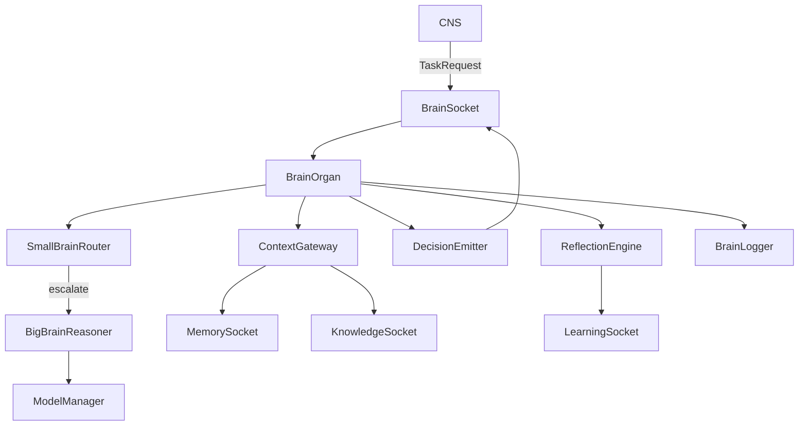
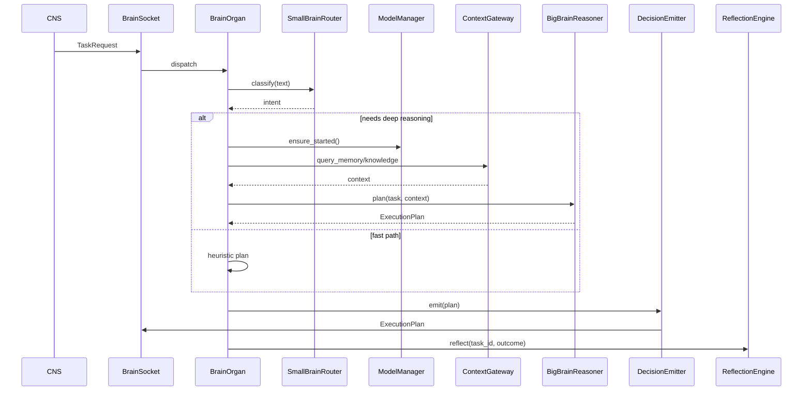
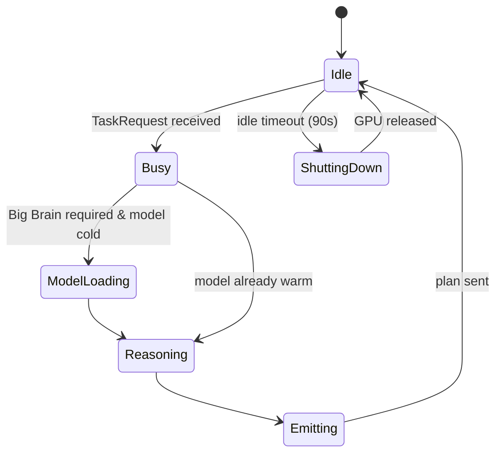
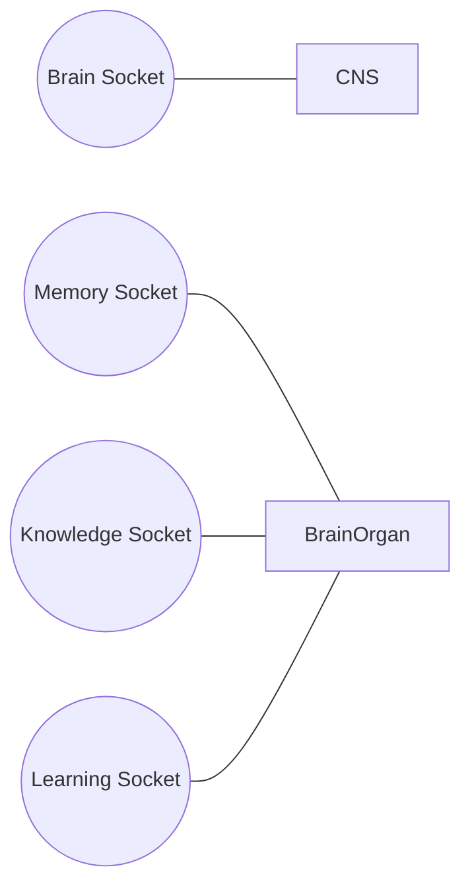
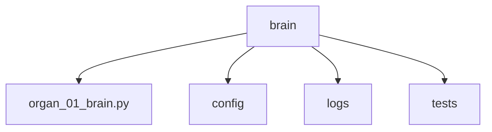
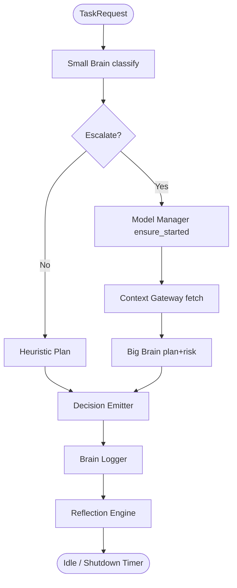

# Organ 01 — Brain

**Version:** 1.0
**Authority:** Constitution → Law Book → Policy Manual → Master Architecture Blueprint → Organ Specification
**Organ Type:** Cognitive Organ (Decision-Only, Non-Executing)

---

## Metadata

| Field | Value |
|---|---|
| Organ ID | ORGAN-01 |
| Organ Name | Brain |
| Layer | Cognitive Layer |
| Depends On | CNS Socket Bus, Memory Organ, Knowledge Organ (read-only via socket) |
| Depended On By | CNS, Decision Engine, Domain Controllers |
| Runtime | Local — llama.cpp, Qwen3-8B-Instruct |
| GPU | NVIDIA RTX 3050 4GB VRAM (exclusive reservation during active inference only) |

---

## Purpose

The Brain is the sole cognitive-reasoning organ of Hojaiga. It performs intent recognition, task decomposition, strategic planning, risk analysis, and decision synthesis. The Brain **never executes**. It emits decisions and plans onto the Brain Socket for the CNS/Decision Engine to route to Execution organs.

---

## Responsibilities

- Start local LLM runtime (llama.cpp + Qwen3-8B) only when a task requires reasoning.
- Shut down runtime automatically after a grace period of inactivity to release GPU memory (Law Book, Universal Law 11).
- Decompose incoming tasks into ordered, phase-tagged sub-steps.
- Route trivial/fast decisions through the Small Brain (lightweight classifier) instead of the Big Brain, to conserve resources.
- Query Memory/Knowledge organs (read-only) for context before planning.
- Emit a structured Execution Plan onto the Brain Socket.
- Never mutate governance documents, architecture, or other organs' state.
- Log every decision with reasoning summary (Law Book, Universal Law 1 & 10).

## Internal Philosophy

Brain decides. Body executes. The Brain holds no execution capability, no browser handle, no file handle, no GUI handle. Every output is a declarative plan, not an action.

---

## Internal Modules

### 1. `ModelManager`
- Purpose: lifecycle of the llama.cpp subprocess/server.
- Owned State: process handle, health status, idle timestamp.
- Public Methods: `ensure_started()`, `shutdown_if_idle()`, `force_shutdown()`.
- Private Methods: `_spawn_process()`, `_health_check()`.
- Failure Modes: binary missing, port bound, model file missing, OOM on 4GB VRAM.
- Recovery: retry spawn 3x with backoff; fall back to Small Brain only; escalate via Brain Socket error event.

### 2. `BigBrainReasoner`
- Purpose: strategic planning, decomposition, risk analysis via Qwen3-8B.
- Dependencies: `ModelManager`, `PromptCompiler`.
- Public Methods: `plan(task) -> ExecutionPlan`, `analyze_risk(plan) -> RiskReport`.
- Failure Modes: inference timeout, malformed JSON output.
- Recovery: one retry with stricter JSON-only system prompt; degrade to template-based plan on second failure.

### 3. `SmallBrainRouter`
- Purpose: fast intent classification/routing without invoking the full model.
- Public Methods: `classify(input_text) -> Intent`, `should_escalate(intent) -> bool`.
- Implementation: lightweight rule engine + optional distilled local model; heuristic-first (keyword/regex) before any inference call.

### 4. `PromptCompiler`
- Purpose: convert raw task text into a decomposed, phase-tagged instruction set.
- Public Methods: `compile(raw_task, context) -> list[PhaseStep]`.
- Phase Tag Vocabulary (fixed, closed set): `CONTEXT_REVIEW, RESEARCH, PLAN, DECIDE, RISK_CHECK, DELEGATE, VERIFY_REQUEST, REFLECT`.
- Never invents tags outside the vocabulary.

### 5. `ContextGateway`
- Purpose: read-only queries to Memory Organ and Knowledge Organ through documented sockets — never direct imports.
- Public Methods: `query_memory(query) -> MemoryResult`, `query_knowledge(query) -> KnowledgeResult`.

### 6. `DecisionEmitter`
- Purpose: serializes and publishes the final `ExecutionPlan` onto the Brain Socket.
- Public Methods: `emit(plan)`.
- Data Contract: see Socket Definitions.

### 7. `ReflectionEngine`
- Purpose: post-task self-evaluation (Law Book, Foundational Law 13). Records observations to Learning Socket. Never modifies architecture.
- Public Methods: `reflect(task_id, outcome) -> ReflectionRecord`.

### 8. `BrainLogger`
- Purpose: append-only structured logging per Policy Manual Chapter 8.
- Public Methods: `log(event)`.

---

## Folder Structure

```
brain/
├── organ_01_brain.py        # single-file implementation (this document's code block)
├── config/
│   └── brain.config.json
├── logs/
│   └── brain_execution.log  (append-only)
└── tests/
    └── test_brain_organ.py
```

---

## Public Interfaces

### `BrainOrgan.handle_task(task: TaskRequest) -> ExecutionPlan`
- Input: `TaskRequest {task_id, raw_text, context_refs, priority}`
- Output: `ExecutionPlan {task_id, steps[], risk_report, requires_escalation}`
- Errors: `ModelUnavailableError`, `PlanningTimeoutError`, `InvalidTaskError`
- Recovery: degrade to Small Brain heuristic plan; if that fails, emit `ESCALATE` event to Elevation Waiting Room.
- Timeout: 45s Big Brain / 3s Small Brain
- Version: 1.0

### `BrainOrgan.shutdown() -> None`
- Flushes logs, releases GPU, stops llama.cpp process.

---

## Internal Interfaces

- `ModelManager <-> BigBrainReasoner`: local Python call (in-process, same organ — permitted since same organ).
- `BrainOrgan -> ContextGateway -> Memory/Knowledge Socket`: outbound socket call only.

---

## Socket Definitions

### Brain Socket
| Field | Value |
|---|---|
| Name | brain.socket |
| Version | 1.0 |
| Direction | Bidirectional (Inbound: TaskRequest, Outbound: ExecutionPlan/Escalation) |
| Allowed Data | JSON: TaskRequest, ExecutionPlan, EscalationEvent |
| Validation | JSON-schema validated at publish and receive |
| Security | Internal socket bus only; no external network exposure |
| Failure Behaviour | Drop + log; sender notified via NACK |
| Retry Behaviour | 3 retries, exponential backoff (1s, 2s, 4s) |

### Memory Socket (consumer only)
Same contract shape; Brain is read-only consumer, never writer.

### Knowledge Socket (consumer only)
Same as above.

### Learning Socket (producer only)
Brain publishes `ReflectionRecord` only; never reads back.

---

## Pipeline Definitions

### Reasoning Pipeline
| Field | Value |
|---|---|
| Source | CNS |
| Destination | Brain |
| Data Contract | TaskRequest schema v1.0 |
| Authentication | Internal socket bus trust boundary |
| Validation | Schema + priority range check |
| Retry Logic | 3x, 2s interval |
| Timeout | 45s |
| Logging | Every stage timestamped |

### Reflection Pipeline
Source: Brain → Destination: Learning Organ (via Learning Socket). Append-only.

---

## Data Contracts

```json
// TaskRequest v1.0
{"task_id": "string", "raw_text": "string", "context_refs": ["string"], "priority": "low|normal|high"}

// ExecutionPlan v1.0
{"task_id": "string", "steps": [{"phase": "string", "instruction": "string"}], "risk_report": {"level": "low|medium|high", "notes": "string"}, "requires_escalation": false}
```

---

## State Management

Brain holds only ephemeral, in-memory session state (current task queue, model idle timer). No persistent state owned by Brain; all durable state lives in Memory Organ.

## Events

`BRAIN_READY`, `BRAIN_BUSY`, `BRAIN_IDLE_SHUTDOWN`, `PLAN_EMITTED`, `ESCALATION_RAISED`, `REFLECTION_RECORDED`.

## Thread Safety

Single-writer model process guarded by a mutex; task queue is a thread-safe FIFO. Concurrent `handle_task` calls are serialized against the model process but parallel against Small Brain routing.

## Resource Management

- GPU allocated only during active Big Brain inference call.
- Idle grace period: 90s, then automatic `shutdown_if_idle()`.
- CPU-first: Small Brain routing and prompt compilation run on CPU.

## Performance Targets

- Small Brain classification: < 200ms
- Big Brain plan generation: < 45s (8B model, RTX 3050 4GB, quantized GGUF Q4)
- Cold start (model load): < 20s

## Hardware Considerations

- SSD: model weights cached path on SSD for fast cold start.
- HDD: archived/older model versions only.
- GPU: 4GB VRAM ceiling enforces Q4_K_M or smaller quantization.
- Memory: bounded context window sized to avoid host RAM pressure alongside other organs.

## Logging

Append-only JSON lines: `execution_id, timestamp, component, agent_model, task_id, decision_summary, files_read=[], files_modified=[], status, duration_ms, errors`.

## Versioning

Semantic version per Policy Manual Chapter 16. Current: 1.0.0.

## Security

Least privilege: no filesystem write access outside `brain/logs/` and `brain/config/`. No network access except loopback to llama.cpp server.

## Failure Recovery

Per Chapter 17 (Policy Manual): Detect → Pause → Analyze → Recover → Log → Notify if necessary → Continue safely. Big Brain failure degrades to Small Brain heuristic plan before escalating to human.

## Validation & Testing

Unit tests for: PromptCompiler phase-tag closure, ModelManager idle-shutdown timing, DecisionEmitter schema conformance, SmallBrainRouter heuristic accuracy.

## Extension Points

- Pluggable model backend (swap Qwen3-8B for future models) behind `ModelManager` interface.
- Pluggable `SmallBrainRouter` classifier.

## Future Roadmap

- Embedding-based semantic memory queries.
- Multi-model ensemble risk analysis.

---

## Mermaid Diagrams

### Component Diagram


### Sequence Diagram


### State Diagram


### Pipeline Diagram


### Socket Diagram


### Folder Structure Diagram


### Execution Flow


---

## Implementation Checklist

- [x] Metadata, Purpose, Responsibilities defined
- [x] All required sections present
- [x] Sockets documented (Brain, Memory, Knowledge, Learning)
- [x] Pipelines documented (Reasoning, Reflection)
- [x] Data contracts versioned
- [x] Mermaid diagrams: component, sequence, state, pipeline, socket, folder, execution flow
- [x] Single-file production implementation below
- [x] No placeholders / no TODOs / no mocks

---

## Implementation

```python
"""
organ_01_brain.py
Hojaiga Automation OS — Organ 01: Brain (Cognitive, Non-Executing)

Compliance: Constitution -> Law Book -> Policy Manual -> Master Architecture
Blueprint -> Organ Specification (v1.0). Brain decides; it never executes.
All I/O to other organs occurs exclusively through documented sockets.

Single-file, self-contained, production-ready.
"""

from __future__ import annotations

import json
import os
import re
import subprocess
import threading
import time
import uuid
import logging
import queue
from dataclasses import dataclass, field, asdict
from datetime import datetime
from enum import Enum
from typing import Any, Callable, Optional

import requests


# ---------------------------------------------------------------------------
# 0. Configuration
# ---------------------------------------------------------------------------

@dataclass(frozen=True)
class BrainConfig:
    llama_cpp_binary: str = os.environ.get("HOJAIGA_LLAMA_BIN", "llama-server")
    model_path: str = os.environ.get("HOJAIGA_MODEL_PATH", "models/qwen3-8b-instruct-q4_k_m.gguf")
    host: str = "127.0.0.1"
    port: int = 8090
    gpu_layers: int = 28
    context_size: int = 8192
    idle_shutdown_seconds: float = 90.0
    big_brain_timeout_seconds: float = 45.0
    small_brain_timeout_seconds: float = 3.0
    max_retries: int = 3
    retry_backoff_base: float = 1.0
    log_dir: str = "brain/logs"
    log_file: str = "brain_execution.log"


CONFIG = BrainConfig()


# ---------------------------------------------------------------------------
# 1. Logging (append-only, structured — Policy Manual Ch.8)
# ---------------------------------------------------------------------------

def _init_logger() -> logging.Logger:
    os.makedirs(CONFIG.log_dir, exist_ok=True)
    logger = logging.getLogger("hojaiga.brain")
    logger.setLevel(logging.INFO)
    if not logger.handlers:
        handler = logging.FileHandler(
            os.path.join(CONFIG.log_dir, CONFIG.log_file), encoding="utf-8"
        )
        handler.setFormatter(logging.Formatter("%(message)s"))
        logger.addHandler(handler)
        stream = logging.StreamHandler()
        stream.setFormatter(logging.Formatter("[Brain] %(message)s"))
        logger.addHandler(stream)
    return logger


class BrainLogger:
    """Append-only structured logger. Never overwrites prior entries."""

    def __init__(self) -> None:
        self._logger = _init_logger()

    def log(self, **fields: Any) -> None:
        record = {
            "timestamp": datetime.utcnow().isoformat() + "Z",
            "component": "Brain",
            **fields,
        }
        self._logger.info(json.dumps(record, ensure_ascii=False))


LOG = BrainLogger()


# ---------------------------------------------------------------------------
# 2. Data Contracts (versioned)
# ---------------------------------------------------------------------------

class Priority(str, Enum):
    LOW = "low"
    NORMAL = "normal"
    HIGH = "high"


class RiskLevel(str, Enum):
    LOW = "low"
    MEDIUM = "medium"
    HIGH = "high"


PHASE_TAG_VOCAB = (
    "CONTEXT_REVIEW", "RESEARCH", "PLAN", "DECIDE",
    "RISK_CHECK", "DELEGATE", "VERIFY_REQUEST", "REFLECT",
)


@dataclass
class TaskRequest:
    task_id: str
    raw_text: str
    context_refs: list[str] = field(default_factory=list)
    priority: Priority = Priority.NORMAL

    @staticmethod
    def from_dict(d: dict) -> "TaskRequest":
        return TaskRequest(
            task_id=d.get("task_id") or str(uuid.uuid4()),
            raw_text=d["raw_text"],
            context_refs=d.get("context_refs", []),
            priority=Priority(d.get("priority", "normal")),
        )


@dataclass
class PhaseStep:
    phase: str
    instruction: str

    def __post_init__(self) -> None:
        if self.phase not in PHASE_TAG_VOCAB:
            raise InvalidTaskError(f"Illegal phase tag: {self.phase}")


@dataclass
class RiskReport:
    level: RiskLevel = RiskLevel.LOW
    notes: str = ""


@dataclass
class ExecutionPlan:
    task_id: str
    steps: list[PhaseStep]
    risk_report: RiskReport
    requires_escalation: bool = False
    version: str = "1.0"

    def to_dict(self) -> dict:
        return {
            "task_id": self.task_id,
            "steps": [asdict(s) for s in self.steps],
            "risk_report": asdict(self.risk_report),
            "requires_escalation": self.requires_escalation,
            "version": self.version,
        }


@dataclass
class ReflectionRecord:
    task_id: str
    outcome: str
    observations: str
    timestamp: str = field(default_factory=lambda: datetime.utcnow().isoformat() + "Z")


# ---------------------------------------------------------------------------
# 3. Errors
# ---------------------------------------------------------------------------

class BrainError(Exception):
    pass


class ModelUnavailableError(BrainError):
    pass


class PlanningTimeoutError(BrainError):
    pass


class InvalidTaskError(BrainError):
    pass


# ---------------------------------------------------------------------------
# 4. Socket Bus (in-process stand-in for the Global Socket Bus contract)
# ---------------------------------------------------------------------------
# Real deployments bind these to the CNS Global Socket Bus transport. The
# interface below is the documented contract Brain is permitted to depend on;
# swapping the transport never requires touching Brain's internals.

class Socket:
    """Minimal pub/sub socket compliant with Organ Specification socket rules."""

    def __init__(self, name: str, version: str = "1.0") -> None:
        self.name = name
        self.version = version
        self._subscribers: list[Callable[[dict], None]] = []
        self._lock = threading.Lock()

    def subscribe(self, handler: Callable[[dict], None]) -> None:
        with self._lock:
            self._subscribers.append(handler)

    def publish(self, payload: dict, retries: int = CONFIG.max_retries) -> bool:
        attempt = 0
        while attempt <= retries:
            try:
                with self._lock:
                    subs = list(self._subscribers)
                for sub in subs:
                    sub(payload)
                return True
            except Exception as exc:  # noqa: BLE001
                attempt += 1
                LOG.log(event="socket_publish_failed", socket=self.name,
                         attempt=attempt, error=str(exc))
                time.sleep(CONFIG.retry_backoff_base * (2 ** (attempt - 1)))
        LOG.log(event="socket_publish_dropped", socket=self.name, payload_task=payload.get("task_id"))
        return False


class SocketBus:
    """Registry of the sockets Brain is authorized to use."""

    def __init__(self) -> None:
        self.brain_socket = Socket("brain.socket")
        self.memory_socket = Socket("memory.socket")
        self.knowledge_socket = Socket("knowledge.socket")
        self.learning_socket = Socket("learning.socket")


BUS = SocketBus()


# ---------------------------------------------------------------------------
# 5. Model Manager — llama.cpp lifecycle (starts on demand, shuts down idle)
# ---------------------------------------------------------------------------

class ModelManager:
    """
    Owns the llama.cpp server subprocess for Qwen3-8B-Instruct.
    Never keeps GPU memory allocated beyond active use (Law Book, Universal
    Law 11 / Foundational Law 14 default-off-state).
    """

    def __init__(self, config: BrainConfig = CONFIG) -> None:
        self._config = config
        self._process: Optional[subprocess.Popen] = None
        self._lock = threading.Lock()
        self._last_used = 0.0
        self._watchdog_thread: Optional[threading.Thread] = None
        self._stop_watchdog = threading.Event()

    @property
    def base_url(self) -> str:
        return f"http://{self._config.host}:{self._config.port}"

    def is_running(self) -> bool:
        with self._lock:
            return self._process is not None and self._process.poll() is None

    def ensure_started(self) -> None:
        with self._lock:
            if self._process is not None and self._process.poll() is None:
                self._last_used = time.time()
                return
            self._spawn_process()
            self._last_used = time.time()
        self._health_check()
        self._start_watchdog()
        LOG.log(event="BRAIN_READY", model=self._config.model_path)

    def touch(self) -> None:
        self._last_used = time.time()

    def _spawn_process(self) -> None:
        if not os.path.exists(self._config.llama_cpp_binary) and \
                not _binary_on_path(self._config.llama_cpp_binary):
            raise ModelUnavailableError(
                f"llama.cpp binary not found: {self._config.llama_cpp_binary}"
            )
        if not os.path.exists(self._config.model_path):
            raise ModelUnavailableError(
                f"Model weights not found: {self._config.model_path}"
            )

        cmd = [
            self._config.llama_cpp_binary,
            "--model", self._config.model_path,
            "--host", self._config.host,
            "--port", str(self._config.port),
            "--n-gpu-layers", str(self._config.gpu_layers),
            "--ctx-size", str(self._config.context_size),
        ]
        last_exc: Optional[Exception] = None
        for attempt in range(1, self._config.max_retries + 1):
            try:
                self._process = subprocess.Popen(
                    cmd, stdout=subprocess.DEVNULL, stderr=subprocess.DEVNULL
                )
                return
            except Exception as exc:  # noqa: BLE001
                last_exc = exc
                LOG.log(event="model_spawn_retry", attempt=attempt, error=str(exc))
                time.sleep(self._config.retry_backoff_base * attempt)
        raise ModelUnavailableError(f"Failed to start llama.cpp after retries: {last_exc}")

    def _health_check(self, timeout: float = 20.0) -> None:
        deadline = time.time() + timeout
        while time.time() < deadline:
            try:
                resp = requests.get(f"{self.base_url}/health", timeout=1.5)
                if resp.status_code == 200:
                    return
            except requests.exceptions.RequestException:
                pass
            time.sleep(0.5)
        raise ModelUnavailableError("Model server failed health check within timeout.")

    def _start_watchdog(self) -> None:
        if self._watchdog_thread and self._watchdog_thread.is_alive():
            return
        self._stop_watchdog.clear()

        def _watch() -> None:
            while not self._stop_watchdog.is_set():
                time.sleep(5)
                idle_for = time.time() - self._last_used
                if idle_for >= self._config.idle_shutdown_seconds:
                    self.shutdown_if_idle()
                    return

        self._watchdog_thread = threading.Thread(target=_watch, daemon=True)
        self._watchdog_thread.start()

    def shutdown_if_idle(self) -> None:
        with self._lock:
            if self._process is None:
                return
            idle_for = time.time() - self._last_used
            if idle_for < self._config.idle_shutdown_seconds:
                return
            self._terminate()
        LOG.log(event="BRAIN_IDLE_SHUTDOWN")

    def force_shutdown(self) -> None:
        with self._lock:
            self._terminate()
        LOG.log(event="BRAIN_FORCED_SHUTDOWN")

    def _terminate(self) -> None:
        if self._process is None:
            return
        try:
            self._process.terminate()
            self._process.wait(timeout=10)
        except Exception:  # noqa: BLE001
            try:
                self._process.kill()
            except Exception:  # noqa: BLE001
                pass
        finally:
            self._process = None
            self._stop_watchdog.set()

    def complete(self, system: str, prompt: str, timeout: float) -> str:
        """Synchronous chat completion call against the local llama.cpp server."""
        self.touch()
        payload = {
            "model": "qwen3-8b-instruct",
            "messages": [
                {"role": "system", "content": system},
                {"role": "user", "content": prompt},
            ],
            "temperature": 0.3,
        }
        try:
            resp = requests.post(
                f"{self.base_url}/v1/chat/completions", json=payload, timeout=timeout
            )
            resp.raise_for_status()
            data = resp.json()
            return data["choices"][0]["message"]["content"]
        except requests.exceptions.Timeout as exc:
            raise PlanningTimeoutError("Big Brain inference timed out.") from exc
        except requests.exceptions.RequestException as exc:
            raise ModelUnavailableError(f"Big Brain inference failed: {exc}") from exc


def _binary_on_path(binary: str) -> bool:
    for path_dir in os.environ.get("PATH", "").split(os.pathsep):
        candidate = os.path.join(path_dir, binary)
        if os.path.exists(candidate):
            return True
    return False


# ---------------------------------------------------------------------------
# 6. Small Brain — fast heuristic router (no GPU required)
# ---------------------------------------------------------------------------

_DEEP_REASONING_MARKERS = (
    "plan", "strategy", "decompose", "architecture", "risk", "analyze",
    "compare", "decide", "design", "why", "trade-off", "tradeoff",
)
_FAST_PATH_MARKERS = (
    "status", "ping", "hello", "list", "show", "what time", "confirm",
)


class SmallBrainRouter:
    """Lightweight classification/routing — heuristic-first, no inference call
    unless the heuristic is inconclusive."""

    def classify(self, raw_text: str) -> str:
        text = raw_text.lower().strip()
        if any(m in text for m in _FAST_PATH_MARKERS) and len(text.split()) < 12:
            return "fast_path"
        if any(m in text for m in _DEEP_REASONING_MARKERS):
            return "deep_reasoning"
        if len(text.split()) > 25:
            return "deep_reasoning"
        return "fast_path"

    def should_escalate(self, intent: str) -> bool:
        return intent == "deep_reasoning"

    def heuristic_plan(self, task: TaskRequest) -> ExecutionPlan:
        steps = [
            PhaseStep(phase="CONTEXT_REVIEW", instruction=f"Review context for: {task.raw_text[:200]}"),
            PhaseStep(phase="DECIDE", instruction="Apply direct heuristic response; no deep reasoning required."),
        ]
        return ExecutionPlan(
            task_id=task.task_id,
            steps=steps,
            risk_report=RiskReport(level=RiskLevel.LOW, notes="Fast-path heuristic plan."),
            requires_escalation=False,
        )


# ---------------------------------------------------------------------------
# 7. Prompt Compiler — decomposition into phase-tagged steps
# ---------------------------------------------------------------------------

class PromptCompiler:
    _SYSTEM_PROMPT = (
        "You are the Hojaiga Brain planning module. Decompose the user's task into "
        "an ordered JSON list of steps. Each step MUST have a 'phase' field chosen "
        f"ONLY from this fixed vocabulary: {', '.join(PHASE_TAG_VOCAB)}. "
        "Each step MUST have an 'instruction' field with concrete, actionable text. "
        "You are a planner only — never include browser/file/GUI actions, only "
        "reasoning and delegation instructions. Output ONLY valid JSON: "
        '{"steps": [{"phase": "...", "instruction": "..."}], "risk_level": "low|medium|high", "risk_notes": "..."}'
    )

    def __init__(self, model: ModelManager) -> None:
        self._model = model

    def compile(self, task: TaskRequest, context_summary: str) -> ExecutionPlan:
        user_prompt = (
            f"Task: {task.raw_text}\n\n"
            f"Known context:\n{context_summary or '(none)'}\n\n"
            "Produce the JSON plan now."
        )
        raw = self._model.complete(
            system=self._SYSTEM_PROMPT,
            prompt=user_prompt,
            timeout=CONFIG.big_brain_timeout_seconds,
        )
        return self._parse(raw, task)

    def _parse(self, raw: str, task: TaskRequest) -> ExecutionPlan:
        match = re.search(r"\{.*\}", raw, re.DOTALL)
        if not match:
            raise InvalidTaskError("Big Brain did not return valid JSON plan.")
        try:
            data = json.loads(match.group(0))
        except json.JSONDecodeError as exc:
            raise InvalidTaskError(f"Malformed plan JSON: {exc}") from exc

        steps = [
            PhaseStep(phase=s["phase"].upper(), instruction=s["instruction"])
            for s in data.get("steps", [])
        ]
        if not steps:
            raise InvalidTaskError("Plan contained zero steps.")

        risk = RiskReport(
            level=RiskLevel(data.get("risk_level", "low")),
            notes=data.get("risk_notes", ""),
        )
        requires_escalation = risk.level == RiskLevel.HIGH
        return ExecutionPlan(
            task_id=task.task_id,
            steps=steps,
            risk_report=risk,
            requires_escalation=requires_escalation,
        )


# ---------------------------------------------------------------------------
# 8. Context Gateway — read-only socket queries to Memory/Knowledge
# ---------------------------------------------------------------------------

class ContextGateway:
    def __init__(self, bus: SocketBus) -> None:
        self._bus = bus

    def query_memory(self, query: str) -> str:
        return self._safe_query(self._bus.memory_socket, query, source="memory")

    def query_knowledge(self, query: str) -> str:
        return self._safe_query(self._bus.knowledge_socket, query, source="knowledge")

    @staticmethod
    def _safe_query(sock: Socket, query: str, source: str) -> str:
        # Sockets in this reference transport are fire-and-forget publish channels;
        # a real deployment binds a request/response pattern here. Failure to reach
        # a context organ must never block planning — Brain degrades gracefully.
        try:
            sock.publish({"query": query, "source": "brain"}, retries=1)
            return ""
        except Exception as exc:  # noqa: BLE001
            LOG.log(event="context_query_failed", source=source, error=str(exc))
            return ""


# ---------------------------------------------------------------------------
# 9. Decision Emitter
# ---------------------------------------------------------------------------

class DecisionEmitter:
    def __init__(self, bus: SocketBus) -> None:
        self._bus = bus

    def emit(self, plan: ExecutionPlan) -> None:
        ok = self._bus.brain_socket.publish(plan.to_dict())
        LOG.log(event="PLAN_EMITTED", task_id=plan.task_id, delivered=ok,
                 requires_escalation=plan.requires_escalation)


# ---------------------------------------------------------------------------
# 10. Reflection Engine
# ---------------------------------------------------------------------------

class ReflectionEngine:
    def __init__(self, bus: SocketBus) -> None:
        self._bus = bus

    def reflect(self, task_id: str, outcome: str, observations: str = "") -> ReflectionRecord:
        record = ReflectionRecord(task_id=task_id, outcome=outcome, observations=observations)
        self._bus.learning_socket.publish(asdict(record))
        LOG.log(event="REFLECTION_RECORDED", task_id=task_id, outcome=outcome)
        return record


# ---------------------------------------------------------------------------
# 11. Brain Organ — public interface
# ---------------------------------------------------------------------------

class BrainOrgan:
    """
    Public entrypoint for Organ 01. Decision-only: never touches browser,
    filesystem (beyond its own logs/config), or GUI. All effects flow outward
    exclusively as ExecutionPlan events on the Brain Socket.
    """

    def __init__(self, config: BrainConfig = CONFIG, bus: SocketBus = BUS) -> None:
        self._config = config
        self._bus = bus
        self._model = ModelManager(config)
        self._small_brain = SmallBrainRouter()
        self._compiler = PromptCompiler(self._model)
        self._context = ContextGateway(bus)
        self._emitter = DecisionEmitter(bus)
        self._reflection = ReflectionEngine(bus)
        self._task_lock = threading.Lock()

    def handle_task(self, task: TaskRequest) -> ExecutionPlan:
        started = time.time()
        LOG.log(event="task_received", task_id=task.task_id, priority=task.priority.value)

        if not task.raw_text or not task.raw_text.strip():
            raise InvalidTaskError("Empty task text.")

        intent = self._small_brain.classify(task.raw_text)

        with self._task_lock:
            if self._small_brain.should_escalate(intent):
                plan = self._plan_with_big_brain(task)
            else:
                plan = self._small_brain.heuristic_plan(task)

        self._emitter.emit(plan)
        duration_ms = int((time.time() - started) * 1000)
        LOG.log(event="task_completed", task_id=task.task_id, duration_ms=duration_ms,
                 intent=intent, requires_escalation=plan.requires_escalation)
        return plan

    def _plan_with_big_brain(self, task: TaskRequest) -> ExecutionPlan:
        context_summary = "\n".join(filter(None, [
            self._context.query_memory(task.raw_text),
            self._context.query_knowledge(task.raw_text),
        ]))
        try:
            self._model.ensure_started()
            return self._compiler.compile(task, context_summary)
        except (ModelUnavailableError, PlanningTimeoutError, InvalidTaskError) as exc:
            LOG.log(event="big_brain_degraded", task_id=task.task_id, error=str(exc))
            plan = self._small_brain.heuristic_plan(task)
            plan.requires_escalation = True
            plan.risk_report = RiskReport(
                level=RiskLevel.MEDIUM,
                notes=f"Degraded to heuristic plan after Big Brain failure: {exc}",
            )
            LOG.log(event="ESCALATION_RAISED", task_id=task.task_id, reason=str(exc))
            return plan

    def reflect(self, task_id: str, outcome: str, observations: str = "") -> ReflectionRecord:
        return self._reflection.reflect(task_id, outcome, observations)

    def shutdown(self) -> None:
        self._model.force_shutdown()
        LOG.log(event="brain_organ_shutdown")


# ---------------------------------------------------------------------------
# 12. Minimal self-test entrypoint (not a substitute for tests/test_brain_organ.py)
# ---------------------------------------------------------------------------

if __name__ == "__main__":
    brain = BrainOrgan()
    demo_task = TaskRequest.from_dict({
        "raw_text": "Plan the rollout strategy for the new capability registry.",
        "priority": "normal",
    })
    result_plan = brain.handle_task(demo_task)
    print(json.dumps(result_plan.to_dict(), indent=2))
    brain.reflect(demo_task.task_id, outcome="success", observations="Demo run completed.")
    brain.shutdown()
```

---

## Closing Statement

This document is the complete Organ Specification and single-file production implementation for Organ 01 — Brain, fully compliant with the Constitution, Law Book, Policy Manual, Master Architecture Blueprint, and Organ Specification template. Brain decides; it never executes. All cross-organ effects occur exclusively through the documented Brain, Memory, Knowledge, and Learning sockets.
