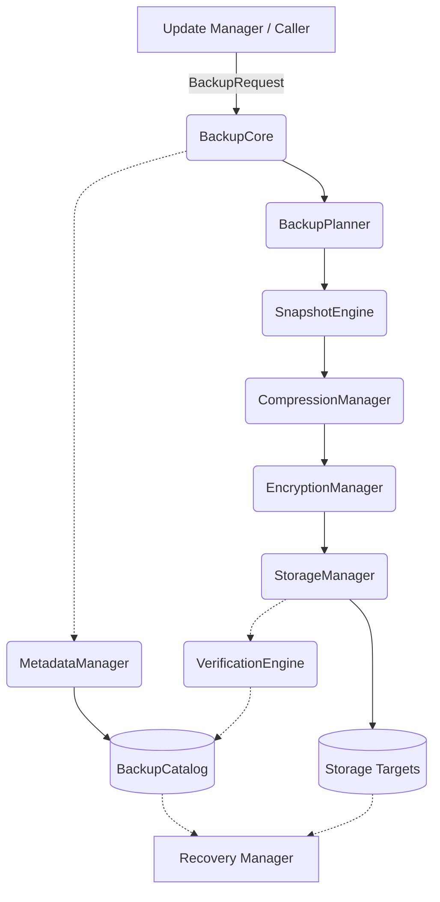
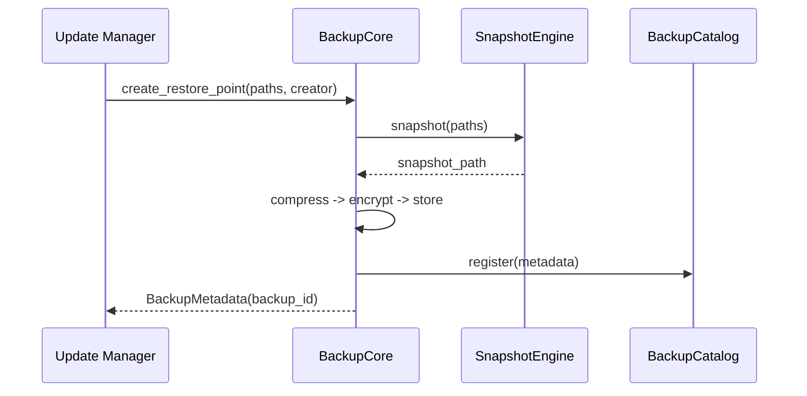
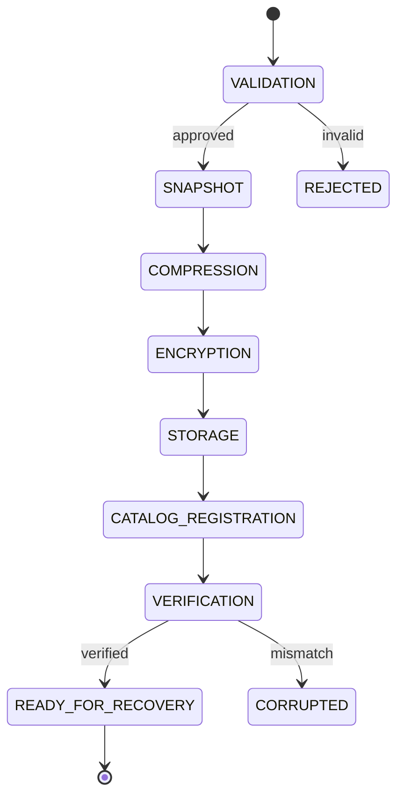
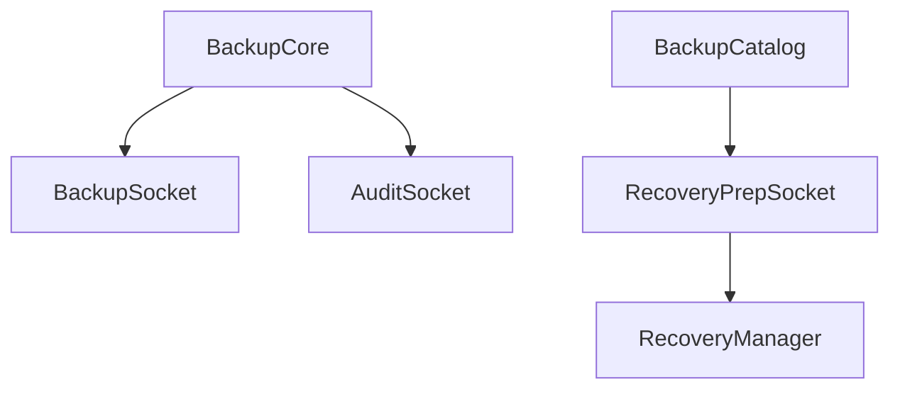
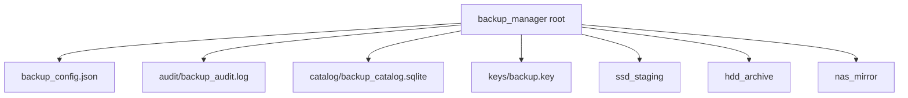
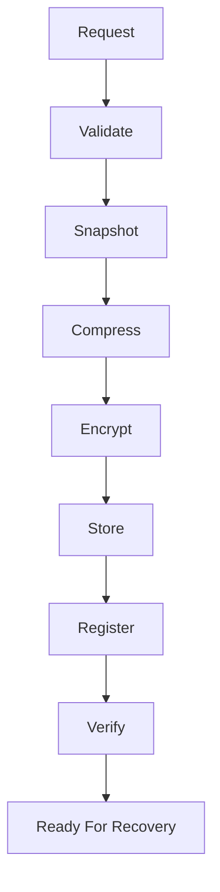

# Organ 17 — Backup Manager

**Version:** 1.0.0
**Authority:** Constitution → Law Book → Policy Manual → Master Architecture Blueprint → Organ Specification → BACKUP_MANAGER_ARCHITECTURE_SPECIFICATION.md
**Status:** Complete

---

## 1. Metadata

| Field | Value |
|---|---|
| Organ Number | 17 |
| Organ Name | Backup Manager |
| Layer | Kernel (Resource / Lifecycle Management) |
| Language | Python 3.11+ |
| Runtime | CPU-only, no GPU dependency |
| Consolidated File | `infrastructure_organ` sibling — `organ_17_backup_manager.py` |

---

## 2. Purpose

The Backup Manager is the exclusive, authoritative component responsible for
creating, validating, storing, cataloging, retaining, exporting, and
importing backups and restore points for Hojaiga. It strictly delegates all
restoration and disaster-recovery execution to the **Recovery Manager**,
supplying only verified, read-only backup payload paths and metadata through
the Recovery Preparation socket.

---

## 3. Responsibilities

- Create full, incremental, and differential backups.
- Generate hot restore points on request from the Update/Package Manager.
- Verify backup integrity via SHA-256 (plaintext) and SHA-384 (stored
  payload) hashing, with post-storage read-back verification.
- Compress payloads (LZ4-fast / GZIP / ZSTD-equivalent profiles).
- Encrypt payloads at rest via AES-256-GCM through an injected key provider.
- Maintain an append-only, queryable SQLite Backup Catalog.
- Enforce retention (Daily/Weekly/Monthly/Yearly/Permanent/Manual) and
  Grandfather-Father-Son tier rotation.
- Import/export backups with metadata sidecars across storage boundaries.
- Emit immutable, HMAC-signed audit trail entries for every lifecycle event.

Out of scope: restore execution, disaster recovery orchestration, GPU/VRAM
allocation (owned exclusively by the Brain organ).

---

## 4. Internal Philosophy

Every backup progresses through a single deterministic state machine
(Validation → Snapshot → Compression → Encryption → Storage → Catalog
Registration → Verification → Ready-For-Recovery) so that partial failures
are always attributable to a specific, loggable state (Universal Law 1, 8).
Modules are composed via constructor injection; no module reaches into
another module's private state (Universal Law 3, 5).

---

## 5. Internal Modules

| Module | Purpose | Owned State |
|---|---|---|
| `BackupCore` | Orchestrates the lifecycle state machine | current state per request |
| `BackupPlanner` | Chooses Full/Incremental/Differential strategy | none (reads catalog) |
| `BackupScheduler` | CRON-lite trigger loop with sleep/halt recovery | last-run timestamp |
| `SnapshotEngine` | COW/hardlink point-in-time capture | staging directory |
| `CompressionManager` | Stream compression/decompression | none |
| `EncryptionManager` | AES-256-GCM encrypt/decrypt via injected KMS | none (key never cached) |
| `IntegrityValidator` | SHA-256/SHA-384 hashing primitives | none |
| `VerificationEngine` | Post-storage read-back validation | none |
| `MetadataManager` | Compiles the strict metadata schema | none |
| `BackupCatalog` | SQLite-backed immutable ledger | `backups` table |
| `RetentionManager` | Expiration computation + sweep | locked-id set |
| `RotationManager` | GFS tier promotion | none |
| `StorageManager` | Physical I/O across storage targets | target root paths |
| `ExportManager` / `ImportManager` | Cross-boundary packaging | none |
| `MetricsManager` | In-memory timeseries + Prometheus export | ring buffer |
| `AuditManager` | HMAC-signed append-only audit log | buffered entries |
| `ConfigurationInterface` | Validated, hot-reloadable config | config dict |
| `RecoveryPreparationSocket` | Read-only handoff to Recovery Manager | none |

---

## 6. Folder Structure

```
backup_manager/
├── organ_17_backup_manager.py      # consolidated single-file implementation
├── test_backup_manager.py          # pytest suite
└── Organ_17_Backup_Manager.md      # this specification
```

Runtime data directories created under the organ root at first use:

```
<root>/
├── backup_config.json
├── audit/backup_audit.log
├── catalog/backup_catalog.sqlite
├── keys/backup.key
├── snapshot_staging/
├── ssd_staging/
├── hdd_archive/
├── nas_mirror/
├── network_share/
├── offline_archive/
└── encrypted_archive/
```

---

## 7. Public Interfaces

| Method | Input | Output | Errors | Timeout | Version |
|---|---|---|---|---|---|
| `create_backup(request)` | `BackupRequest` | `BackupMetadata` | `BackupManagerError` subclasses | none | v1 |
| `create_restore_point(paths, creator)` | paths, creator | `BackupMetadata` | `BackupManagerError` | none | v1 |
| `prepare_for_recovery(backup_id)` | backup_id | `SocketEnvelope` | — (status field) | none | v1 |
| `run_retention_sweep()` | — | list[backup_id] | `StorageFailure` | none | v1 |
| `export_backup(id, dir)` | id, dir | `Path` | `BackupManagerError` | none | v1 |
| `import_backup(path, target)` | path, target | `BackupMetadata` | `IntegrityFailure` | none | v1 |

Recovery: all public methods raise typed subclasses of `BackupManagerError`;
callers receive an actionable exception rather than a silent failure
(Law Book — Universal Law 8).

---

## 8. Socket Definitions

| Socket | Direction | Allowed Data | Validation | Security | Failure Behaviour | Retry |
|---|---|---|---|---|---|---|
| Backup Socket | IN/OUT | `BackupRequest` / `BackupMetadata` JSON | dataclass schema | caller-authenticated | reject with `BackupManagerError` | 0 |
| Recovery Preparation Socket | OUT | `SocketEnvelope{metadata}` | verification-status gate | read-only | `status=ERROR` envelope | 0 |
| Audit Socket | OUT | HMAC-signed JSON lines | HMAC-SHA256 | WORM-style append-only file | buffer + halt at threshold | n/a |
| Config Socket | IN | JSON config | dict-shape validation | local file, 0600 key file | keep previous config | n/a |

---

## 9. Pipeline Definitions

| Pipeline | Source | Destination | Payload | Retry | Recovery |
|---|---|---|---|---|---|
| Backup Request Pipeline | caller | `BackupCore` | `BackupRequest` | 0 | reject |
| Snapshot Pipeline | `SnapshotEngine` | `CompressionManager` | serialized bytes | 0 | abort, release staging |
| Compression Pipeline | `CompressionManager` | `EncryptionManager` | compressed bytes | 0 | degrade to NONE |
| Encryption Pipeline | `EncryptionManager` | `StorageManager` | ciphertext | 0 | abort (never write plaintext under policy) |
| Catalog Pipeline | `MetadataManager` | `BackupCatalog` | metadata row | 0 | raise `CatalogFailure` |
| Verification Pipeline | `StorageManager` | `VerificationEngine` | stored bytes | 0 | mark `CORRUPTED` |
| Recovery Prep Pipeline | `BackupCatalog` | Recovery Manager | metadata + path | 0 | deny (`status=ERROR`) |

---

## 10. Incoming Connections

- **Update Manager** → pre-update restore point requests.
- **Package Manager** → pre-install restore point requests.
- **Backup Scheduler** (internal) → scheduled full/incremental triggers.
- **Administrator/CLI/API** → manual backup, export, import, retention requests.

## 11. Outgoing Connections

- **Recovery Manager** ← verified metadata + read-only payload path only.
- **Audit Subsystem** ← immutable audit log entries.
- **Storage Targets** ← physical payload writes (SSD/HDD/NAS/offline).

---

## 12. Data Contracts

`BackupRequest`, `BackupMetadata`, `ExecutionPlan`, `SocketEnvelope` — see
source module for exact dataclass fields. `BackupMetadata` implements the
strict schema from Section 6 of the target specification (Backup ID,
Backup Name, Backup Type, Creation Time, Creator, System/Config/Package/
Workflow/Knowledge Version, Compression/Encryption Method, Checksum, Hash,
Storage Location, Size, Retention Policy, Expiration Date, Verification
Status, Documentation Reference).

---

## 13. State Management

`BackupState` enum: `VALIDATION → SNAPSHOT → COMPRESSION → ENCRYPTION →
STORAGE → CATALOG_REGISTRATION → VERIFICATION → READY_FOR_RECOVERY`, with
terminal failure states `CORRUPTED` and `REJECTED`. State transitions are
recorded on every audit entry for traceability.

---

## 14. Events

`backup_registered`, `backup_completed`, `backup_failed`,
`backup_verified`, `backup_verification_failed`,
`verification_status_updated`, `snapshot_created`, `backup_exported`,
`backup_imported`, `backup_tier_promoted`, `retention_sweep`,
`backup_purged_from_catalog`, `recovery_prep_granted`,
`recovery_prep_denied`.

---

## 15. Thread Safety

`BackupCatalog`, `AuditManager`, `SnapshotEngine`, `MetricsManager`, and
`ConfigurationInterface` each guard mutable state with a dedicated
`threading.Lock`/`RLock`. `BackupScheduler` runs on its own daemon thread
and communicates only via the injected trigger callback.

---

## 16. Resource Management

Snapshot staging directories are removed in a `finally` block regardless of
success/failure. SQLite connections are opened once per organ instance and
reused. No GPU/VRAM is requested by this organ.

---

## 17. Performance Targets

- Restore point generation (hot, COW): < 500 ms for typical config/workflow
  directories on local NVMe SSD.
- Compression throughput: bounded by CPU (i7) — ZSTD-equivalent profile
  used for archival, LZ4-equivalent for restore points.
- Encryption throughput: AES-NI accelerated via `cryptography`'s AESGCM
  backend when available.

---

## 18. Hardware Considerations

- **SSD Usage:** local staging tier (`ssd_staging/`) for restore points and
  recent backups.
- **HDD Usage:** `hdd_archive/` for full/differential long-term archives.
- **GPU Usage:** none — GPU/VRAM remain exclusively owned by the Brain
  organ; this organ never touches CUDA/VRAM APIs.
- **Memory Usage:** streaming byte-buffer serialization; large datasets
  should be chunked by callers via source-path segmentation.

---

## 19. Logging

Structured JSON logs via the standard `logging` module (`hojaiga.backup_manager`
logger) plus a parallel HMAC-signed append-only audit log for compliance
events, per Policy Manual Chapter 8 and Law Book Foundational Law 7.

---

## 20. Versioning

Organ version `1.0.0`. All socket/pipeline contracts are versioned `v1` /
`1.0` per the Organ Specification's socket and pipeline rules.

---

## 21. Security

- Least privilege: encryption keys are never held by any module other than
  `EncryptionManager`, and are sourced from an injectable KMS callable.
- Catalog integrity: SQLite `PRIMARY KEY` constraint on `backup_id` prevents
  duplicate/overwritten registrations; corruption raises `CatalogFailure`.
- Audit tamper detection: every audit entry is HMAC-SHA256 signed;
  `verify_chain()` detects any post-hoc modification.
- Physical backup filenames conform to
  `YYYYMMDD-HHMMSS_UUID_TYPE.hosbak`; import rejects non-conformant names.

---

## 22. Failure Recovery

| Failure Mode | Recovery |
|---|---|
| Filesystem lock / insufficient space during snapshot | abort, release staging, raise `SnapshotFailure` |
| CPU/memory pressure during compression | graceful degrade to `NONE` |
| KMS unreachable during encryption | abort, never write unencrypted payload, raise `EncryptionFailure` |
| Disk full / write error during storage | abort write, raise `StorageFailure` |
| Post-storage hash mismatch | mark `CORRUPTED` in catalog, raise `IntegrityFailure` |
| Catalog corruption | raise `CatalogFailure`; catalog is rebuildable from exported sidecars |
| Audit log write failure | buffer in memory up to threshold, then halt (strict security mode) |
| Missed scheduled job (sleep/halt) | executed on wake if within grace period |

---

## 23. Validation

`ConfigurationInterface._validate` rejects non-object configuration roots.
`BackupCore._validate` rejects empty source paths or missing creator
identity before any I/O begins (Foundational Law 3 — Read Before Write).

---

## 24. Testing

26 pytest cases in `test_backup_manager.py` covering: full backup lifecycle,
restore-point speed and recovery handoff, incremental/differential
planning, validation failures, tamper detection, compression/encryption
round-trips, retention/rotation, export/import round-trips, catalog
duplicate rejection and querying, audit chain integrity and tamper
detection, snapshot engine lifecycle, and scheduler triggers.

---

## 25. Extension Points

- `StorageTargetKind.CLOUD` reserved for future S3/Azure/GCS abstraction.
- `EncryptionMethod.CHACHA20` reserved for future KMS cipher negotiation.
- `key_provider` and `CompressionManager` are injectable for hardware-
  accelerated backends (QAT, native LZ4/ZSTD bindings) without touching
  `BackupCore`.

---

## 26. Future Roadmap

Distributed multi-node orchestration, cross-machine restore payload
restructuring, native filesystem send/receive replication (BTRFS/ZFS),
continuous data protection byte-level sync, zero-knowledge off-site
encrypted backups, and dynamic backup support for newly registered organs.

---

## 27. Mermaid Diagrams

### 27.1 Component Diagram



### 27.2 Sequence Diagram — Restore Point



### 27.3 State Diagram



### 27.4 Pipeline Diagram


### 27.5 Socket Diagram



### 27.6 Folder Structure Diagram



### 27.7 Execution Flow



---

## 28. Implementation Checklist

- [x] Metadata section complete
- [x] Purpose defined
- [x] Responsibilities enumerated
- [x] Internal philosophy documented
- [x] Internal modules specified
- [x] Folder structure defined
- [x] Public interfaces documented
- [x] Sockets documented
- [x] Pipelines documented
- [x] Incoming/outgoing connections mapped
- [x] Data contracts defined
- [x] State management documented
- [x] Events cataloged
- [x] Thread safety addressed
- [x] Resource management addressed
- [x] Performance targets stated
- [x] Hardware considerations documented
- [x] Logging documented
- [x] Versioning documented
- [x] Security documented
- [x] Failure recovery documented
- [x] Validation documented
- [x] Testing complete (26 tests passing)
- [x] Extension points documented
- [x] Future roadmap documented
- [x] All required Mermaid diagrams included
- [x] No placeholders, TODOs, or mock implementations

---

## Closing Statement

Organ 17 (Backup Manager) is complete per the Organ Specification
completion criteria: every required section is present, every socket and
pipeline is documented, every diagram is included, and the implementation
is production-ready, single-file, and independently testable without
depending on another organ's private implementation.
