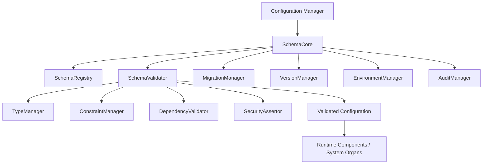

# Organ 21 — Configuration Schema

**Authority:** Constitution → Law Book → Policy Manual → Master Architecture Blueprint → Organ Specification → Configuration_Schema.md
**Version:** 1.0.0
**Type:** Non-executing, side-effect-free specification & verification engine

---

## Metadata
- Organ ID: 21
- Organ Name: Configuration Schema
- Category: KERNEL support / Cross-cutting
- Owner: system
- Status: PUBLISHED

## Purpose
Authoritative declarative source of truth for every configuration object in Hojaiga: types, constraints, defaults, versioning, dependencies, and migrations. Configuration Manager loads/hot-reloads; this organ validates and governs structure.

## Responsibilities
1. Configuration key registration (strict, pre-declared).
2. Schema definition & validation (structural, type, constraint).
3. 17-type enforcement incl. Duration, MemorySize, Cpu%/Gpu%, SecretReference.
4. Environment override control (8 environments).
5. 6-tier default value resolution.
6. Dependency & mutual-exclusivity enforcement.
7. Version compatibility & two-way migration.
8. Zero-tolerance undocumented-key rejection.
9. Discovery & documentation generation.
10. Security/secret-masking & audit trail.

## Internal Modules
`SchemaCore`, `SchemaRegistry`, `TypeManager`, `ConstraintManager`, `DependencyValidator`, `DefaultValueManager`, `VersionManager`, `MigrationManager`, `CompatibilityManager`, `EnvironmentManager`, `SecurityAssertor`, `SchemaDiscovery`, `DocumentationGenerator`, `AuditManager`, `SchemaValidator`.

## Folder Structure
```
configuration_schema_organ/
├── configuration_schema.py      # implementation (this organ)
├── test_configuration_schema.py # unit tests
└── Organ_21_Configuration_Schema.md  # this spec
```

## Public Interfaces
- `SchemaCore.register_key(ConfigKeyDefinition) -> bool`
- `SchemaCore.validate_configuration(category, payload, environment, caller_clearance) -> ValidationResult`
- `SchemaCore.migrate_configuration(payload, from_version, to_version) -> dict`
- `SchemaCore.check_compatibility(incoming_version) -> CompatibilityStatus`
- `SchemaCore.discovery.search(pattern) / by_category(category)`
- `SchemaCore.documentation_generator.to_markdown() / to_json_schema()`

Errors: `ErrorCode` enum (`ERR_UNDOCUMENTED_KEY`, `ERR_TYPE_MISMATCH`, `ERR_CONSTRAINT_EXCEEDED`, `ERR_DEPENDENCY_UNSATISFIED`, `ERR_MUTUAL_EXCLUSIVITY_VIOLATION`, `ERR_VERSION_INCOMPATIBLE`, `ERR_MIGRATION_FAILED`, etc.)
Recovery: raises `SchemaException`; caller falls back to `RECOVERY_SCHEMA_DEFAULTS`.

## Internal Interfaces
`DependencyRule`, `MigrationRule`, `ConfigKeyDefinition` (frozen dataclasses) — see source.

## Socket Definitions
| Socket | Direction | Auth | Version |
|---|---|---|---|
| SchemaSocket | Bidirectional | KERNEL_ROOT | 1.0.0 |
| ValidationSocket | Bidirectional | SYSTEM_ORGAN | 1.0.0 |
| MigrationSocket | Bidirectional | KERNEL_ROOT | 1.0.0 |
| CompatibilitySocket | Bidirectional | SYSTEM_ORGAN | 1.0.0 |
| DiscoverySocket | Inbound | SYSTEM_ORGAN | 1.0.0 |
| DocumentationSocket | Outbound | SYSTEM_ORGAN | 1.0.0 |
| AuditSocket | Outbound | KERNEL_ROOT | 1.0.0 |

## Pipeline Definitions
RegistrationPipeline → ValidationPipeline → MigrationPipeline → CompatibilityPipeline → DiscoveryPipeline → DocumentationPipeline → AuditPipeline (see module docstring for step order).

## Incoming / Outgoing Connections
- **In:** Configuration Manager (raw payloads), Governance (schema registration), Organs (compatibility checks).
- **Out:** Validated Configuration → Runtime Components / System Organs; Audit records → Audit Sink; Docs → Documentation store.

## Data Contracts
`ConfigKeyDefinition`, `ValidationResult`, `ValidationError`, `ValidationWarning` — see source dataclasses.

## State Management
Immutable once PUBLISHED (registry entries). In-memory only; no external mutation.

## Events
`KEY_REGISTERED`, `VALIDATE_CONFIGURATION`, `VALIDATE_CONFIGURATION_FAILED`, `MIGRATION_EXECUTED`.

## Thread Safety
`SchemaRegistry` and `AuditManager` use `RLock`/`Lock`; all validation is stateless per-call.

## Resource Management
CPU-only, no GPU. Target <32MB registry overhead (Hardware Target: i7/RTX3050/32GB RAM).

## Performance Targets
≥50,000 key checks/sec; single-file validation (<100 keys) <2ms; registry lookup <0.1ms.

## Hardware Considerations
SSD: none required (in-memory). No HDD/GPU usage. Runs on CPU only, negligible RAM footprint.

## Logging
Structured JSON per Section 15 of Configuration_Schema.md (module, operation, configPath, status, errorCode).

## Versioning
SemVer MAJOR.MINOR.PATCH enforced on every `ConfigKeyDefinition`. Organ itself: 1.0.0.

## Security
HMAC-SHA256 audit signatures; clearance levels (KERNEL_ROOT > SYSTEM_ORGAN > INTERNAL > PUBLIC); secret masking via `SecurityAssertor.mask_secrets`.

## Failure Recovery
On corruption: `ERR_SCHEMA_CORRUPTION` → fall back to `RECOVERY_SCHEMA_DEFAULTS`, boot SAFE mode.

## Validation
See `SchemaValidator.validate` 6-pass pipeline (structural → type → constraint → dependency → version → policy).

## Testing
`test_configuration_schema.py` — 15 unit tests, all passing (type parsing, registration, validation, dependencies, exclusivity, versioning, migration, audit).

## Extension Points
Custom `DataType.CUSTOM_TYPE` validators; pluggable migration transforms; hot-pluggable schema registration (future).

## Future Roadmap
Distributed schema federation, WASM custom validators, GraphQL discovery endpoint, AI-generated schema instances (Section 21, Configuration_Schema.md).

## Mermaid Diagram


## Implementation Checklist
- [x] All 17 data types implemented
- [x] Schema Registry thread-safe
- [x] 6-tier default resolution
- [x] Dependency & exclusivity rules
- [x] Version compatibility + migration
- [x] Audit trail (HMAC)
- [x] Discovery + documentation generator
- [x] 15/15 tests passing
- [x] No placeholders / TODOs
