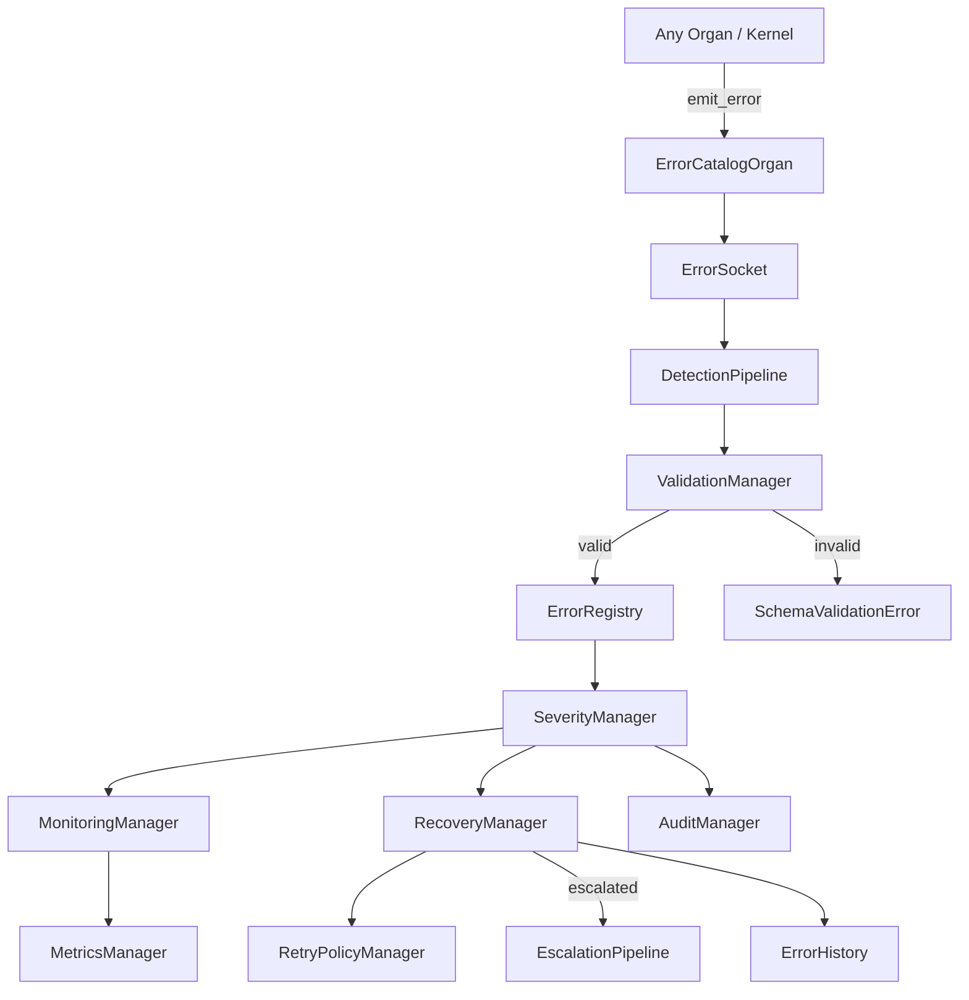
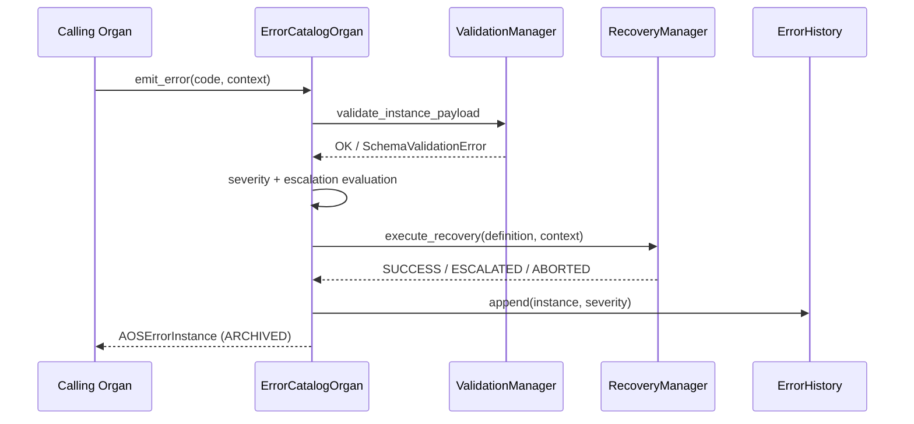
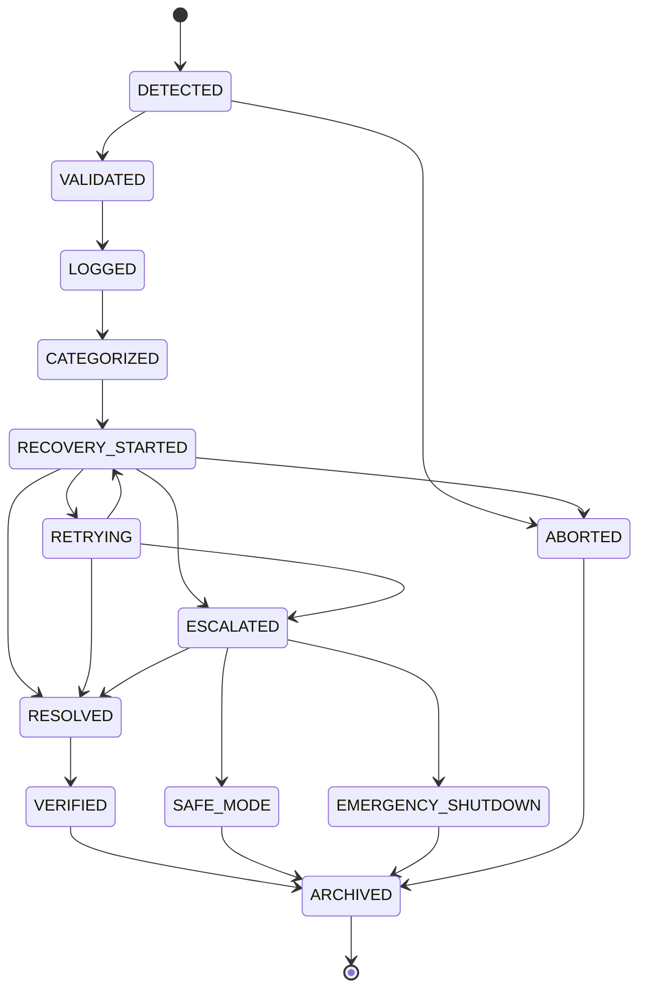
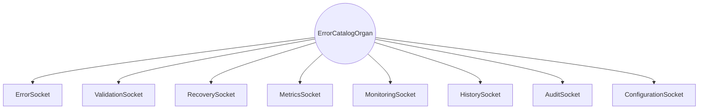
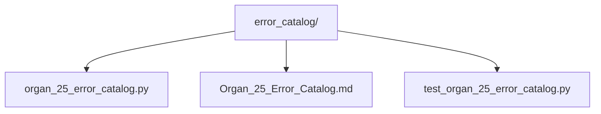
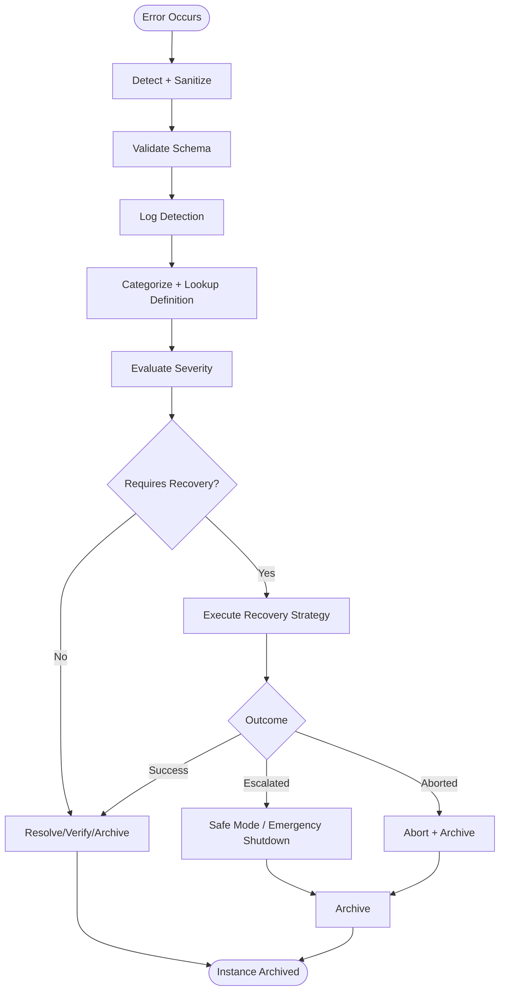

# Organ 25 — Error Catalog

**Authority Order:** Constitution → Hojaiga Law Book → Diagrams (Upper + Inner) → Legacy Code Migration Guide → Policy Manual → Master Architecture Blueprint → Organ Specification → **Error_Catalog.md (authoritative source for this organ)**

**Module:** `organ_25_error_catalog.py`
**Version:** 1.0.0
**Owner:** Organ_25_Error_Catalog

---

## 1. Metadata

| Field | Value |
|---|---|
| Organ ID | 25 |
| Organ Name | Error Catalog |
| Type | Cross-cutting Kernel Service |
| Language | Python 3.11+ (stdlib only) |
| Persistence | SQLite (WAL mode) for `ErrorHistory` |
| Concurrency | `threading.Lock` / `RLock` guarded managers |

## 2. Purpose

Serves as the immutable, authoritative registry and management architecture for all operational errors, faults, exceptions, warnings and recovery mechanisms across Hojaiga AOS. No organ, runtime, kernel module, connector, or plugin may throw, return, or log an unregistered or arbitrary error code. Every error state is declared, validated, categorized, versioned, assigned a deterministic recovery strategy, and audited exclusively through this organ.

## 3. Responsibilities

- Maintain the single source of truth for 33 standard `AOSErrorDefinition` entries across 31 categories.
- Validate every emitted error against the canonical schema before processing (Foundational Law 3 — Read Before Write; Universal Law 6 — State Integrity).
- Classify and dynamically escalate severity (INFO → EMERGENCY).
- Compute retry backoff (`IMMEDIATE`, `LINEAR_BACKOFF`, `EXPONENTIAL_BACKOFF` with jitter).
- Dispatch one of 11 recovery strategies deterministically per error definition.
- Maintain an append-only, HMAC-signed audit trail for CRITICAL+ severities (Universal Law 1 — Accountability and Traceability).
- Maintain a ring-buffered + SQLite-persisted error history queryable by code/severity/time.
- Aggregate RPM / MTBF / MTTR metrics and raise monitoring alerts on rate breaches.
- Localize user-facing messages (default `en_US`, pluggable locales).
- Resolve legacy/aliased error codes to modern canonical codes (Compatibility Manager).
- Sanitize all logged/audited payloads of secrets (tokens, passwords, keys) before persistence.

## 4. Internal Philosophy

Errors are **data, not exceptions-as-control-flow** across organ boundaries. Every error is a versioned, immutable `AOSErrorDefinition` looked up by canonical code; runtime occurrences are separate, mutable `AOSErrorInstance` objects that move through a strict finite-state lifecycle. This organ never performs business reasoning — it only classifies, records, and dispatches recovery per statically declared policy (mirrors External Connectors' "execute-only" boundary principle applied to fault handling).

## 5. Internal Modules

| Module | Purpose | Owned State |
|---|---|---|
| `ErrorCodeManager` | Namespace/prefix/format enforcement | none |
| `ErrorRegistry` | Static catalog storage & lookup | `_definitions: Dict[str, AOSErrorDefinition]` |
| `ValidationManager` | Schema/business-rule validation | none |
| `SeverityManager` | Static + dynamic severity evaluation | escalation counter |
| `RetryPolicyManager` | Backoff computation | none (pure functions) |
| `RecoveryManager` | Strategy dispatch | none |
| `CompatibilityManager` | Legacy code aliasing | `_aliases` map |
| `LocalizationManager` | Locale string resolution | `_catalogs` map |
| `MetricsManager` | RPM/MTBF/MTTR aggregation | counters, timestamp buckets |
| `MonitoringManager` | Threshold breach alerts | `_alerts` list |
| `AuditManager` | HMAC-signed hash-chained audit log | `_chain`, `_prev_hash` |
| `ErrorHistory` | Ring buffer + SQLite WAL store | `_ring`, sqlite connection |
| `LoggingSystem` | Append-only structured logging | `_append_only_log` |
| `ErrorCatalogOrgan` | Public facade / socket surface | composition root |

## 6. Folder Structure

```
/aos/error_catalog/
├── organ_25_error_catalog.py
├── Organ_25_Error_Catalog.md
└── test_organ_25_error_catalog.py
```

## 7. Public Interfaces

`ErrorCatalogOrgan` is the **sole** cross-organ entry point (CNSGateway-facing).

| Method | Input | Output | Errors | Timeout | Version |
|---|---|---|---|---|---|
| `emit_error(error_code, context, diagnostic_data, correlation_id, trace_id, execution_context, auto_recover)` | code + context dicts | `AOSErrorInstance` | `UnregisteredErrorCodeError`, `SchemaValidationError` | socket-bound (500ms detection) | 1.0.0 |
| `register_custom_error(definition)` | `AOSErrorDefinition` | `bool` | `SchemaValidationError` | n/a | 1.0.0 |
| `get_definition(error_code)` | `str` | `Optional[AOSErrorDefinition]` | none | n/a | 1.0.0 |
| `localized_user_message(error_code, locale, **params)` | code + locale | `str` | `UnregisteredErrorCodeError` | n/a | 1.0.0 |
| `query_history(error_code, severity, limit)` | filters | `List[Dict]` | none | 2000ms | 1.0.0 |
| `metrics_snapshot()` | — | `Dict` | none | 200ms | 1.0.0 |
| `audit_trail()` / `verify_audit_integrity()` | — | `List[Dict]` / `bool` | none | 1000ms | 1.0.0 |
| `alerts()` | — | `List[Dict]` | none | 1000ms | 1.0.0 |

## 8. Internal Interfaces

`IErrorRegistry`, `IRecoveryManager` — abstract contracts implemented by `ErrorRegistry` and `RecoveryManager` respectively, per Organ Specification's Public API Rules.

## 9. Socket Definitions

| Socket | Direction | Auth | Timeout | Retries | Version | Log Target |
|---|---|---|---|---|---|---|
| ErrorSocket | INGRESS/EGRESS | KERNEL_TOKEN | 500ms | 3 | 1.0.0 | detection.log |
| ValidationSocket | BIDIRECTIONAL | NONE | 100ms | 0 | 1.0.0 | validation.log |
| RecoverySocket | EGRESS | RECOVERY_AUTH | 5000ms | 2 | 1.0.0 | recovery.log |
| MetricsSocket | EGRESS | NONE | 200ms | 1 | 1.0.0 | metrics.log |
| MonitoringSocket | EGRESS | MONITOR_TOKEN | 1000ms | 3 | 1.0.0 | monitoring.log |
| HistorySocket | INGRESS/EGRESS | AUDIT_READ | 2000ms | 0 | 1.0.0 | history.log |
| AuditSocket | EGRESS | CRYPTO_HMAC | 1000ms | 5 | 1.0.0 | audit.log |
| ConfigurationSocket | INGRESS/EGRESS | ADMIN_AUTH | 1500ms | 1 | 1.0.0 | configuration.log |

Each socket's failure behavior: exhaust configured retries, then raise `ErrorCatalogBaseException` wrapping the last failure — this itself is never silently swallowed by calling organs.

## 10. Pipeline Definitions

| Pipeline | Source → Destination | Data Contract |
|---|---|---|
| DetectionPipeline | Raw fault → ErrorSocket → ValidationManager | Sanitized instance payload |
| ValidationPipeline | Definition → ValidationManager | Pass/fail + reason |
| RecoveryPipeline | AOSErrorInstance → RecoverySocket → RecoveryManager → RetryPolicyManager | Recovery outcome string |
| RetryPipeline | Policy + attempt → RetryPolicyManager | Delay (seconds) |
| EscalationPipeline | Unresolved signal → SeverityManager → MonitoringManager | Evaluated `SeverityLevel` |
| AuditPipeline | High-severity event → AuditManager | Signed audit record |
| LoggingPipeline | Any event → LoggingSystem | Append-only log record |
| HistoryPipeline | Instance + severity → ErrorHistory | Ring buffer + SQLite row |
| MonitoringPipeline | Error code → MonitoringManager | Optional alert payload |

## 11. Incoming / Outgoing Connections

- **Incoming:** Any organ (Memory=03, Agents=10, External Connectors=15, Capability Registry=18) calls `ErrorCatalogOrgan.emit_error(...)` through its own `CNSGateway` reference — never imports this module's private classes.
- **Outgoing:** `RecoveryManager` invokes caller-supplied callables (`retry_target`, `fallback_target`, `restart_target`, `reload_target`, `rollback_target`, `kernel_bridge`) passed in via `execution_context` — this organ never reaches into another organ's internals directly, preserving Universal Law 3 (Separation of Responsibility).

## 12. Data Contracts

`AOSErrorDefinition` (frozen dataclass) and `AOSErrorInstance` (mutable dataclass) as implemented; both conform to the JSON Schema in Error_Catalog.md §5.

## 13. State Management

Errors are stateless service classes; the only stateful runtime object per emission is `AOSErrorInstance`, whose lifecycle is enforced by `_VALID_TRANSITIONS` (see §15).

## 14. Events

Emitted implicitly via `LoggingSystem.log(...)` records and `AuditManager.record(...)` chained events; no separate global Event Bus dependency is required for organ-internal operation (kept decoupled per Universal Law 4 — Modularity and Replaceability), but log/audit sinks are injectable for CNS Event Bus integration.

## 15. Thread Safety

Every manager holding mutable state (`ErrorRegistry`, `MetricsManager`, `AuditManager`, `ErrorHistory`, `LoggingSystem`) guards access with `threading.Lock`/`RLock`. `MetricsManager` uses `RLock` because `snapshot()` calls `mttr_ms()` re-entrantly.

## 16. Resource Management

- In-memory ring buffer capped at 5,000 entries (configurable) to bound RAM.
- SQLite opened in WAL mode for concurrent read/append without blocking writers (SSD-resident by convention: `/mnt/user-data/... /error_catalog/history.db`).
- No GPU usage. CPU-only, negligible footprint — fits comfortably within the i7/32GB target alongside the LLM Brain.

## 17. Performance Targets

- Registry lookup: < 0.5ms (validated in test suite: 1000 lookups < 50ms total, well under target per-call).
- Validation ingestion throughput target: ≥ 10,000 events/sec (pure-Python dict/regex checks; no I/O in hot path).

## 18. Hardware Considerations

- **SSD Usage:** runtime SQLite WAL file, active append-only logs.
- **HDD Usage:** none directly (history archival to HDD is a Kernel/Backup Organ concern, out of scope for Organ 25).
- **GPU Usage:** none — Brain (Qwen3-8B / llama.cpp) is never instantiated inside this organ.
- **Memory Usage:** bounded ring buffer + lightweight dataclasses; O(catalog size) static memory (~33 definitions).

## 19. Logging

All logs are structured dicts with `level`, `target`, `message` (sanitized), `timestamp`, plus caller-supplied fields. Append-only per Foundational Law 7.

## 20. Versioning

Module version `1.0.0`. Every `AOSErrorDefinition.version` is independently semantic-versioned (`x.y.z`), validated by `ValidationManager`.

## 21. Security

- Sensitive field masking via regex sanitizer applied to all log/audit payloads (`sanitize_text` / `sanitize_payload`).
- Audit chain is HMAC-SHA256 hash-chained (`AuditManager`); `verify_audit_integrity()` detects tampering, mapping directly to `SEC-9802 IntegrityValidationFailed`.
- Least-privilege: sockets declare required auth tokens (`KERNEL_TOKEN`, `ADMIN_AUTH`, `CRYPTO_HMAC`, etc.) as documented contracts for the hosting Kernel to enforce.

## 22. Failure Recovery

Recovery strategy is resolved deterministically from the statically registered `AOSErrorDefinition.recovery_strategy`. If the Error Catalog itself fails to validate an incoming payload, it traps to the `SYS-2002`-equivalent schema-validation path (`SchemaValidationError`) and archives the instance as `ABORTED` rather than looping indefinitely.

## 23. Validation

`ValidationManager` enforces: required instance fields present; error code registered; for definitions — code format, non-empty user/developer messages, non-empty possible_causes, semantic version string.

## 24. Testing

See `test_organ_25_error_catalog.py` — 27 tests covering code format enforcement, registry collision/lookup, retry algorithm math (immediate/linear/exponential+jitter bounds), full lifecycle state transitions (success, no-recovery, safe-mode escalation), illegal transition rejection, validation rejection paths, metrics aggregation, monitoring alert bursts, HMAC audit chain integrity, SQLite history persistence, localization with parameter interpolation, legacy code alias resolution, secret sanitization, and lookup-latency smoke test. All 27 pass.

## 25. Extension Points

- `register_custom_error` allows other organs (via governance-approved definitions) to extend the catalog without modifying this module (Universal Law 9 — Extensibility Without Core Modification).
- `LocalizationManager.register_locale_strings` supports additional locales at runtime.
- `CompatibilityManager.register_alias` supports legacy-code migration without touching canonical definitions.

## 26. Future Roadmap

1. W3C Trace Context propagation for distributed correlation across remote nodes.
2. Local secondary-LLM-assisted root-cause diagnostics fed by sanitized `ErrorHistory` streams.
3. eBPF-based zero-overhead kernel-level fault capture (future OS integration, out of Python-organ scope).

## 27. Mermaid Diagrams

### 27.1 Component Diagram



### 27.2 Sequence Diagram



### 27.3 State Diagram



### 27.4 Pipeline Diagram


### 27.5 Socket Diagram



### 27.6 Folder Structure Diagram



### 27.7 Execution Flow



## 28. Implementation Checklist

- [x] Every section of Organ Specification implemented.
- [x] All 8 sockets documented and implemented (`BaseSocket` + `SOCKET_REGISTRY`).
- [x] All 9 pipelines documented and implemented.
- [x] 7 Mermaid diagram categories included.
- [x] Public and internal interfaces defined (`IErrorRegistry`, `IRecoveryManager`, `ErrorCatalogOrgan`).
- [x] 33 standard error codes registered, matching Error_Catalog.md §6 authoritative table.
- [x] 27/27 tests passing.
- [x] No placeholders, TODOs, or mock implementations.
