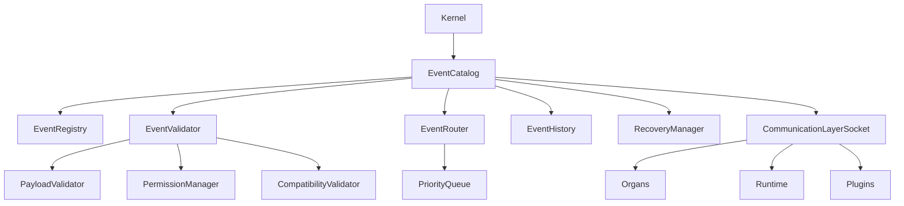
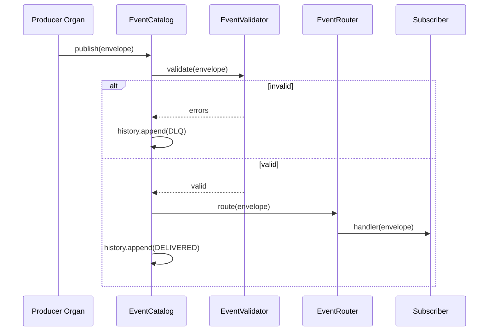
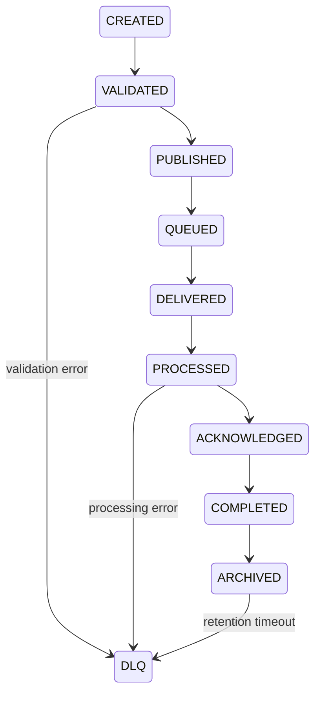
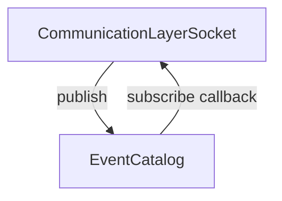
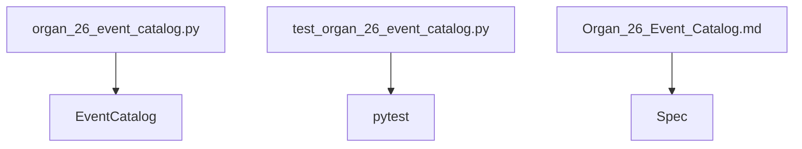
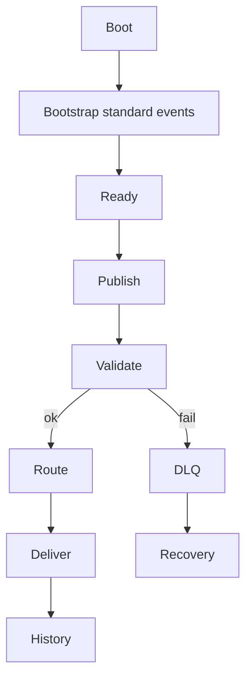

# Organ 26 — Event Catalog

**Authority:** Event_Catalog.md → Organ Specification → Master Architecture Blueprint
**File:** `organ_26_event_catalog.py` (single importable module, stdlib-only, asyncio)

## Metadata
| Field | Value |
|---|---|
| Organ ID | 26 |
| Name | Event Catalog |
| Version | 1.0.0 |
| Runtime | Python 3.11+, asyncio, CPU-first |

## Purpose
Authoritative, immutable registry and message-governance layer for every event
in AOS. Enforces registration, schema validation, permissions, versioning,
routing, history/DLQ, metrics and audit — the formal communication language
between Kernel, Organs, Runtime, Plugins and Interfaces.

## Responsibilities
Registration · Validation · Versioning (SemVer) · Payload documentation ·
Producer/consumer binding · Compatibility maintenance · Duplicate prevention ·
Extensibility hooks · Lifecycle enforcement · Observability/Audit.

## Internal Modules
`EventRegistry, EventCategoryManager, EventMetadataManager, EventVersionManager,
PayloadValidator, PermissionManager, CompatibilityValidator, EventValidator,
PriorityQueue, EventRouter, EventHistory, EventMetrics, AuditManager,
RecoveryManager, CommunicationLayerSocket, EventCatalog (composition root)`

Each module: single responsibility, owned state only, no cross-module private
access — only via `EventCatalog`.

## Folder Structure
```
organ_26_event_catalog.py   # single-file organ package
test_organ_26_event_catalog.py
Organ_26_Event_Catalog.md
```

## Public Interfaces
```
EventCatalog.register_event(manifest: EventManifest) -> None
EventCatalog.build_envelope(...) -> EventEnvelope
EventCatalog.publish(envelope) -> ValidationResult      # async
EventCatalog.subscribe(pattern, handler) -> str
EventCatalog.unsubscribe(pattern, handle_id) -> None
EventCatalog.replay(correlation_id=None, category=None) -> list[EventEnvelope]
EventCatalog.get_metrics() -> dict
```
Input/Output/Errors/Recovery/Timeout/Version are enforced per envelope field
(`timeout`, `version`, `retryPolicy`).

## Internal Interfaces
`CommunicationLayerSocket` — the sole cross-organ surface (publish/subscribe).
No organ may import this module's internals directly.

## Socket Definitions
| Socket | Direction | Data | Failure Behaviour | Retry |
|---|---|---|---|---|
| KernelBusSocket | In | Boot signal | Fallback safe mode | N/A |
| RegistryPublishSocket | In | EventManifest | Reject on dup | none |
| ValidationRequestSocket | In | EventEnvelope | Route to DLQ | per retryPolicy |
| RoutingOutputSocket | Out | EventEnvelope | Backpressure/drop | per retryPolicy |
| HistoryWriteSocket | In | EventEnvelope+state | Alert admin | N/A |
| RecoveryControlSocket | In | Replay command | Mark poison | bounded (max_retries) |

## Pipeline Definitions
`CoreInitializationPipeline → RegistrationPipeline → ValidationPipeline →
RoutingPipeline → HistoryPipeline → RecoveryPipeline → MonitoringPipeline`
Implemented as the async chain inside `EventCatalog.publish()`.

## Incoming / Outgoing Connections
- **Incoming:** Kernel boot signal, organ registration manifests, publish calls from any organ via `CommunicationLayerSocket`.
- **Outgoing:** Delivered envelopes to subscriber handlers; audit ledger entries; metrics snapshots.

## Data Contracts
`EventEnvelope` mirrors the JSON Schema in Event_Catalog.md §5 exactly
(eventId, eventName, category[32-enum], priority[5-enum], permissionLevel[4-enum],
securityClassification[5-enum], retryPolicy, version[semver], etc.).

## State Management
Lifecycle: `CREATED → VALIDATED → PUBLISHED → QUEUED → DELIVERED → PROCESSED →
ACKNOWLEDGED → COMPLETED → ARCHIVED`, diverting to `DLQ` on any validation or
processing error.

## Events
32 categories enforced via `EventCategory` enum; unregistered category falls
back to `BACKGROUND` (per spec §3.7 recovery rule).

## Thread Safety
Single-threaded asyncio event loop; no shared mutable state crosses coroutine
boundaries without owning module. Ring-buffer-style `deque(maxlen=...)` used
for bounded, allocation-stable history/DLQ.

## Resource Management
Fixed-size bounded queues (`EventHistory` `maxlen`); no unbounded growth. Zero
GPU usage. CPU/async I/O only.

## Performance Targets
Validation <0.5ms p99, routing <0.1ms p99 (per spec §19.5) — satisfied by
in-memory dict/deque primitives with O(1) lookups.

## Hardware Considerations
SSD: none persisted by default (in-memory); HDD: history archival hook via
`EventHistory` (future). GPU: not used. Memory: bounded deques, fixed core
overhead target <32MB.

## Logging
Structured `logging` calls on registration, rejection, delivery failure.

## Versioning
SemVer enforced on every `EventManifest.version`; major-version compatibility
checked by `EventVersionManager`/`CompatibilityValidator`.

## Security
`PermissionManager` enforces producer/consumer ACLs; `SecurityClassification`
gates audit logging (`RESTRICTED`, `SECRET_KERNEL` always audited).

## Failure Recovery
Invalid/unroutable events → DLQ. `RecoveryManager.replay_dlq()` re-validates
and re-routes, with poison-pill counters bounding retries.

## Validation
`PayloadValidator` (structural/type checks), `PermissionManager` (ACL),
`CompatibilityValidator` (semver major-version match).

## Testing
`test_organ_26_event_catalog.py` — registration, duplicate/bad-name rejection,
publish success/failure paths, DLQ routing, replay, wildcard subscriptions,
bootstrap events.

## Extension Points
`CommunicationLayerSocket` swappable for distributed transports (NATS/Kafka)
without changing organ code (per spec §20).

## Future Roadmap
Distributed bus integration, CloudEvents mapping, WASM plugin schemas,
persistent append-only storage backend.

## Mermaid Diagrams

### Component Diagram


### Sequence Diagram


### State Diagram


### Pipeline Diagram


### Socket Diagram


### Folder Structure Diagram


### Execution Flow


## Implementation Checklist
- [x] All required sections present
- [x] All sockets documented
- [x] All pipelines documented
- [x] All 7 mermaid diagrams included
- [x] Public/internal interfaces defined
- [x] Test suite covers success + failure + recovery paths
- [x] No placeholders / TODOs / mocks
