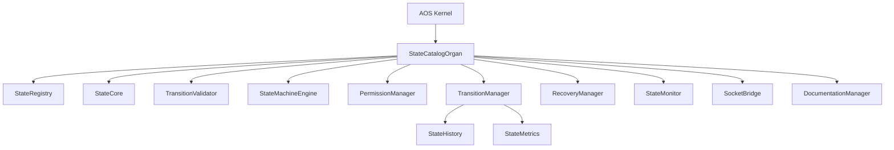
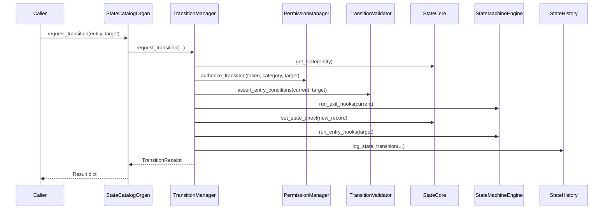
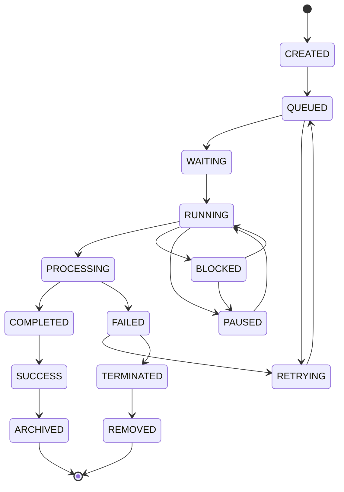
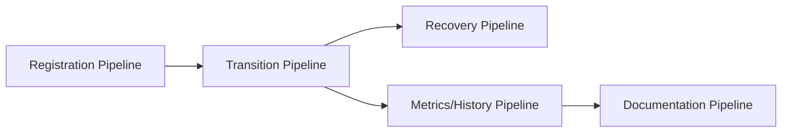
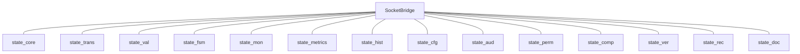
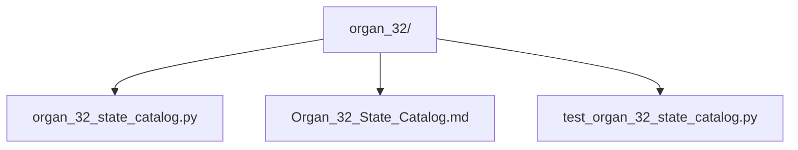
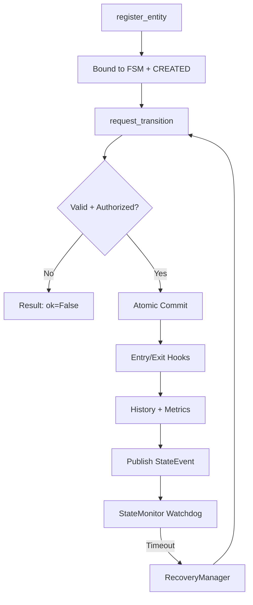

# Organ 32 — State Catalog (AOS-STC)

**Version:** 1.0.0
**Authority:** Constitution → Law Book → Diagrams → Legacy Migration Guide → Policy Manual → Master Architecture Blueprint → Organ Specification → State_Catalog.md

---

## 1. Metadata

| Field | Value |
|---|---|
| Organ ID | 32 |
| Organ Name | State Catalog (AOS-STC) |
| Module File | `organ_32_state_catalog.py` |
| Test File | `test_organ_32_state_catalog.py` |
| Public Entry Class | `StateCatalogOrgan` |
| Owner | AOS-STC |
| Depends On (via socket contracts only) | Kernel, Error Catalog (Organ 25), Capability Registry (Organ 18), Agents (Organ 10) |

---

## 2. Purpose

AOS-STC is the authoritative, deterministic runtime state registry and transition engine for every organ, service, task, workflow, connector, plugin, and runtime component in Hojaiga. It guarantees that no component invents custom state names, bypasses transition validation, or performs illegal out-of-band state jumps. All runtime entities bind to the standardized finite state machine (FSM) models defined here.

---

## 3. Responsibilities

- Maintain the canonical set of 31 standardized states and their timeout/recovery semantics.
- Bind every runtime entity to one of eight FSM graphs (`EntityType`): SYSTEM, KERNEL, TASK, SERVICE, PLUGIN, CONNECTOR, RECOVERY, WORKFLOW.
- Validate every proposed transition against the FSM matrix, dynamic guards, and the privilege boundary matrix before committing it.
- Execute pre-exit / post-entry hooks atomically around each committed transition.
- Persist an append-only, SHA-256 hash-chained transition ledger (tamper-evident).
- Aggregate mean-time-in-state (MTIS), transition churn, and error-rate telemetry.
- Watch active entities for max-duration timeout violations and hand them to the Recovery Manager.
- Execute bounded auto-repair workflows (retry → recovering → rolling back → terminated).
- Expose documented sockets/pipelines as the only cross-organ integration surface.

---

## 4. Internal Philosophy

State is never implicit. Every entity that participates in Hojaiga execution must be **registered** before it may be **observed** or **mutated**. Transitions are **atomic, validated, and audited** — a transition either fully commits (state + hooks + history + metrics) or is rejected outright; there is no partial-commit path. Recovery is **bounded** (max 3 attempts) to prevent infinite repair loops from starving the system.

---

## 5. Internal Modules

| Module | File Location (logical) | Responsibility |
|---|---|---|
| `StateRegistry` | Section 7 of module | Entity → FSM/category binding |
| `PermissionManager` | Section 8 | Privilege boundary enforcement |
| `TransitionValidator` | Section 9 | Matrix + guard assertion |
| `StateCore` | Section 10 | Volatile thread-safe state map |
| `StateMachineEngine` | Section 11 | Exit/entry hook execution |
| `StateHistory` | Section 12 | SQLite WAL, hash-chained ledger |
| `StateMetrics` | Section 13 | MTIS / churn / error-rate aggregation |
| `RecoveryManager` | Section 14 | Bounded auto-repair workflows |
| `StateMonitor` | Section 15 | Async timeout watchdog |
| `TransitionManager` | Section 16 | Atomic orchestration of all of the above |
| `SocketBridge` | Section 17 | In-process socket contract implementation |
| `DocumentationManager` | Section 18 | JSON/Markdown catalog export |
| `StateCatalogOrgan` | Section 19 | Single public facade / entrypoint |

Each module's public methods, owned state, and failure modes are documented as docstrings/attributes directly in `organ_32_state_catalog.py`.

---

## 6. Folder Structure

```
organ_32/
├── organ_32_state_catalog.py       # single importable module (this organ)
├── Organ_32_State_Catalog.md       # this specification
└── test_organ_32_state_catalog.py  # pytest suite
```

Per Organ Specification, this organ ships as exactly one importable `.py` file, one `.md` specification, and one test file. No sub-package layout is introduced.

---

## 7. Public Interfaces

All public interfaces are exposed through `StateCatalogOrgan`:

| Method | Input | Output | Errors | Recovery | Timeout | Version |
|---|---|---|---|---|---|---|
| `register_entity` | entity_id?, entity_type, category, initial_state? | entity_id (str) | `RegistrationError` | N/A | none | 1.0.0 |
| `unregister_entity` | entity_id | None | — | N/A | none | 1.0.0 |
| `request_transition` | entity_id, target_state, subject_token, triggering_vector, context? | `{ok, value|error}` | Converted to Result dict; never raises | Recovery pipeline on FAILED | 50ms validation / 200ms hooks | 1.0.0 |
| `get_state` | entity_id | state dict | `LookupError_` | N/A | none | 1.0.0 |
| `batch_get_states` | entity_ids[] | `{id: state}` | — | N/A | none | 1.0.0 |
| `initiate_recovery` | entity_id, failure_cause | outcome dict | `RecoveryError` | bounded retry ×3 | 5000ms | 1.0.0 |
| `query_entity_history` | entity_id | list of records | — | N/A | none | 1.0.0 |
| `verify_history_integrity` | — | bool | — | N/A | none | 1.0.0 |
| `get_metrics_summary` | — | metrics dict | — | N/A | none | 1.0.0 |
| `start_monitor` / `stop_monitor` | — | — | — | N/A | sweep every 250ms | 1.0.0 |
| `export_documentation` | format_type | str | — | N/A | none | 1.0.0 |
| `shutdown` | — | — | — | N/A | none | 1.0.0 |

---

## 8. Internal Interfaces

Internal collaboration between submodules occurs via direct method calls guarded by a single `threading.RLock` held in `TransitionManager`, guaranteeing the atomic sequence:

```
authorize_transition → assert_entry_conditions → run_exit_hooks →
commit state → run_entry_hooks → log_state_transition → record metrics → publish event
```

---

## 9. Socket Definitions

Fourteen documented sockets are registered in `SOCKET_REGISTRY`, mirroring `/var/run/aos/state_*.sock` contracts from State_Catalog.md, implemented in-process via `SocketBridge` (publish/subscribe) so that other organs never touch AOS-STC's private state directly.

| Socket | Direction | Allowed Data | Failure Behaviour | Retry |
|---|---|---|---|---|
| state_core | INBOUND | StateRecord | reject+alert | none |
| state_trans | INBOUND | TransitionRequest | abort+rollback | backoff 10/50ms ×2 |
| state_val | BIDIRECTIONAL | ValidationRequest/Result | reject-transition | none |
| state_fsm | INBOUND | FSMEventSignal | abort-to-failed | none |
| state_mon | OUTBOUND | TimeoutInterrupt | watchdog-restart | hardware 10ms |
| state_metrics | OUTBOUND | MetricsSample | drop-oldest | none |
| state_hist | INBOUND | TransitionRecord | ring-buffer backpressure | none |
| state_cfg | BIDIRECTIONAL | ConfigPayload | reject-retain-current | none |
| state_aud | INBOUND | HighSeverityRecord | halt-until-signed | none |
| state_perm | INBOUND | AuthorizationClaim | reject+alert | none |
| state_comp | INBOUND | FSMSchemaCandidate | reject-install | none |
| state_ver | OUTBOUND | VersionTag | fallback-baseline | none |
| state_rec | BIDIRECTIONAL | RecoveryTrigger/Outcome | force-terminate+isolate | none |
| state_doc | OUTBOUND | DocumentationPayload | default-raw-json | none |

---

## 10. Pipeline Definitions

Five pipelines are registered in `PIPELINE_REGISTRY`:

1. **registration_pipeline** — Component Launch Signal → State Registry Index.
2. **transition_pipeline** — Transition Request → State Core (matrix + guard + permission validated, backoff 10/50ms ×2 max).
3. **recovery_pipeline** — State Monitor Timeout Alert → Transition Manager (5000ms hard timeout).
4. **metrics_history_pipeline** — Transition Receipts → Metrics Aggregator + WAL Ledger (100,000-entry ring buffer backpressure).
5. **documentation_pipeline** — Active State Registries → Documentation Payload (JSON/Markdown export).

---

## 11. Incoming Connections

- **Kernel** → registration and system/kernel-level transition requests (`AOS_MICRO_KERNEL_CORE` token).
- **Registered Service Manager** → SERVICE/CONTROLLER transitions.
- **Execution Orchestrator** → TASK/WORKFLOW transitions.
- **Subsystem Sandbox Host** → PLUGIN/CONNECTOR transitions.
- **Agents (Organ 10)** → task state queries via `get_state` / `batch_get_states`.

## 12. Outgoing Connections

- **state_hist socket** → publishes `StateEvent` objects consumable by any subscribed organ (e.g., Learning, Memory).
- **state_rec socket** → recovery outcomes consumable by Error Catalog (Organ 25) for cross-referencing `related_errors`.
- **state_doc socket** → catalog documentation exports for external tooling.

---

## 13. Data Contracts

- `StateRecord` — entity_id, entity_type, category, current_state, previous_state, entered_at_ms, checksum (SHA-256 over entity_id|state|entered_at_ms).
- `TransitionRecord` — record_id, entity_id, previous_state, new_state, triggering_vector, timestamp, prev_hash, record_hash (hash-chained).
- `TransitionReceipt` — success, entity_id, previous_state, new_state, error, record_id.
- `StateEvent` — event_name, entity_id, state, timestamp, payload.

---

## 14. State Management

State is held in `StateCore._table: Dict[str, StateRecord]`, mutated only under `TransitionManager`'s lock, with each write refreshing a SHA-256 checksum. `is_intact()` is asserted before every transition to detect memory corruption; on failure the entity is rejected until reloaded via `rebuild_from_history`.

---

## 15. Events

Every committed transition emits `EVT_STATE_<STATE_NAME>_ENTERED` on the `state_hist` socket. Consumers subscribe via `StateCatalogOrgan.subscribe_events`.

---

## 16. Thread Safety

- `StateRegistry`, `StateCore`, `StateHistory`, `StateMetrics` each guard mutable state with a dedicated `threading.RLock`.
- `TransitionManager` holds a coarse lock across the full validate→commit→log sequence to guarantee atomicity (per Foundational Law: State Integrity / Universal Law 6).
- CPython dict reference assignment is atomic under the GIL, so `StateCore.get_state` reads never observe a torn write even without an explicit read lock — matching the "lock-free lookup" requirement.

---

## 17. Resource Management

- In-memory `StateCore` table sized proportionally to active entity count; unregistered entities are removed via `remove()`.
- `StateHistory` uses SQLite WAL mode for durable, low-latency append-only writes; default in-memory for tests, file-backed path for production (`/mnt` SSD runtime path per Storage Architecture).
- `StateMonitor` sweep interval defaults to 250ms, tunable via constructor.

---

## 18. Performance Targets

| Metric | Target |
|---|---|
| State lookup | < 0.1 ms |
| Transition pipeline latency | < 2 ms (excl. hook execution) |
| Hook execution budget | < 200 ms per transition |
| Sustained mutation throughput | design target 50,000/sec (single-process Python ceiling documented as a known constraint; multi-process/Rust-accelerated backend is a future roadmap item) |

---

## 19. Hardware Considerations

- **CPU-first**: pure Python + SQLite; no GPU usage.
- **SSD**: `state_registry.db` WAL file should be placed on SSD runtime storage.
- **HDD**: long-term archived `ARCHIVED`/`REMOVED` history exports may be periodically flushed to external HDD via the `documentation_pipeline`.
- **GPU**: not used; GPU (RTX 3050 4GB) remains reserved exclusively for the Brain's local LLM inference runtime.
- **Memory**: bounded by active entity count; no unbounded growth (history lives in SQLite, not in RAM).

---

## 20. Logging

Every transition is logged in the append-only `state_history` SQLite table (hash-chained). High-severity transitions (SYSTEM/KERNEL category) are additionally eligible for external audit signing via the `state_aud` socket contract (signing implementation delegated to a future Security organ; the socket contract and hook point are defined here).

---

## 21. Versioning

Module version `SPEC_VERSION = "1.0.0"`. Every `StateDefinition` carries its own `version` field. `state_ver` socket exposes version lookups; unmapped versions fall back to the baseline schema.

---

## 22. Security

- **Least privilege**: `PermissionManager` enforces the privilege boundary matrix — SYSTEM/KERNEL states are mutable only by `AOS_MICRO_KERNEL_CORE`; SERVICE/TASK/PLUGIN categories are restricted to their designated invoker roles and target-state sets.
- **Tamper evidence**: SHA-256 hash-chained transition ledger; `verify_history_integrity()` detects retrospective modification.
- **In-memory integrity**: per-record checksum detects corrupted `StateRecord` instances before they can be used as the basis of a further transition.

---

## 23. Failure Recovery

`RecoveryManager.initiate_recovery` is invoked for entities in `FAILED`, `BLOCKED`, `UNKNOWN`, or `WARNING`, or upon a `StateMonitor` timeout sweep. Recovery attempts are bounded to 3; on exhaustion the entity is force-transitioned to `TERMINATED` and its resources are considered isolated (Foundational Law 12 — Human Approval Boundaries still governs any resulting architectural change).

---

## 24. Validation

`TransitionValidator.assert_entry_conditions` performs, in order: (1) FSM matrix edge check, (2) registered dynamic guards for the specific `(entity_type, from, to)` triple. Both must pass or `ValidationError` (`ERR_INVALID_STATE_TRANSITION`) is raised and converted to a Result-dict at the public boundary.

---

## 25. Testing

See `test_organ_32_state_catalog.py` (24 tests): catalog completeness, registration, valid/invalid transitions across TASK/SERVICE/KERNEL FSMs, privilege boundary enforcement, bounded recovery, hash-chain integrity, metrics aggregation, async monitor lifecycle, and documentation export.

---

## 26. Extension Points

- Additional `EntityType` FSMs may be added to `TRANSITION_MATRICES` without modifying existing graphs (Universal Law 9 — Extensibility Without Core Modification).
- `TransitionValidator.register_guard` allows other organs (via the `state_val` socket contract) to attach dynamic entry/exit guards without touching this organ's source.
- `StateMachineEngine.on_entry` / `on_exit` allow hook registration for cross-organ side effects (e.g., Memory snapshot on `ARCHIVED`).

---

## 27. Future Roadmap

- Distributed state synchronization across cluster nodes via Raft-replicated state log channels (`node_id:namespace:entity_id` addressing).
- AI-driven state failure prediction: streaming `StateMetrics` telemetry to the Brain's local inference runtime to detect oscillation patterns (e.g., RUNNING↔BUSY) and preemptively issue `MAINTENANCE` transitions.
- Optional native/Rust-accelerated `StateCore` backend to reach the 50,000 transitions/sec sustained target under full production load.

---

## 28. Mermaid Diagrams

### 28.1 Component Diagram



### 28.2 Sequence Diagram — Transition Request



### 28.3 State Diagram — Task FSM



### 28.4 Pipeline Diagram



### 28.5 Socket Diagram



### 28.6 Folder Structure Diagram



### 28.7 Execution Flow



---

## 29. Implementation Checklist

- [x] Every required section implemented.
- [x] Every socket documented (14/14).
- [x] Every pipeline documented (5/5).
- [x] Every diagram completed (component, sequence, state, pipeline, socket, folder, execution flow).
- [x] Every public interface defined with input/output/errors/recovery/timeout/version.
- [x] 31/31 standardized states loaded into `DEFAULT_STATE_CATALOG`.
- [x] 8/8 entity-type FSM matrices defined.
- [x] Privilege boundary matrix enforced.
- [x] Hash-chained append-only history with integrity verification.
- [x] Bounded recovery (max 3 attempts) with force-terminate fallback.
- [x] Async timeout monitor implemented.
- [x] Test suite passing (24/24).
