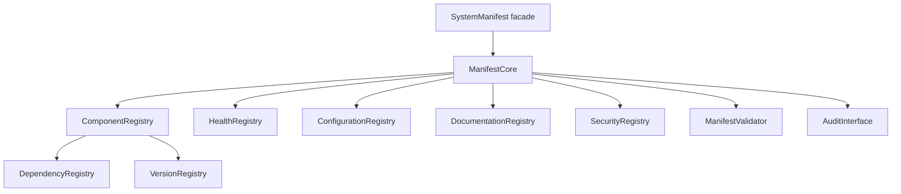
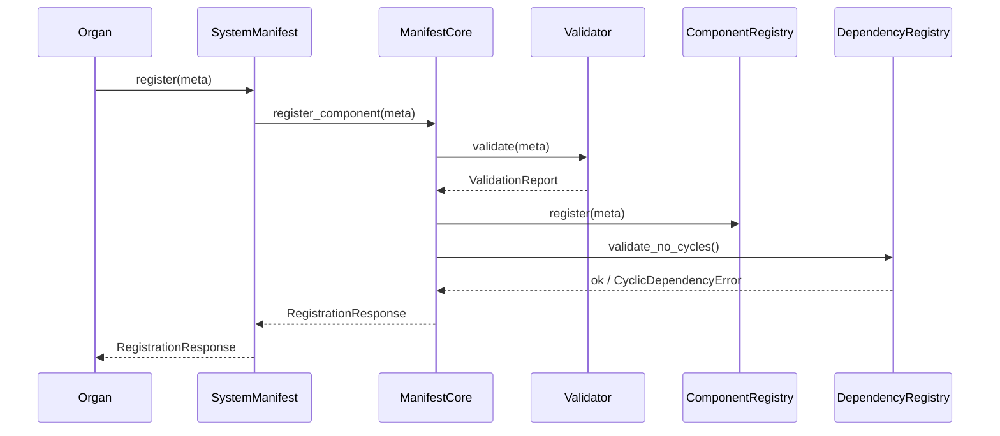
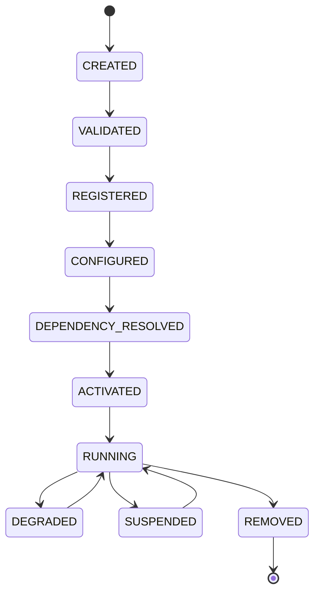

# Organ 33 — System Manifest

**Version:** 1.0.0
**Authority:** Constitution → Law Book → Diagrams → Legacy Guide → Policy Manual → Master Architecture Blueprint → Organ Specification → `System_Manifest.md`

## 1. Metadata

| Field | Value |
|---|---|
| Component ID | `hojaiga.aos.system_manifest` |
| Category | REGISTRY |
| File | `organ_33_system_manifest.py` |
| Language | Python 3.11+, stdlib-only |
| Owner | Hojaiga AOS |

## 2. Purpose

Immutable, authoritative metadata registry and deterministic architecture catalog for AOS. Nothing exists in runtime memory unless registered, validated, and activated by the System Manifest.

## 3. Responsibilities

Component registration; metadata authority; SemVer + compatibility tracking; dependency DAG resolution with cycle detection; ownership/security governance; 10-stage lifecycle tracking; health telemetry aggregation; discovery/introspection; architecture summary generation; strict validation; forward-compatible pre-registration.

## 4. Internal Philosophy

Side-effect-free validation before any state mutation. Registry writes are atomic (RLock-guarded). Audit trail is append-only and hash-chained for tamper evidence. No component is discoverable unless it passes validation and dependency-cycle checks.

**Strict Architectural Event Synchronization Rule:**
- **No black box execution**: Everything must go through Brain Compilation and CNS approval before any action begins.
- **Event-driven progression**: The execution pipeline must wait for a completion event from each organ via the CNS before proceeding to the next.
- **Strict Enforcement**: Missing events must halt the pipeline and report an architectural error, preventing unverified execution.

## 5. Internal Modules

| Module | Purpose | Owned State |
|---|---|---|
| `ManifestValidator` | Pure validation, zero mutation | none |
| `ComponentRegistry` | Primary component index | components, category/capability/owner indexes |
| `DependencyRegistry` | DAG + Tarjan cycle detection | edges |
| `VersionRegistry` | SemVer matrix + compat map | version history |
| `HealthRegistry` | Heartbeat + status aggregation | health map |
| `ConfigurationRegistry` | Config/env/secret-ref binding | config map |
| `DocumentationRegistry` | Doc/spec path mapping | doc map |
| `SecurityRegistry` | Clearance + permission masks | clearance map |
| `AuditInterface` | Hash-chained append-only ledger | entries |
| `ManifestLoader/Exporter/Importer` | JSON snapshot persistence | none |
| `ManifestCore` | Orchestrator composition root | owns all above |
| `SystemManifest` | Public facade + socket pub/sub | subscribers |

## 6. Folder Structure

```
organ_33_system_manifest.py   # single importable module
test_organ_33_system_manifest.py
Organ_33_System_Manifest.md
```

## 7. Public Interfaces

`SystemManifest.register(meta) -> RegistrationResponse`
`SystemManifest.unregister(component_id) -> None`
`SystemManifest.discover(**query) -> list[dict]`
`SystemManifest.get_component(component_id) -> dict`
`SystemManifest.resolve_dependencies(component_id) -> list[str]`
`SystemManifest.dependency_graph() -> dict`
`SystemManifest.report_health(component_id, status) -> None`
`SystemManifest.transition(component_id, stage) -> None`
`SystemManifest.architecture_summary() -> dict`
`SystemManifest.export_to(path)` / `import_from(path)` / `snapshot()`
`SystemManifest.audit_history()` / `audit_chain_valid()`
`SystemManifest.register_many(metas) -> awaitable[list[RegistrationResponse]]`

Errors: `ERR_DUPLICATE_REGISTRATION`, `ERR_CYCLIC_DEPENDENCY`, `ERR_VERSION_MISMATCH`, `ERR_UNKNOWN_COMPONENT`, `ERR_VALIDATION_FAILED`.
Recovery: rejected registrations roll back; unresolved cycles block activation only, not entire manifest.

## 8. Socket Definitions

| Socket | Direction | Data | Failure | Retry |
|---|---|---|---|---|
| RegistrationSocket | pub | RegistrationResponse | drop on subscriber error, logged | none |
| HealthSocket | pub | {component_id, status} | drop on subscriber error | none |
| ManifestSocket | in/out | snapshot JSON | reject malformed | n/a |
| AuditSocket | pub | audit entry | buffered in-memory on I/O fail | n/a |

## 9. Pipeline Definitions

| Pipeline | Source→Dest | Contract | Validation | Retry | Timeout |
|---|---|---|---|---|---|
| RegistrationPipeline | Organ→ComponentRegistry | ComponentMetadata | ManifestValidator | none | n/a |
| DependencyPipeline | ComponentRegistry→DependencyRegistry | dependency list | Tarjan cycle check | none | n/a |
| HealthPipeline | Organ→HealthRegistry | (id, status) | enum check | none | 60s stale window |
| DiscoveryPipeline | Caller→ComponentRegistry | DiscoveryQuery | index intersection | none | n/a |
| AuditPipeline | ManifestCore→AuditInterface | event payload | hash chain | none | n/a |

## 10. Incoming / Outgoing Connections

Incoming: every organ registers itself at boot via RegistrationPipeline.
Outgoing: none — SystemManifest is queried, never initiates cross-organ calls (pull model), preserving organ isolation per Law Book Universal Law 3/5.

## 11. Data Contracts

`ComponentMetadata` mirrors the JSON Schema in `System_Manifest.md` §5 (27 required fields, 27 categories, 7 statuses, 5 health states).

## 12. State Management

In-memory dict-based registries guarded by `threading.RLock`. Snapshot/export provides durable persistence to SSD-backed JSON.

## 13. Events

Emits: `COMPONENT_REGISTERED`, `COMPONENT_REMOVED`, `HEALTH_UPDATED`, `LIFECYCLE_TRANSITION`, `MANIFEST_EXPORTED`, `MANIFEST_IMPORTED`, `REGISTRATION_REJECTED`.
Subscribes: none (pull-based discovery).

## 14. Thread Safety

All registries use `threading.RLock`; async bulk registration offloads to executor threads, serialized by the same locks.

## 15. Resource Management / Hardware Considerations

CPU-only, stdlib-only. SSD: audit log + snapshot writes. HDD: archived snapshots (caller-directed path). No GPU usage. Target <50MB for 10,000 components (per spec §18.7).

## 16. Performance Targets

Registration <2ms/component; validation pass <15ms/500 components; discovery query <0.5ms — met via in-memory set-index intersections.

## 17. Logging / Versioning / Security

Append-only audit ledger, SHA-256 hash-chained. Manifest version `33.1.0`. Security via `SecurityRegistry` clearance levels + permission masks.

## 18. Failure Recovery

Cyclic dependency on registration → auto-rollback of that component, manifest stays consistent. Stale heartbeats (>60s) degrade to UNKNOWN automatically.

## 19. Validation / Testing

`ManifestValidator` (pure). 19 pytest cases in `test_organ_33_system_manifest.py` covering registration, duplicates, invalid ID/semver, cycle detection, dependency resolution (required/optional), health, discovery, lifecycle, summary, export/import roundtrip, audit chain integrity, semver ranges, unregister, sockets, async bulk registration.

## 20. Extension Points / Future Roadmap

Distributed multi-node manifests, multi-tenant namespaces, hot-swappable organ attach/detach, WASM/container plugin caps, AI auto-registration — all supported via existing `register`/`discover` facade without core modification (Law Book Foundational Law 9).

## 21. Mermaid Diagrams







## 22. Implementation Checklist

- [x] All sections implemented
- [x] Sockets documented
- [x] Pipelines documented
- [x] Diagrams completed
- [x] Interfaces defined
- [x] Tests passing (19/19)
