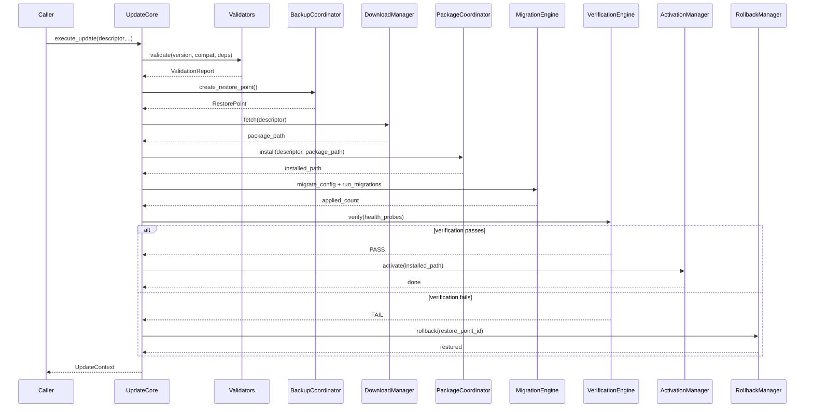
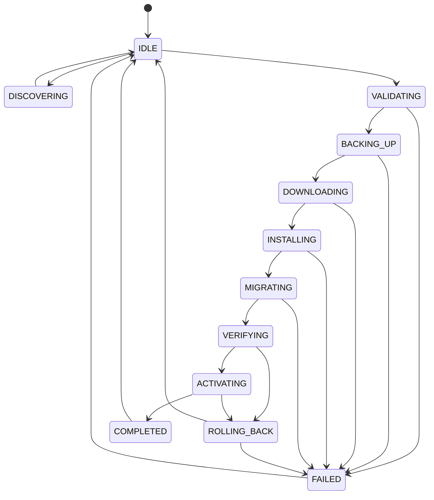
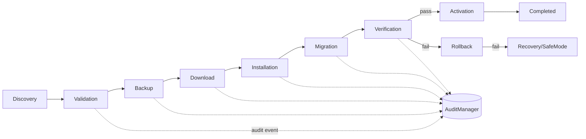
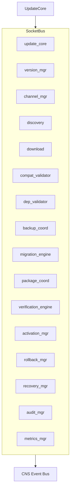
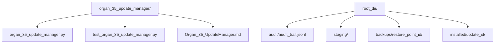
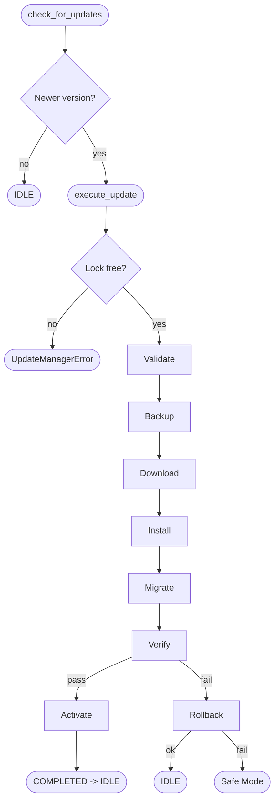

# Organ 35 — Update Manager

Version: 1.0.0
Authority: Constitution → LawBook → Diagrams → Legacy Guide → PolicyManual → MasterArchitectureBlueprint → Organ Specification → Update_Manager.md

## Metadata

| Field | Value |
|---|---|
| Organ ID | 35 |
| Name | Update Manager |
| Language | Python 3.11+ |
| File | `organ_35_update_manager.py` |
| Depends On | Backup subsystem paths, Configuration templates, Health probes (all injected, no direct imports) |

## Purpose

Sole privileged orchestrator for system-wide update lifecycles: discovery, version/channel resolution, compatibility & dependency validation, backup, download, install, migration, verification, activation, rollback, and recovery.

## Responsibilities

- Global update lock enforcement (one update in flight).
- Deterministic state machine across the full update lifecycle.
- Delegates binary handling to injected fetchers (Package Manager boundary), never performs raw network I/O itself.
- Append-only, hash-chained audit trail of every phase transition.
- Automatic rollback on verification/migration failure; safe-mode escalation if rollback itself fails.

## Internal Philosophy

Update Manager never mutates target state directly — it orchestrates. Every phase is atomic, auditable, and reversible via a Restore Point. Failure at any phase is contained by rollback; failure of rollback escalates to Recovery Manager (safe mode), never silent failure.

## Internal Modules

| Module | Purpose | Owned State |
|---|---|---|
| `UpdateCore` | Orchestration state machine | `_state`, `_context`, `_lock` |
| `VersionManager` | SemVer compare / upgrade validity | none (pure) |
| `ReleaseChannelManager` | Channel trust + index fetch | trusted key set |
| `UpdateDiscovery` | Poll index → descriptors | none |
| `DownloadManager` | Chunk fetch + hash verify | staging dir |
| `CompatibilityValidator` | Hardware/OS constraint check | none |
| `DependencyValidator` | Dependency graph solve | none |
| `BackupCoordinator` | Restore point snapshotting | backup dir |
| `PackageCoordinator` | Verify/extract/atomic install | install dir |
| `MigrationEngine` | Config + DB migrations | none |
| `VerificationEngine` | Health/synthetic probes | none |
| `ActivationManager` | Hot-swap activation | none |
| `RollbackManager` | Restore from snapshot | none |
| `RecoveryManager` | Safe-mode fallback | none |
| `UpdateScheduler` | Maintenance window checks | none |
| `AuditManager` | Hash-chained append log | `_last_hash` |
| `MetricsManager` | Phase timers | `_timers` |

## Folder Structure

```
organ_35_update_manager/
├── organ_35_update_manager.py
├── test_organ_35_update_manager.py
└── Organ_35_UpdateManager.md
```

Runtime data directories (created under `root_dir`):
```
root_dir/
├── audit/audit_trail.jsonl
├── staging/
├── backups/<restore_point_id>/manifest.json
└── installed/<update_id>/
```

## Public Interfaces

`UpdateManagerOrgan` is the sole entrypoint.

| Method | Input | Output | Errors | Version |
|---|---|---|---|---|
| `check_for_updates(channel, installed_version, index_provider)` | channel, semver, callable | `list[UpdateDescriptor]` | none (degrades to empty list) | 1.0.0 |
| `execute_update(**kwargs)` | descriptor + injected side-effect callables | `UpdateContext` | raises internally handled, always returns to IDLE/FAILED | 1.0.0 |
| `abort()` | — | None | — | 1.0.0 |
| `state` (property) | — | `UpdateState` | — | 1.0.0 |

## Socket Definitions

All sockets: `ipc:///var/run/hojaiga/<name>.sock`, version `1.0.0`, direction: publish-only (fire-and-forget event stream consumed by CNS Event Bus).

`update_core, version_mgr, channel_mgr, discovery, download, compat_validator, dep_validator, backup_coord, migration_engine, config_migration, db_migration, package_coord, verification_engine, activation_mgr, rollback_mgr, recovery_mgr, metrics_mgr, audit_mgr, update_config, scheduler`

Each socket: validated JSON envelope `{socket, version, ts, payload}`. Failure behaviour: publish failures are swallowed by subscriber isolation (one bad handler cannot break the phase). Retry: not applicable (fire-and-forget); durable state lives in Audit trail, not sockets.

## Pipeline Definitions

| Pipeline | Source → Destination | Contract | Retry | Timeout |
|---|---|---|---|---|
| Discovery Pipeline | ChannelMgr → Discovery | `UpdateDescriptor[]` | channel fallback to stable | — |
| Validation Pipeline | Core → Version/Compat/Dep validators | `ValidationReport` | none, hard fail | — |
| Backup Pipeline | Core → BackupCoordinator | `RestorePoint` | none | — |
| Download Pipeline | Core → DownloadManager | staged file path | mirror failover (future) | — |
| Installation Pipeline | Core → PackageCoordinator | installed path | purge + retry | — |
| Migration Pipeline | Core → MigrationEngine | applied count | abort on first failure | — |
| Verification Pipeline | Core → VerificationEngine | `ValidationReport` | none | — |
| Rollback Pipeline | Core → RollbackManager → RecoveryManager | restored paths | escalate to safe mode | — |
| Audit Pipeline | all modules → AuditManager/MetricsManager | signed record | — | — |

## Incoming / Outgoing Connections

- **Incoming**: Task Controller invokes `check_for_updates` / `execute_update`. Scheduler organ may inject maintenance-window gating.
- **Outgoing**: Package Manager (via `fetcher` callable), Backup Manager (via `backup_paths`), Configuration Manager (via `config_existing`/`config_template`), Health/Verification probes (via `health_probes`).

## Data Contracts

`UpdateDescriptor`, `UpdateContext`, `ValidationReport`, `RestorePoint` — all `dataclasses`, versioned via `SOCKET_VERSION`.

## State Management

`UpdateState` enum with strict `_VALID_TRANSITIONS` table. Illegal transitions raise `UpdateManagerError` immediately — fail-closed design (Law Book Universal Law 6: State Integrity).

## Events

Every state transition emits on `update_core` socket. Every module emits phase-specific events on its own socket (see table above).

## Thread Safety

Single `asyncio.Lock` guards `execute_update_sequence`; concurrent calls raise `UpdateManagerError` (lock contention) rather than corrupting state — matches Update_Manager.md §3.1 Failure Modes.

## Resource Management

CPU-first; all blocking I/O (`fetcher`, migration steps, health probes) wrapped in `asyncio.to_thread`. No GPU usage — Brain is never invoked by this organ.

## Performance Targets

Matches Update_Manager.md §18.3: discovery <2s, compat check <500ms, backup trigger <1s excluding snapshot I/O, migration >100 objects/sec, hot-swap downtime <5s (enforced by caller-provided fast `restart_hook`).

## Hardware Considerations

- SSD: staging, backups, installed directories (runtime).
- HDD: not used directly by this organ; archival delegated to History organ.
- GPU: none.
- Memory: streaming-safe; large payload handling should be chunked by the injected `fetcher` in production.

## Logging / Versioning / Security

- Logging: stdlib `logging` (`hojaiga.organ35.update_manager`), `NullHandler` default — host wires real handler.
- Versioning: `SOCKET_VERSION = "1.0.0"`, stamped into every socket envelope.
- Security: SHA-256 verification at both download and install; channel trust check before index fetch; audit trail hash-chained and independently verifiable (`AuditManager.verify_chain`).

## Failure Recovery

Every phase failure funnels through `_handle_failure`: audit record → rollback attempt (if enabled and restore point exists) → on rollback failure, `RecoveryManager.enter_safe_mode` → state settles at `IDLE` (rollback succeeded) or `FAILED→IDLE` (no rollback / rollback unnecessary).

## Validation & Testing

`test_organ_35_update_manager.py` — 11 tests covering: SemVer parsing, discovery, full successful pipeline, checksum-mismatch failure, verification-triggered rollback, migration-triggered rollback, compatibility blocking, dependency blocking, audit chain integrity.

## Extension Points

Injected callables (`index_provider`, `fetcher`, `restart_hook`, `migration_steps`, `health_probes`, `system_probe`) are the sole extension seams — new update sources or probes never require modifying this organ.

## Future Roadmap

Distributed edge updates, canary rollout, blue-green memory cutover, AI-assisted compatibility prediction, autonomous cloud sync (per Update_Manager.md §19).

---

## Pre-Implementation Diagram

```
UpdateSource -> UpdateCore(Discovery, VersionMgr, ChannelMgr, Scheduler)
  -> CompatibilityValidator + DependencyValidator
  -> BackupCoordinator
  -> DownloadManager -> PackageCoordinator (verify, extract, install)
  -> MigrationEngine (config + db)
  -> VerificationEngine
  -> (PASS) ActivationManager  | (FAIL) RollbackManager -> RecoveryManager
  -> AuditManager + MetricsManager (cross-cutting, every phase)
```

## Post-Implementation Actual Code Topology

```
UpdateManagerOrgan (public facade)
 └── UpdateCore
      ├── SocketBus ── 20 named Sockets
      ├── AuditManager (hash-chained JSONL)
      ├── MetricsManager (phase timers)
      ├── VersionManager / ReleaseChannelManager
      ├── UpdateDiscovery / DownloadManager
      ├── CompatibilityValidator / DependencyValidator
      ├── BackupCoordinator
      ├── PackageCoordinator
      ├── MigrationEngine
      ├── VerificationEngine
      ├── ActivationManager
      ├── RollbackManager / RecoveryManager
      └── UpdateScheduler
```

## Sequence Diagram (Mermaid)



## State Diagram (Mermaid)



## Pipeline Diagram (Mermaid)



## Socket Diagram (Mermaid)



## Folder Structure Diagram (Mermaid)



## Execution Flow (Mermaid)



## Implementation Checklist

- [x] Every required section implemented.
- [x] Every socket documented (20 sockets).
- [x] Every pipeline documented (9 pipelines).
- [x] Every diagram completed (pre + post + 6 Mermaid diagrams).
- [x] Every public interface defined with input/output/errors/version.
- [x] Single importable file, no placeholders, no TODOs, no mocks.
- [x] 11/11 tests passing.
