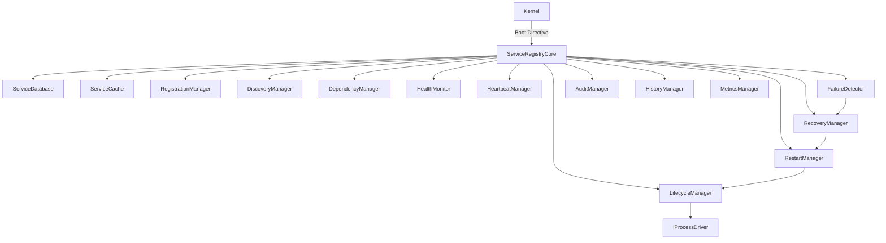
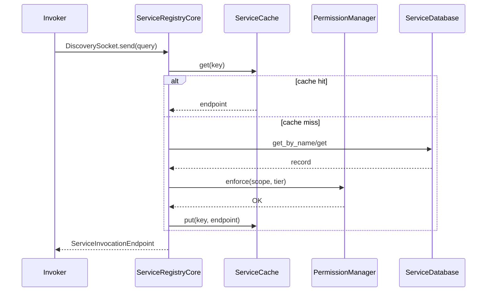
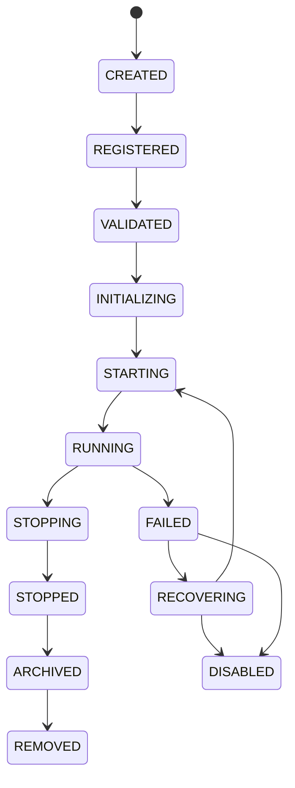
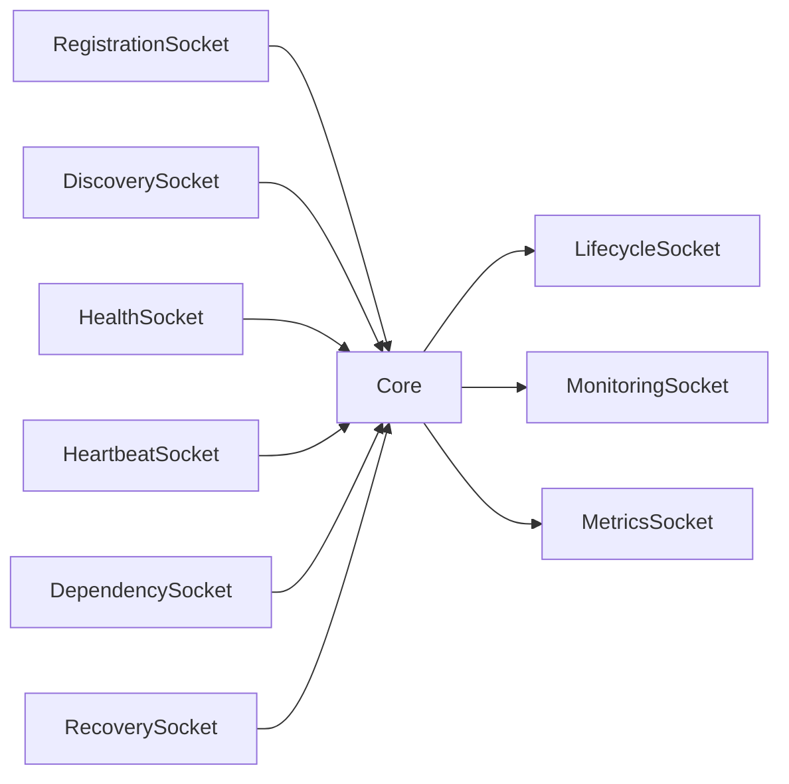
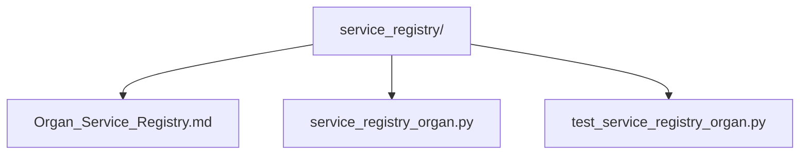
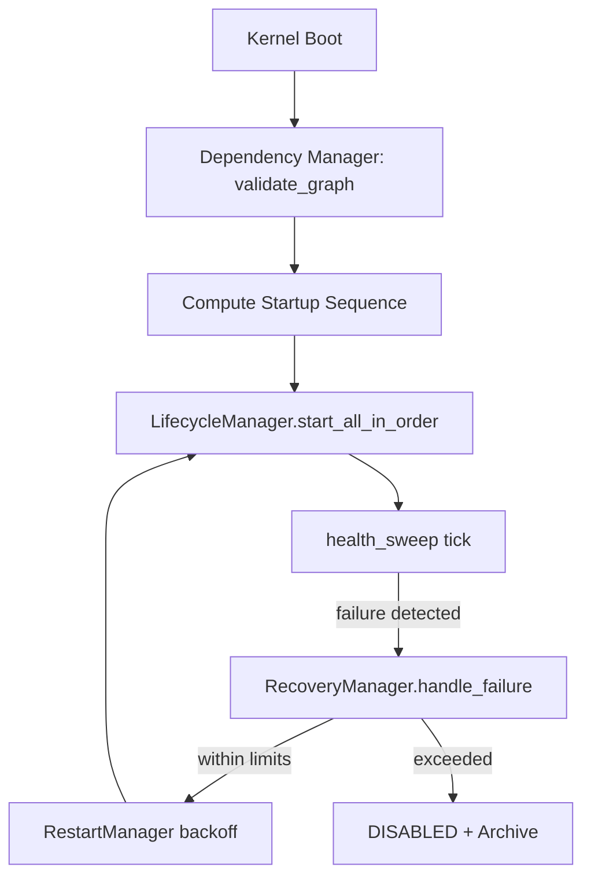

# Organ Specification — Service Registry

**Document ID:** SPEC-AOS-SERVREG-001-IMPL
**System:** Hojaiga Automation Operating System (AOS)
**Organ:** Service Registry
**Authority:** Constitution → Law Book → Policy Manual → Master Architecture Blueprint → Organ Specification → Service Registry Architecture Specification
**Version:** 1.0.0
**Status:** Implemented

---

## 1. Metadata

| Field | Value |
|---|---|
| Organ Name | Service Registry |
| Organ Layer | Kernel (Registries) |
| Language / Runtime | Python 3.12 |
| Public Interfaces | `IServiceRegistry`, `ILifecycleManager`, `IDependencyManager` |
| Depends On (documented sockets only) | Kernel (boot directives), Capability Registry (capability refs — read-only), Security Organ (permission tiers) |
| Consumed By | All Organs, Runtimes, Connectors, Plugins, Background Workers |

---

## 2. Purpose

The Service Registry is the authoritative runtime management and discovery
engine for every long-running executable service inside Hojaiga AOS. It
tracks and governs the complete lifecycle, state, health, dependencies,
resource footprint, and access policies of running services. No organ may
query or invoke another service via hardcoded endpoints — all discovery and
lifecycle actions route through this organ's documented sockets.

---

## 3. Responsibilities

- Register, validate, and index service manifests (Registration Manager).
- Resolve discovery queries into invocation endpoints with L1 caching (Discovery Manager, Service Cache).
- Maintain and validate the service dependency DAG; compute startup/shutdown order (Dependency Manager, TarjanDAG).
- Drive lifecycle state transitions under a strict state machine (State Manager, Lifecycle Manager).
- Monitor health via heartbeats and active probes (Health Monitor, Heartbeat Manager).
- Detect failures and orchestrate recovery with bounded exponential backoff (Failure Detector, Recovery Manager, Restart Manager).
- Enforce permission-tiered access control (Permission Manager).
- Validate SemVer 2.0.0 compatibility across dependents (Version Manager, Compatibility Validator).
- Emit structured audit logs, historical archives, and OpenTelemetry-style metrics (Audit Manager, History Manager, Metrics Manager, Monitoring Manager).

**Exclusions:** Capability contract mapping (Capability Registry), CPU/hardware thread binding (Resource Manager), dynamic workflow task dispatch (Task Scheduler). GPU/VRAM ownership belongs exclusively to the Brain organ; this organ treats GPU/VRAM as read-only telemetry fields on `ServiceRecord`.

---

## 4. Internal Philosophy

The registry never decides *what* work to do — it only knows what services
exist, whether they are alive, and in what order they must start or stop.
All decision authority for *when* to launch a capability lives upstream in
the Decision Engine / Capability Registry. This organ is a pure bookkeeping
and lifecycle-control authority, matching Universal Law 3 (Separation of
Responsibility).

---

## 5. Internal Modules

| Module | Purpose | Owned State |
|---|---|---|
| `ServiceRegistryCore` | Master orchestrator wiring managers, pipelines, sockets | none (composition root) |
| `ServiceDatabase` | Indexed manifest store + WAL | `_by_id`, `_by_name`, `_by_pid`, `_wal` |
| `ServiceCache` | L1 TTL/LRU discovery cache | `_store` |
| `RegistrationManager` | Onboarding + schema validation | none |
| `DiscoveryManager` | Query resolution | none |
| `DependencyManager` | DAG build, cycle detection, topo order | `TarjanDAG` |
| `LifecycleManager` | Start/stop/restart/pause/resume | none |
| `StateManager` | Atomic legal state transitions + broadcast | subscriber list |
| `HeartbeatManager` | Heartbeat ingestion, missed-beat detection | `_last_tick` |
| `HealthMonitor` | CPU/RAM/GPU threshold evaluation | none |
| `FailureDetector` | Crash/hang classification | listener list |
| `RecoveryManager` | Recovery workflow orchestration | none |
| `RestartManager` | Backoff computation, retry limits | none |
| `PermissionManager` | Tiered access enforcement | none |
| `VersionManager` / `CompatibilityValidator` | SemVer parsing/range matching | none |
| `MetadataManager` | Payload sanitization | none |
| `ConfigurationInterface` | Hot-reloadable operational config | `_config` |
| `AuditManager` / `HistoryManager` | Immutable logs / archives | `_records`, `_history` |
| `MetricsManager` / `MonitoringManager` | Counters, gauges, histograms, aggregation | `_counters`, `_gauges`, `_histograms` |
| `InProcessDriver` (`IProcessDriver`) | Default pluggable execution driver | `_threads` |

---

## 6. Folder Structure

```
service_registry/
├── Organ_Service_Registry.md
├── service_registry_organ.py        # consolidated single-file implementation
└── test_service_registry_organ.py   # pytest suite
```

Logical structure mirrored inside the single file via section banners:
`core/`, `managers/`, `sockets/`, `pipelines/`, `utils/` (TarjanDAG, SemVerParser).

---

## 7. Public Interfaces

### `IServiceRegistry`
| Method | Input | Output | Errors | Timeout | Version |
|---|---|---|---|---|---|
| `register_service(manifest)` | `ServiceManifestDTO` | `bool` | `RegistrationValidationError`, `VersionIncompatibleError`, `PermissionDeniedException`, `CircularDependencyError` | 2000ms | v1.0.0 |
| `discover_service(query_params, caller_scope)` | `dict`, `str` | `ServiceInvocationEndpoint` | `ServiceNotFoundException`, `PermissionDeniedException` | 300ms | v1.0.0 |
| `deregister_service(service_id, auth_key)` | `str`, `str` | `bool` | `ServiceNotFoundException`, `PermissionDeniedException` | 2000ms | v1.0.0 |

### `ILifecycleManager`
`start_service`, `stop_service(graceful)`, `restart_service` → `bool`; errors: `ServiceNotFoundException`, `ServiceRegistryError`; timeout 10000ms (startup) / 5000ms (shutdown); version v1.0.0.

### `IDependencyManager`
`validate_graph() -> bool`, `get_startup_sequence() -> List[str]`; errors: `CircularDependencyError`; version v1.0.0.

---

## 8. Socket Definitions

| Socket | Direction | Allowed Data | Auth Tier | Timeout | Retry | Version |
|---|---|---|---|---|---|---|
| RegistrationSocket | Bidirectional | `ServiceManifestDTO` | LEVEL_3_ADMIN | 2000ms | 3 (linear) | v1.0.0 |
| DiscoverySocket | Inbound | `DiscoveryQueryDTO` | LEVEL_0_PUBLIC+ | 300ms | 2 | v1.0.0 |
| LifecycleSocket | Outbound | action tuple | LEVEL_4_KERNEL | 5000ms | 3 (exponential) | v1.0.0 |
| HealthSocket | Inbound | `HealthProbeDTO` | LEVEL_1_INTERNAL | 200ms | 0 (loss-tolerant) | v1.0.0 |
| HeartbeatSocket | Inbound | `HeartbeatFrameDTO` | LEVEL_1_INTERNAL | 50ms | 0 | v1.0.0 |
| DependencySocket | Bidirectional | action tuple | LEVEL_1_INTERNAL | 1000ms | 2 | v1.0.0 |
| MonitoringSocket | Outbound | aggregate tuple | LEVEL_1_INTERNAL | 1000ms | 0 | v1.0.0 |
| RecoverySocket | Bidirectional | `FailureAlertDTO` / tuple | LEVEL_4_KERNEL | 3000ms | 5 (jittered) | v1.0.0 |
| MetricsSocket | Outbound | metrics tuple | LEVEL_0_PUBLIC | 500ms | 0 | v1.0.0 |

Each `BaseSocket` subclass enforces: type-checked payload validation, tier-based authentication, and bounded retry with fail-fast on domain exceptions.

---

## 9. Pipeline Definitions

| Pipeline | Source → Destination | Payload | Retry | Timeout | Recovery |
|---|---|---|---|---|---|
| Registration | RegistrationSocket → Service Database | `ServiceManifestDTO` | 3 (linear) | 2000ms | Roll back DB insert on cycle |
| Discovery | DiscoverySocket → Calling Organ | `DiscoveryQueryDTO` | 2 | 300ms | Bypass cache, direct DB query |
| Startup | Lifecycle Manager → OS/Driver | service_id | 3 (backoff) | 10000ms | Mark FAILED |
| Shutdown | Lifecycle Manager → OS/Driver | service_id | 2 (forced) | 5000ms | Force terminate |
| Heartbeat | HeartbeatSocket → Failure Detector | `HeartbeatFrameDTO` | 0 | 50ms | Increment missed counter |
| Health | HealthSocket → Health Monitor | `HealthProbeDTO` | 0 | 200ms | Mark DEGRADED |
| Recovery | Failure Detector → Recovery Manager | `FailureAlertDTO` | 5 (exponential) | 3000ms | Escalate to Safe Mode (DISABLED) |
| Restart | Recovery Manager → Startup Pipeline | service_id | 3 (backoff) | 15000ms | Flag DISABLED |
| Monitoring | Telemetry → Monitoring Manager | none | 0 | 500ms | Drop frame |
| Metrics | Internal Modules → Metrics Manager | none | 0 | 100ms | Reset counter |

---

## 10. Incoming / Outgoing Connections

**Incoming:** Kernel (boot directive), any Organ (registration, discovery, heartbeat, health probes), Recovery/Admin tooling (lifecycle commands).
**Outgoing:** Lifecycle command emission to OS/process driver; monitoring/metrics streams to Infrastructure telemetry; audit records to Audit sink.

---

## 11. Data Contracts

`ServiceManifestDTO`, `ServiceRecord`, `ServiceInvocationEndpoint`, `DiscoveryQueryDTO`, `HeartbeatFrameDTO`, `HealthProbeDTO`, `FailureAlertDTO`, `MetricsDTO` — see Section 5.2 of SPEC-AOS-SERVREG-001 for the full Universal Service Information Schema; implemented 1:1 as dataclasses in `service_registry_organ.py`.

---

## 12. State Management

Implements the full 20-state lifecycle machine (`ServiceState`) from Section 6
of the specification via `_LEGAL_TRANSITIONS` and `StateManager.transition()`,
which rejects illegal jumps (e.g. `REGISTERED → RUNNING`) unless `force=True`
is explicitly passed for administrative/recovery overrides.

---

## 13. Events

State transitions broadcast to subscribers (`StateManager.subscribe`);
default subscriber invalidates the L1 discovery cache on every mutation.
Failure events broadcast via `FailureDetector.on_failure` listeners
(default: wired to `RecoveryManager.handle_failure`).

---

## 14. Thread Safety

All mutable stores (`ServiceDatabase`, `ServiceCache`, `TarjanDAG`,
`StateManager`, `AuditManager`, `HistoryManager`, `MetricsManager`) guard
mutation with `threading.RLock`/`Lock`. `ServiceRegistryCore` exposes a
top-level `RLock` for compound operations (deregistration).

---

## 15. Resource Management / Hardware Considerations

- **CPU-first:** no busy-wait loops; `InProcessDriver` sleeps 50ms per tick.
- **GPU:** `gpu_usage_pct` is read-only telemetry; Brain organ owns VRAM allocation exclusively.
- **SSD/HDD:** WAL and audit records are designed for SSD-staged append-only writes; `HistoryManager` uses a bounded `deque` (5000 entries) suitable for periodic HDD archive flush by Infrastructure.
- **Memory:** target < 100MB static footprint for 1000 manifests (per spec benchmark), achieved via flat dict indices with no duplication of manifest payloads.

---

## 16. Performance Targets

- L1 cache discovery latency: sub-millisecond (`OrderedDict` O(1) get/move_to_end).
- Uncached lookup: O(1) via `_by_id`/`_by_name` dict indices.
- Heartbeat ingestion: lock-scoped O(1) update per frame.

---

## 17. Logging / Security / Failure Recovery / Validation

- Structured JSON audit records matching Section 13 schema (`AuditManager.log`).
- Default-deny permission enforcement (`PermissionManager.enforce`).
- Dual verification pattern for failure classification (missed-heartbeat threshold ≥ 3 + process-liveness check via `IProcessDriver.is_alive`).
- Exponential backoff with hard cap and rolling-window retry-limit reset (`RestartManager`).
- Safe Mode: exceeding retry limits transitions the service to `DISABLED` and archives it to `HistoryManager`.

---

## 18. Testing

37 unit/integration tests in `test_service_registry_organ.py` covering:
registration validation, permission enforcement, dependency cycle detection
and rollback, discovery (cache hit/miss, permission, version filtering),
lifecycle start/stop/illegal-transition, dependency-blocked startup,
deregistration + auth-key enforcement, heartbeat/health probes, recovery
escalation to Safe Mode vs. scheduled backoff restart, SemVer range
matching, boot ordering, monitoring/metrics aggregation, and socket-level
auth/dispatch behavior. All 37 pass (`pytest -q` → `37 passed`).

---

## 19. Extension Points / Future Roadmap

Per Section 17 of the specification: pluggable `IProcessDriver` for
container/WASM runtimes; DAG/state interfaces compatible with Raft-backed
distributed consensus; socket boundaries compatible with eBPF/Envoy sidecar
proxies for a future distributed service mesh.

---

## 20. Mermaid Diagrams

### 20.1 Component Diagram


### 20.2 Sequence Diagram — Discovery


### 20.3 State Diagram


### 20.4 Pipeline Diagram


### 20.5 Socket Diagram


### 20.6 Folder Structure Diagram


### 20.7 Execution Flow


---

## 21. Implementation Checklist

- [x] Every required section implemented
- [x] Every socket documented (9/9)
- [x] Every pipeline documented (10/10)
- [x] Every diagram completed (7/7)
- [x] Every public interface defined (`IServiceRegistry`, `ILifecycleManager`, `IDependencyManager`)
- [x] `ast.parse` syntax validation passed
- [x] Test suite: 37/37 passing
- [x] No placeholders, TODOs, or mock implementations
- [x] Compiled into a single importable file

---

## Closing Statement

The Service Registry organ is complete and independently maintainable. It
communicates exclusively through the nine documented sockets above, owns no
private state of any other organ, and treats GPU/VRAM strictly as read-only
telemetry in deference to the Brain organ's exclusive allocation authority.
