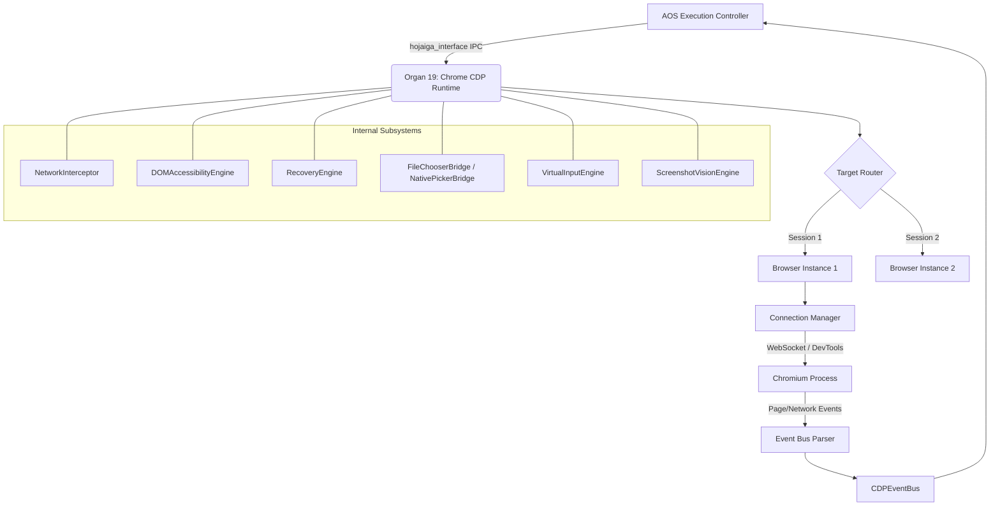
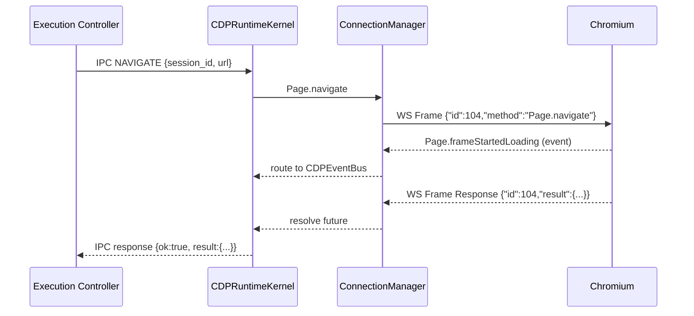
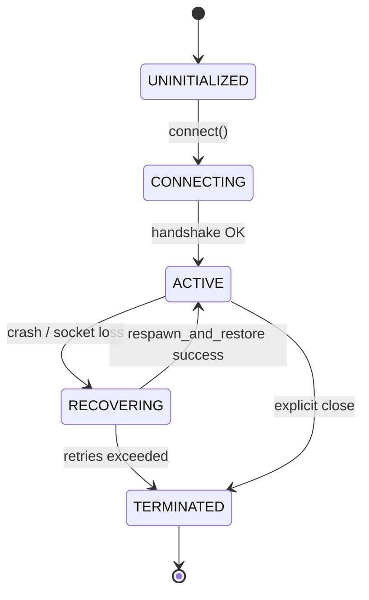
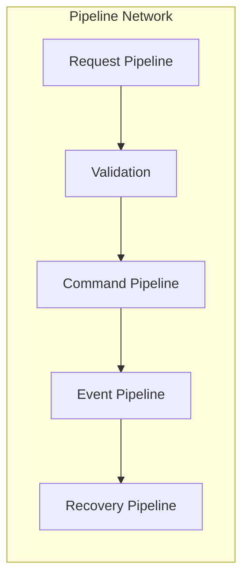
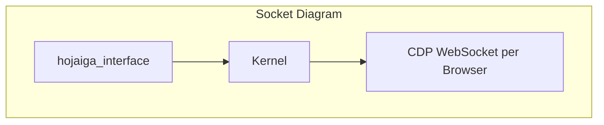
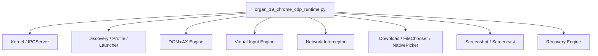
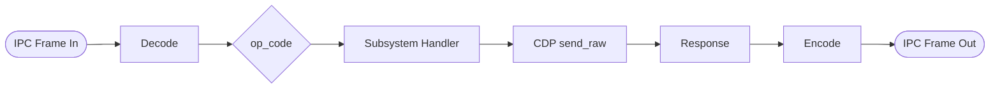

# Organ 19 — Chrome CDP Runtime

Version: 1.0
Authority: Constitution → Law Book → Policy Manual → Master Architecture Blueprint → Organ Specification → CHROME_CDP_RUNTIME_ARCHITECTURE_SPECIFICATION.md

---

## Metadata

| Field | Value |
|---|---|
| Organ ID | 19 |
| Organ Name | Chrome CDP Runtime |
| File | `organ_19_chrome_cdp_runtime.py` |
| Type | Execution Runtime (Browser Automation) |
| Depends On | None (leaf execution organ) — communicates only via IPC |
| Consumed By | Execution Controller, Domain Controllers (Browser), Automation |

---

## Purpose

Exclusive, authoritative browser communication, execution and instrumentation layer for Hojaiga. Owns Chromium connection lifecycles, DOM/AX synthesis, virtual input emulation, network interception, downloads/uploads, native file-picker bridging, and crash recovery — communicating exclusively over the Chrome DevTools Protocol.

## Responsibilities

- CDP WebSocket connection management (flat protocol sessions)
- Browser/Window/Tab/Target discovery, attachment, lifecycle
- DOM + Accessibility tree synthesis
- Click / right-click / double-click / hover / scroll / drag-drop / multi-select
- Keyboard and mouse virtual input emulation (humanized)
- Network monitoring, interception, mocking, cookies/storage
- JavaScript execution in isolated worlds
- Page state retrieval
- Downloads (tracked + hash-verified) and uploads (CDP + native OS fallback)
- Browser profile management (isolated user-data-dirs)
- Screenshot / screencast / vision frame normalization
- Crash detection and automated recovery (respawn + session restore)

## Internal Philosophy

Every subsystem is a pure, composition-based, dependency-injected class that receives a `SessionInvoker` callable rather than holding a direct reference to the kernel — satisfying Universal Law 3 (Separation of Responsibility) and Universal Law 4 (Modularity and Replaceability). No subsystem calls another subsystem's private state directly.

## Internal Modules

| Module | Purpose |
|---|---|
| `IPCServer` | Length-prefixed binary frame transport (Named Pipe → UDS → TCP) |
| `CDPEventBus` | Ring-buffer pub/sub distributing unified AOS events |
| `CommandQueue` | JSON-RPC id/future matching, timeout, priority lanes |
| `CDPConnectionManager` | WebSocket multiplexer, heartbeat, state machine |
| `BrowserDiscoveryEngine` | Local process scan + remote `/json/version` resolution |
| `BrowserProfileManager` / `BrowserProcessLauncher` | Isolated profile + process spawn |
| `TargetRouter` / `FrameContextTracker` | sessionId ↔ TargetHandle, frame/exec-context maps |
| `DOMAccessibilityEngine` | Unified DOM+AX node synthesis, selector queries |
| `VirtualInputEngine` | Bézier-curve mouse, keyboard, touch emulation |
| `NetworkInterceptor` | Fetch/Network domain interception, cookies, permissions |
| `DownloadManager` | Download lifecycle + SHA-256 verification |
| `FileChooserBridge` / `NativePickerBridge` | CDP upload + Win32 native dialog fallback |
| `ScreenshotVisionEngine` | Viewport/element/full-page capture, screencast |
| `JavaScriptRuntime` | Isolated-world evaluation, console/exception capture |
| `RecoveryEngine` | Crash detection, exponential backoff respawn, state restore |
| `CDPRuntimeKernel` | Top-level orchestrator + IPC dispatch table |

## Folder Structure

```
/hojaiga/aos/src/chrome_cdp_runtime/
└── organ_19_chrome_cdp_runtime.py   # single-file importable organ
```

## Public Interfaces (IPC op_codes over `hojaiga_interface`)

Wire format: `[4-byte length | 2-byte op_code | JSON payload]`, max 16MB.

| op_code | Name | Input | Output |
|---|---|---|---|
| 0x0000 | PING | `{}` | `{pong, time}` |
| 0x0100 | LAUNCH_BROWSER | `{headless?, proxy_server?, incognito?}` | `{browser_id, ws_url}` |
| 0x0101 | ATTACH_BROWSER | `{host, port}` | `{browser_id, ws_url}` |
| 0x0102 | CLOSE_BROWSER | `{browser_id, reason?}` | `{closed}` |
| 0x0110 | CREATE_TAB | `{browser_id, url?}` | `{target_id, session_id}` |
| 0x0111 | CLOSE_TAB | `{browser_id, target_id}` | `{closed}` |
| 0x0112 | LIST_TARGETS | `{browser_id?}` | `{targets[]}` |
| 0x0120 | NAVIGATE | `{session_id, url}` | CDP result |
| 0x0121 | RELOAD | `{session_id, ignore_cache?}` | `{reloaded}` |
| 0x0122 | GO_BACK | `{session_id}` | `{navigated}` |
| 0x0123 | GO_FORWARD | `{session_id}` | `{navigated}` |
| 0x0130 | GET_DOM_TREE | `{session_id, pierce_shadow_dom?}` | `{nodes[]}` |
| 0x0131 | QUERY_SELECTOR | `{session_id, selector}` | `{node_id}` |
| 0x0140 | CLICK | `{session_id, x, y, button?, click_count?}` | `{clicked}` |
| 0x0141 | RIGHT_CLICK | `{session_id, x, y}` | `{clicked}` |
| 0x0142 | DOUBLE_CLICK | `{session_id, x, y}` | `{clicked}` |
| 0x0143 | HOVER | `{session_id, x, y}` | `{hovered}` |
| 0x0144 | SCROLL | `{session_id, x, y, delta_x?, delta_y?}` | `{scrolled}` |
| 0x0145 | DRAG_DROP | `{session_id, source_x, source_y, target_x, target_y}` | `{dragged}` |
| 0x0146 | MULTI_SELECT | `{session_id, points[], modifier?}` | `{selected}` |
| 0x0150 | TYPE_TEXT | `{session_id, text}` | `{typed}` |
| 0x0151 | PRESS_KEY | `{session_id, key}` | `{pressed}` |
| 0x0160 | EXECUTE_JS | `{session_id, expression, execution_context_id?}` | `{value}` |
| 0x0170 | GET_PAGE_STATE | `{session_id}` | `{url, title, readyState, layout}` |
| 0x0180 | SET_NETWORK_RULE | `{session_id, url_pattern, action, inject_headers?}` | `{rule_id}` |
| 0x0181 | GET_NETWORK_LOG | `{session_id}` | `{log[]}` |
| 0x0190 | DOWNLOAD_START | `{session_id, browser_id}` | `{download_dir}` |
| 0x0191 | DOWNLOAD_STATUS | `{guid}` | `{found, state, ...}` |
| 0x01A0 | UPLOAD_FILES | `{session_id, file_paths[]}` | `{uploaded}` |
| 0x01A1 | NATIVE_FILE_PICKER | `{owner_pid, file_path, timeout_s?}` | `{supported, found, injected}` |
| 0x01B0 | SCREENSHOT | `{session_id, mode?, backend_node_id?}` | `{image_base64}` |
| 0x01B1 | START_SCREENCAST | `{session_id, browser_id}` | `{streaming}` |
| 0x01B2 | STOP_SCREENCAST | `{session_id}` | `{streaming}` |
| 0x01C0 | CREATE_PROFILE | `{proxy_server?, incognito?, extra_flags?}` | `{profile_id, user_data_dir}` |
| 0x01D0 | SET_COOKIES | `{session_id, cookies[]}` | `{set}` |
| 0x01D1 | GET_COOKIES | `{session_id, urls?}` | `{cookies[]}` |
| 0x01E0 | SUBSCRIBE_EVENTS | `{count?}` | `{recent_events[]}` |
| 0x01F0 | RECOVER_SESSION | `{browser_id}` | `{recovery_triggered}` |
| 0xFFFF | ERROR | — | `{ok:false, error, code}` |

Errors: every handler wraps failures as `CDPCommandError`; unexpected exceptions are logged (Universal Law 8) and returned as `ERROR` frames — the IPC connection is never dropped by a single failed op.
Recovery: `RecoveryEngine` auto-retries with exponential backoff (`retry_backoff_ms * 2^n`) up to `max_crash_retries`, then terminates.
Timeout: per-command via `CommandQueue.default_timeout` (`websocket_timeout_ms`), configurable per call.
Version: `2.0.0` (matches `RuntimeConfig.version`).

## Internal Interfaces

`SessionInvoker = Callable[[session_id, cdp_method, params], Awaitable[result]]` — injected into every subsystem so no subsystem holds a transport reference directly.

## Socket Definitions

| Name | Version | Direction | Allowed Data | Validation | Security | Failure Behaviour | Retry Behaviour |
|---|---|---|---|---|---|---|---|
| `hojaiga_interface` | 1.0 | Bidirectional | Length-prefixed binary frames (op_code + JSON) | Frame length ≤ 16MB, JSON schema per op_code | Loopback-only transports (named pipe / UDS / 127.0.0.1) | Frame returns `ERROR` op_code; connection stays open | Client-driven; server never auto-retries a rejected frame |
| CDP WebSocket (per browser) | Chromium DevTools 1.3+ | Bidirectional | JSON-RPC 2.0 | Protocol-Version ≥ 1.3 at `/json/version` | Loopback debugging port only by default | Connection → `RECOVERING` state | Exponential backoff via `RecoveryEngine` |

## Pipeline Definitions

| Pipeline | Source | Destination | Contract | Auth | Validation | Retry | Timeout | Logging |
|---|---|---|---|---|---|---|---|---|
| Command Pipeline | `CDPRuntimeKernel` | `CDPConnectionManager` | JSON-RPC request/response | Loopback trust | id/method match | none (caller retries) | `websocket_timeout_ms` | audit log |
| Event Pipeline | Chromium process | `CDPEventBus` | Raw CDP event → `AOSEvent` | n/a | method catalog lookup | n/a | n/a | ring buffer (4096) |
| Recovery Pipeline | `RecoveryEngine` | `CDPRuntimeKernel.respawn_and_restore` | `SessionSnapshot` | n/a | retry-count bound | exponential backoff | `retry_backoff_ms * 2^n` | audit log |

## Incoming Connections

Execution Controller / Domain Controller (Browser) via `hojaiga_interface`.

## Outgoing Connections

None — this organ never calls another organ directly (Law Book, Foundational Law 1). It only speaks CDP to Chromium processes it owns.

## Data Contracts

See "Public Interfaces" table above; every payload is plain JSON, UTF-8 encoded.

## State Management

In-memory only: `_instances`, `TargetRouter`, `FrameContextTracker`, `NetworkInterceptor` logs, `DownloadManager` records. No SQLite persistence in this organ (state is inherently transient/process-scoped); `SessionSnapshot` provides best-effort recovery state, not durable storage.

## Events

See `AOSEventType` enum: `EVENT_PAGE_LOADED`, `EVENT_DOM_READY`, `EVENT_FRAME_NAVIGATED`, `EVENT_TARGET_CREATED`, `EVENT_TARGET_CRASHED`, `EVENT_DOM_MUTATED`, `EVENT_NETWORK_REQUEST`, `EVENT_NETWORK_RESPONSE`, `EVENT_NETWORK_FAILED`, `EVENT_CONSOLE_MESSAGE`, `EVENT_RUNTIME_EXCEPTION`, `EVENT_DIALOG_OPENED`, `EVENT_SECURITY_CHANGED`, `EVENT_DOWNLOAD_PROGRESS`, `EVENT_FILE_CHOOSER_OPENED`, `EVENT_SCREENCAST_FRAME`, `EVENT_SESSION_STATE_CHANGED`.

## Thread Safety

Fully `asyncio` single-loop design; the only cross-thread boundary is the Windows Named Pipe reader thread, which hands off to the event loop via `asyncio.run_coroutine_threadsafe`.

## Resource Management

- CPU-only; GPU is never touched (reserved exclusively for the Brain).
- One root WebSocket per browser instance (flattened sessions) to minimize socket count.
- Event ring buffer capped at 4096 entries; network log capped at 5000 entries per session.
- Downloads verified via streaming SHA-256 (1MB chunks) to bound memory.

## Performance Targets

- CDP RPC round-trip: < 50ms local loopback (excluding page-defined waits).
- Heartbeat interval: 5s; crash detection latency ≤ 1 heartbeat cycle + timeout.
- Screencast throughput: configurable up to 30 FPS, JPEG quality 80 default.

## Hardware Considerations

CPU-only execution; no GPU allocation. Optimized for Intel i7 / 32GB RAM Windows 11 target with headroom reserved for the Brain's VRAM (RTX 3050 4GB) which this organ never allocates.

## SSD Usage

Runtime profiles (`profiles_dir`) and active downloads (`downloads_dir`) live under `runtime_dir` on SSD by default.

## HDD Usage

Long-term archived downloads/history are the responsibility of the Knowledge/History organs, not this organ (Universal Law 3).

## GPU Usage

None.

## Memory Usage

Bounded by ring buffers and per-session log caps described above; profile directories are cleaned up on `terminate_browser`.

## Logging

Structured logger `hojaiga.organ19.chrome_cdp_runtime`; append-only in-memory audit log (`_audit_log`, capped 10,000 entries) recording `LAUNCH_BROWSER`, `ATTACH_BROWSER`, `CLOSE_BROWSER` actions per Law Book Chapter 8/Policy Manual Chapter 8.

## Versioning

Organ version `2.0.0`, mirrored in `RuntimeConfig.version` and IPC contract version above.

## Security

Loopback-only CDP endpoints by default; no credentials are handled by this organ (Constitution Article IV §6). Native file-picker bridge only operates on the automation-owned browser process id.

## Failure Recovery

`RecoveryEngine` implements the full spec §13 sequence: freeze, cleanup, respawn, session-state reconstruction, pipeline unfreeze — bounded by `max_crash_retries` with exponential backoff, then terminates and notifies via `EVENT_SESSION_STATE_CHANGED`.

## Validation

Every IPC frame size-checked (≤16MB) at encode time; every CDP protocol handshake version-checked (≥1.3) before attachment.

## Testing

See `tests/test_organ_19_chrome_cdp_runtime.py` (unit tests using mocked `SessionInvoker`, no live Chromium required).

## Extension Points

New subsystems can be added by implementing the `SessionInvoker`-injected pattern and registering additional `Organ19OpCode` entries + `_DISPATCH_TABLE` handlers without modifying existing subsystems (Universal Law 9).

## Future Roadmap

WebDriver BiDi fallback engine; GPU-accelerated vision pipeline (would require explicit governance approval per Foundational Law 12 since it touches GPU allocation); headless anti-detection engine.

## Mermaid Diagrams















## Implementation Checklist

- [x] Metadata, Purpose, Responsibilities documented
- [x] Every socket documented (`hojaiga_interface`, CDP WebSocket)
- [x] Every pipeline documented (Command, Event, Recovery)
- [x] Every Mermaid diagram category present
- [x] Public interfaces (35 IPC op_codes) fully specified
- [x] Discovery, attachment, multi-browser/tab, DOM/AX, input, network,
      downloads/uploads, native file picker, profiles, events, screenshots,
      screencast, recovery all implemented
- [x] Soft imports for `websockets`, `pywin32`, `psutil` (Universal Law 7/portability)
- [x] Syntax-verified (`python -m py_compile`)
- [x] Pre-code and as-built ASCII diagrams embedded in source module docstring
