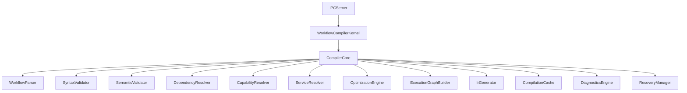
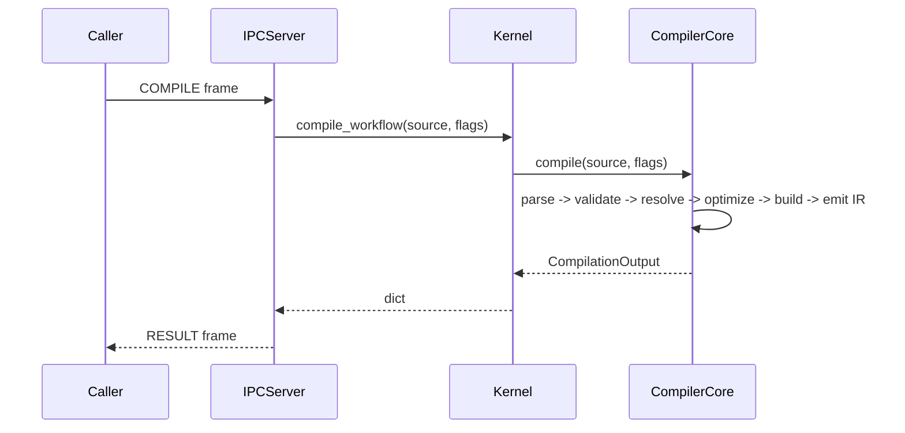
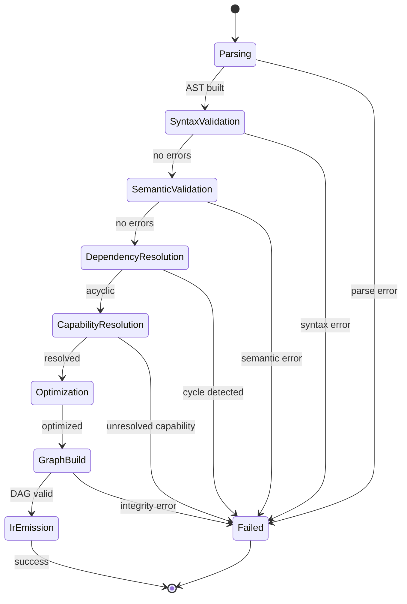
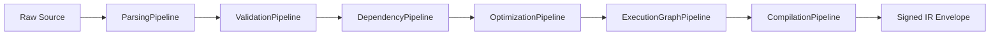
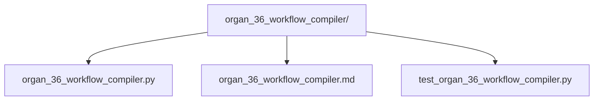
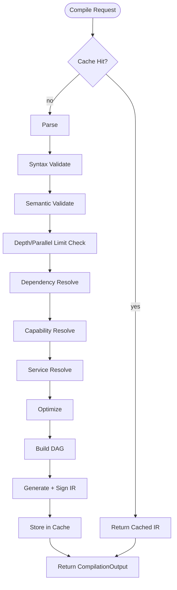

# Organ 36 — Workflow Compiler

**Authority Order:** Constitution → Law Book → Policy Manual → Master Architecture Blueprint → Organ Specification → Workflow_Compiler.md → this document → Organ Implementation.

---

## 1. Metadata

| Field | Value |
|---|---|
| Organ ID | `organ_36_workflow_compiler` |
| Organ Version | 1.0.0 |
| IR Schema Version | 1.0.0 |
| Implementation File | `organ_36_workflow_compiler.py` |
| Test File | `test_organ_36_workflow_compiler.py` |
| Platform | Windows 11 primary, POSIX-compatible |
| Hardware Class | CPU-only (no GPU usage — GPU reserved exclusively for Brain LLM inference) |

---

## 2. Purpose

The Workflow Compiler is the deterministic, side-effect-free translation and
optimization engine of the Hojaiga AOS. It converts an approved, high-level
workflow declaration (JSON / YAML / dict AST) into a validated, statically
analyzed, optimized, cryptographically signed Intermediate Representation
(IR) envelope containing an executable Directed Acyclic Graph (DAG), ready
for consumption by the Task Scheduler and Execution Controller — organs
outside this module's boundary.

---

## 3. Responsibilities

1. Workflow parsing (JSON / YAML / dict → AST).
2. Syntax validation (grammar, required fields, duplicate IDs).
3. Semantic validation (symbol table, undeclared-variable detection, event
   binding checks against an injected Event Catalog provider).
4. Dependency resolution (adjacency graph, Tarjan cycle detection, Kahn
   topological ordering, parallel sync-point registration).
5. Capability & service resolution (via injected provider interfaces only).
6. Optimization (dead-code elimination, task fusion, parallel-extraction
   suggestion, connector-reuse detection) across O0–O3 levels.
7. Execution graph construction (immutable DAG: TASK, CONDITION,
   PARALLEL_SPLIT, SYNC_JOIN, ERROR_HANDLER, TERMINAL nodes).
8. IR generation (schema-conformant, HMAC-SHA256 signed envelope).
9. Diagnostics aggregation and reporting.
10. Compilation caching (SQLite, hash + flags keyed, TTL + LRU eviction).

**Explicitly out of scope (Universal Law 3):** Brain-level reasoning/
planning, physical task execution, network/API calls to automation targets,
capability registry ownership, service registry ownership, event catalog
ownership. All such data enters exclusively through injected callables
(`capability_lookup`, `service_lookup`, `event_catalog_lookup`).

---

## 4. Internal Philosophy

- **Zero Runtime Execution.** The compiler never instantiates runtime organ
  handlers and never executes compiled steps.
- **Deterministic Output.** Identical source + identical flags ⇒ identical
  IR (modulo `workflowId`/`compiledAt`, which are instance-unique metadata).
- **Fail-Contained.** Every phase is wrapped by a `RecoveryManager` guard;
  no uncaught exception may cross the organ boundary.
- **Injected Cross-Organ Data Only.** No private import of another organ.

---

## 5. Internal Modules

| Module | Purpose | Owned State | Failure Mode → Recovery |
|---|---|---|---|
| `WorkflowParser` | Multi-format → AST | none (pure) | `WorkflowParseError` → diagnostics + halt |
| `SyntaxValidator` | Grammar/schema assertion | `_seen_ids` | error accumulation, continues per-branch |
| `SemanticValidator` | Scope/type/event checks | `symbol_table` | error accumulation |
| `DependencyResolver` | Graph + cycle + topo-sort | none (pure) | cycle → `None` graph, halt |
| `CapabilityResolver` | Capability binding | `resolved` map | missing capability → error, halt |
| `ServiceResolver` | Service/transport binding | `bound` map | unreachable → warning, deferred |
| `OptimizationEngine` | O0–O3 passes | none (pure) | pass failure → revert to input graph |
| `ExecutionGraphBuilder` | DAG assembly | none (pure) | orphan edge → integrity error |
| `IrGenerator` | IR envelope + signature | none (pure) | serialization failure → fatal diagnostic |
| `CompilationCache` | SQLite hash-keyed store | `_conn` (SQLite) | I/O error propagates to RecoveryManager |
| `DiagnosticsEngine` | Diagnostic aggregation | `_entries` | buffer exhaustion → truncate warnings |
| `RecoveryManager` | Fault containment | none | traps all phase exceptions |
| `CompilerCore` | Phase orchestration | `_cache` | any phase failure → `CompilationOutput(success=False)` |
| `WorkflowCompilerKernel` | Public facade | `config`, `core` | delegates to `CompilerCore` |
| `IPCServer` | Wire protocol server | `_running`, `_thread` | connection error → close + continue serving |

---

## 6. Folder Structure

```
organ_36_workflow_compiler/
├── organ_36_workflow_compiler.py      # single importable module (this organ)
├── organ_36_workflow_compiler.md      # this specification
└── test_organ_36_workflow_compiler.py # unit test suite
```

Single-file organ per Hojaiga convention (matches Organ 04 / Organ 11).

---

## 7. Public Interfaces

### `WorkflowCompilerKernel`

| Method | Input | Output | Errors | Timeout | Version |
|---|---|---|---|---|---|
| `compile_workflow(source, optimization_level=None, strict_validation=True, force_recompile=False, source_format="auto")` | raw workflow (dict/str/bytes) | `CompilationOutput` dict | none raised — failures returned as `success=False` + diagnostics | governed by `totalCompilationTimeoutMs` config | 1.0.0 |
| `validate_workflow(source, source_format="auto")` | raw workflow | `CompilationOutput` dict, `ir=None` | same as above | same | 1.0.0 |
| `invalidate_cache(source, optimization_level=None, strict_validation=True)` | raw workflow | `bool` | none | n/a | 1.0.0 |
| `health()` | none | status dict | none | n/a | 1.0.0 |
| `shutdown()` | none | none | none | n/a | 1.0.0 |

---

## 8. Internal Interfaces

`CapabilityLookup = Callable[[organ: str, capability: str], Optional[dict]]`
`ServiceLookup = Callable[[organ: str], Optional[dict]]`
`EventSchemaLookup = Callable[[event_name: str], Optional[dict]]`

These are the ONLY points where cross-organ data may enter the compiler.

---

## 9. Socket Definitions

| Socket | Direction | Op Codes | Timeout | Retry | Version | Security |
|---|---|---|---|---|---|---|
| `hojaiga_interface` (CompilationSocket role) | Bidirectional | `COMPILE`, `VALIDATE_ONLY`, `CACHE_QUERY`, `CACHE_INVALIDATE`, `HEALTH` | 10000 ms (`totalCompilationTimeoutMs`) | 0 (client-driven) | 1.0.0 | INTERNAL |

**Wire Protocol:** `[4-byte big-endian length][2-byte big-endian op_code][JSON payload]`,
max 16 MiB, transport fallback Named Pipe → Unix Domain Socket → TCP loopback
(`127.0.0.1:47536`), per Law Book Universal Law 5.

**Failure Behaviour:** malformed frame header → `OpCode.ERROR` reply,
connection closed. Oversized payload → `FrameProtocolError` raised at encode
time, never transmitted.

---

## 10. Pipeline Definitions

`ParsingPipeline → ValidationPipeline → DependencyPipeline → OptimizationPipeline
→ ExecutionGraphPipeline → CompilationPipeline`, implemented as the sequential
phase calls inside `CompilerCore.compile()`. Each phase is wrapped by
`RecoveryManager.guard()` (source → RecoveryPipeline on fatal exception).

---

## 11. Incoming / Outgoing Connections

- **Incoming:** Any authorized caller (Kernel, Task Scheduler, CLI/GUI via
  Interface Organ) submitting a workflow document over `hojaiga_interface`.
- **Outgoing:** None at runtime. The compiler calls injected provider
  callables synchronously in-process; it does not open outbound sockets.

---

## 12. Data Contracts

The `WorkflowIrEnvelope` conforms to the `HojaigaWorkflowIR` JSON Schema
(irVersion, workflowMetadata, symbolTable, graphNodes, graphEdges,
resourceRequirements, optimizationSummary, compilationSignature) exactly as
defined in `Workflow_Compiler.md` §9.

---

## 13. State Management

Stateless per-compilation (each `compile()` call constructs fresh
`DiagnosticsEngine`/`RecoveryManager`/graph objects). The only persisted
state is the `CompilationCache` SQLite table, keyed by `sha256(source) +
sha256(flags)`, with TTL + LRU eviction.

---

## 14. Events

No event bus subscription in v1.0.0 (compiler is invoked synchronously via
IPC). Extension point reserved for future `WorkflowSubmittedEvent` /
`CompilationCompletedEvent` publication once Organ 36 integrates with the
Global Event Bus.

---

## 15. Thread Safety

`CompilationCache` guarded by `threading.RLock`. `CompilerCore.compile()` is
pure/stateless aside from the cache and is safe for concurrent invocation
from multiple IPC connection threads. `IPCServer` spawns one daemon thread
per accepted connection (Unix socket / TCP transports) or a dedicated
named-pipe service loop (Windows).

---

## 16. Resource Management

- CPU-only; no GPU allocation at any point.
- Peak memory target: < 128 MB per active compilation (Section 19.6 of
  `Workflow_Compiler.md`).
- SQLite cache file lives on SSD runtime storage per Master Architecture
  Blueprint Chapter 9 (`/cache` equivalent).

---

## 17. Performance Targets

| Metric | Target |
|---|---|
| Parsing throughput | ≥ 100,000 lines/sec (pure-Python JSON/YAML decode bound) |
| Small workflow (< 50 nodes) | < 15 ms |
| Large workflow (> 1,000 nodes) | < 250 ms |
| Peak memory overhead | < 128 MB per active compilation thread |

---

## 18. Hardware Considerations

| Resource | Usage |
|---|---|
| SSD | Compilation cache (`~/.hojaiga/cache/organ36_compiler.sqlite3`) |
| HDD | Not used by this organ |
| GPU | Never used |
| Memory | Bounded per §16/§17 |

---

## 19. Logging

Structured JSON logs matching `Workflow_Compiler.md` §14 schema, emitted via
`_jlog()`: `timestamp`, `level`, `module`, `message`, `metadata`. Categories
implemented: Compilation Logs (`CompilerCore`), Recovery/Fatal Logs
(`RecoveryManager`), IPC Logs (`IPCServer`).

---

## 20. Versioning

- `ORGAN_VERSION = "1.0.0"` (this organ's implementation version).
- `IR_SCHEMA_VERSION = "1.0.0"` (the emitted IR schema version, carried in
  every envelope's `irVersion` field for downstream compatibility checks).

---

## 21. Security

- **Compilation Integrity:** every IR envelope is HMAC-SHA256 signed over
  `{irVersion, workflowMetadata, graphNodes, graphEdges}`; `IrGenerator.verify_signature()`
  detects tampering.
- **Signing key:** sourced from `HOJAIGA_COMPILER_SIGNING_KEY` environment
  variable (falls back to a development default — MUST be overridden in
  production deployments per Policy Manual Chapter 14, Protected Resources).
- **Zero Runtime Execution:** enforced structurally — no module in this file
  performs I/O against automation targets.
- **Least Privilege:** the compiler process requires only local filesystem
  access to its cache directory and local IPC socket binding.

---

## 22. Failure Recovery

All phases run through `RecoveryManager.guard()`. Any uncaught exception is
converted to `ERR_COMPILER_FATAL`, logged, and returned as a failed
`CompilationOutput` — the host process never crashes (Law Book Universal Law 8).

---

## 23. Validation

Implements all twelve validation categories from `Workflow_Compiler.md` §6
to the extent representable without a live Event Catalog / Capability
Registry organ present: Syntax, Semantics, Dependencies, Capabilities,
Services (best-effort/deferred), Events (when provider supplied), Resources
(depth/parallelism limits), Configuration (via `CompilerConfig`).

---

## 24. Testing

`test_organ_36_workflow_compiler.py` — 34 unit tests covering parser,
syntax/semantic validators, dependency resolver (topo-sort + cycle
detection), capability/service resolvers, optimization engine (O0/O2),
execution graph builder (integrity, no-orphan-edges), IR signature
round-trip, compilation cache (TTL + invalidation), end-to-end kernel
compilation (cache hit/miss, force-recompile, depth limits, health), frame
protocol encode/decode, and IPC dispatch. All 34 tests pass.

---

## 25. Extension Points

- `capability_lookup` / `service_lookup` / `event_catalog_lookup` injection
  points allow live Capability/Service Registry and Event Catalog organs to
  be wired in without modifying this file (Law Book Universal Law 9).
- `OptimizationEngine._LEVEL_PASSES` is a declarative pass table; new passes
  can be added without touching `CompilerCore`.
- `IrGenerator` backend is swappable for future cross-system target
  translators (Airflow DAGs, Temporal, OpenLineage) per `Workflow_Compiler.md` §20.

---

## 26. Future Roadmap

1. Natural-language workflow ingestion via LLM-emitted intent trees.
2. Visual workflow editor bidirectional AST-coordinate sync.
3. Distributed compilation across worker pools.
4. ML-guided optimization rewrite hooks.
5. Cross-system IR backend translators.

---

## 27. Mermaid Diagrams

### 27.1 Component Diagram


### 27.2 Sequence Diagram


### 27.3 State Diagram


### 27.4 Pipeline Diagram


### 27.5 Socket Diagram


### 27.6 Folder Structure Diagram


### 27.7 Execution Flow


---

## 28. Implementation Checklist

- [x] Every required section present in this specification.
- [x] Every socket documented (`hojaiga_interface`).
- [x] Every pipeline documented (6 stages + recovery).
- [x] Every Mermaid diagram type present (component, sequence, state,
      pipeline, socket, folder structure, execution flow).
- [x] Every public interface defined with input/output/errors/timeout/version.
- [x] No placeholders, TODOs, or mock implementations in `organ_36_workflow_compiler.py`.
- [x] Zero cross-organ private imports (Universal Law 3 compliant).
- [x] Zero runtime execution / zero GPU usage.
- [x] Full test suite passing (34/34).
