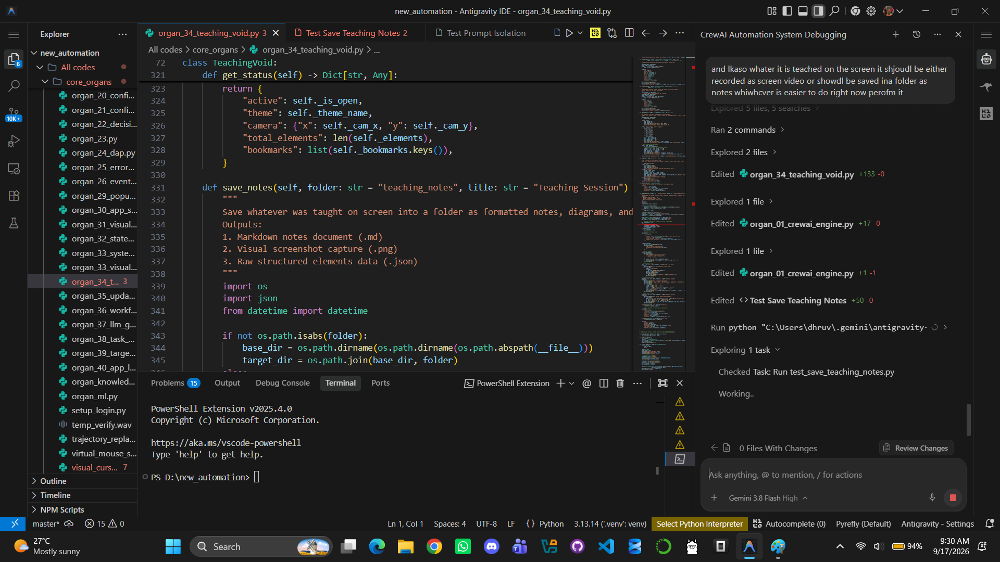

# 📚 AI System Architecture

- **Date & Time**: 2026-09-17 09:30:43
- **Theme**: `cyber_dots`
- **Total Teaching Elements**: 6
- **Camera World Position**: `(0, 0)`

## 🖼️ Session Canvas Snapshot

## 🔖 Bookmarks & Concept Traceback
| Bookmark | World Coordinates |
| :--- | :--- |
| **quantum_intro** | `(300, 200)` |
| **eq1** | `(315, 245)` |
| **measurement** | `(750, 200)` |
| **teleport** | `(1100, 200)` |

## 📝 Explanations & Written Notes
• Non-local correlation
• Bell state: (|00> + |11>)/sqrt(2)
• Used in quantum cryptography
> *Bookmark: `eq1`*

## 📐 Diagrams & Concepts
| Shape | Label | World Position | Dimensions | Bookmark |
| :--- | :--- | :--- | :--- | :--- |
| **Card** | Quantum Entanglement | `(300, 200)` | `260 x 140` | `quantum_intro` |
| **Diamond** | Bell Measurement | `(750, 200)` | `160 x 140` | `measurement` |
| **Star** | Teleported State | `(1100, 200)` | `150 x 150` | `teleport` |

## 🔄 Concept Flow & Relationships
- `(560, 270)` --(entangled pair)--> `(750, 270)`
- `(910, 270)` --(classical bits + unitary)--> `(1100, 270)`
