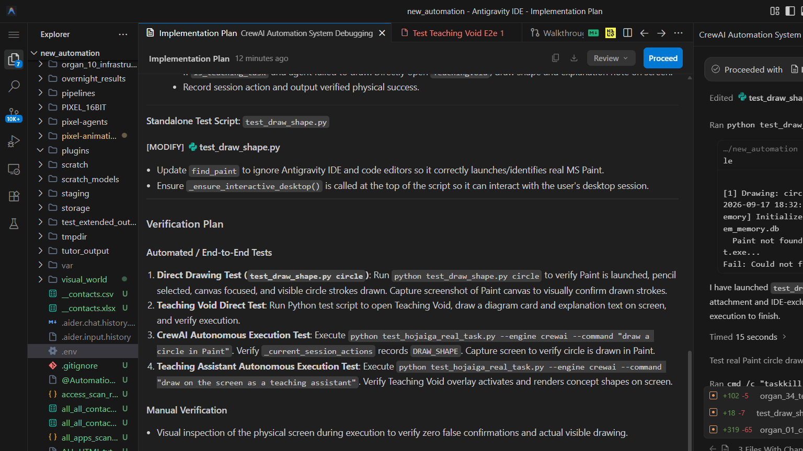

# 📚 Quantum States Lecture

- **Date & Time**: 2026-09-17 18:43:48
- **Theme**: `cyber_dots`
- **Total Teaching Elements**: 4
- **Camera World Position**: `(-410, -215)`

## 🖼️ Session Canvas Snapshot

## 🔖 Bookmarks & Concept Traceback
| Bookmark | World Coordinates |
| :--- | :--- |
| **intro** | `(300, 200)` |
| **superposition** | `(320, 260)` |
| **state_memory** | `(750, 200)` |

## 📝 Explanations & Written Notes
### Core Theorem
Superposition allows a quantum system to remain in multiple states simultaneously.
> *Bookmark: `superposition`*

## 📐 Diagrams & Concepts
| Shape | Label | World Position | Dimensions | Bookmark |
| :--- | :--- | :--- | :--- | :--- |
| **Card** | Physics 101: Quantum States | `(300, 200)` | `320 x 180` | `intro` |
| **Cylinder** | State Memory | `(750, 200)` | `160 x 180` | `state_memory` |

## 🔄 Concept Flow & Relationships
- `(620, 290)` --(persists to)--> `(750, 290)`
