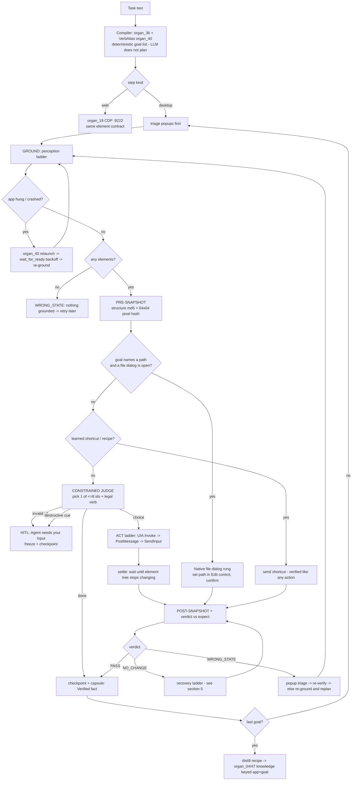
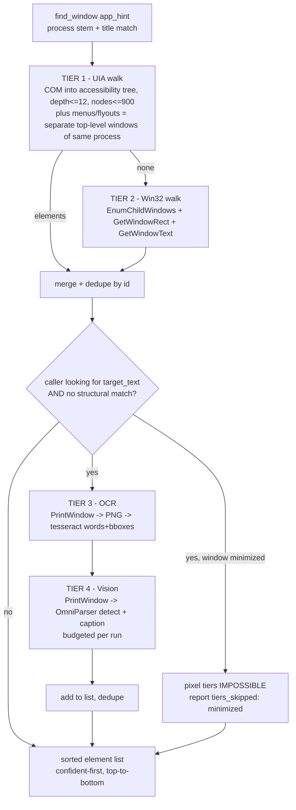
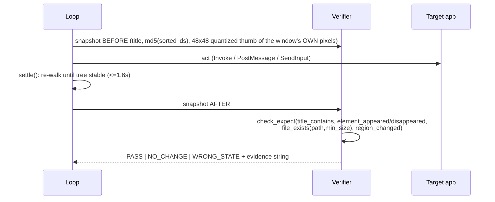
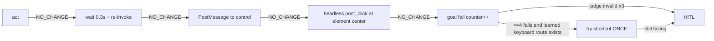
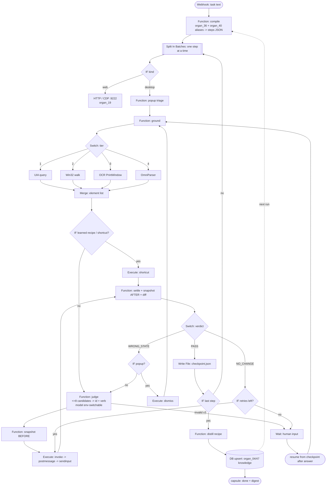
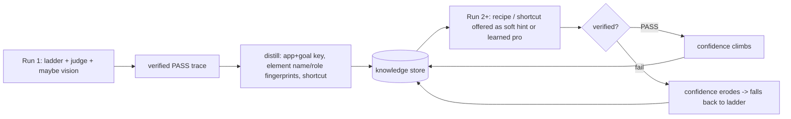

# Perception & Autonomy — How It Should Physically Work

Source of truth for the code: `All codes/core_organs/desktop_grounding.py`
(`DesktopGrounding.ground`, `DesktopVerifier`, `ConstrainedJudge`, `DesktopAutonomyLoop.step/run`).
Markers: ✅ = present in code, 🟡 = coded but unmeasured / never run end-to-end, ⬜ = designed only.

---

## 1. The one idea

> **Nothing is ever believed. Every action is followed by a measurement of the screen, and only the measurement decides success.**

Perception = "turn a window into one flat list of elements, using the cheapest real signal that works".
Self-healing = "if the measurement disagrees with the expectation, climb a ladder; if the ladder is exhausted, stop safely and ask a human once".

Every tier returns the **same contract**, so the judge/actor never know where an element came from:

```
GroundedElement { id, name, role, bbox(l,t,r,b), hwnd, tier, confidence }
```

---

## 2. Master loop (one goal, one app)



---

## 3. Perception: what physically happens



| Tier | Mechanism | Pixels? | Typical use | Cost |
|---|---|---|---|---|
| 1 UIA | COM accessibility tree | no | Office, Explorer, Settings, Chrome chrome | ms |
| 2 Win32 | child-window enumeration | no | legacy / owner-drawn controls | ms |
| 3 OCR | PrintWindow → tesseract | **yes** | custom-drawn text, sparse UIA | sub-second to seconds |
| 4 Vision | PrintWindow → OmniParser | **yes** | canvases: Blender, games, GL | seconds on CPU |

Rules that make it honest:
- Escalation happens **only** when a specific `target_text` is wanted and tiers 1–2 miss it.
- `report.tiers_ran` / `tiers_skipped` / `tier_ms` are always returned. A tier that did not run is **reported as skipped**, never silently assumed.
- Minimized windows cannot be rendered → pixel tiers are skipped with a reason.
- `PrintWindow` captures the window even if covered, so perception does not need to steal focus. ⬜ verify per-app (some GPU apps return black).

---

## 4. Verification (the trust core)



Why two signatures: the UIA tree does not change when you extrude a face in Blender — **only pixels do**. Structure catches dialogs/menus; the pixel hash catches canvases.

Pixel delta is tolerance-based, not exact-byte (`REGION_MIN_CHANGED_FRACTION = 0.02`): the window is captured with PrintWindow (so an occluding window cannot be hashed by mistake), reduced to 48x48 grayscale, quantized into 16 brightness bands, and a change counts only when >= 2% of cells moved. Measured on a controlled Tk canvas (`benchmarks/region_hash_hardening.py` -> `grounding_reports/region_hash_hardening.json`): idle 0.000, caret-sized flicker 0.001 (ignored), canvas recolor 0.140 (detected, structure signature identical), fully-occluded window 0.000 while the old screen-grab path on the same moment reported 0.969. The measured fraction always appears in the evidence string, so a suppressed small change stays visible — the trade-off is that a genuinely tiny canvas edit reads as NO_CHANGE and walks the ladder instead of falsely passing.

| Verdict | Meaning | Reaction |
|---|---|---|
| PASS | after-state matches postcondition (default: signature moved) | checkpoint, reinforce knowledge, next goal |
| NO_CHANGE | app never reacted | climb recovery ladder, never repeat same rung |
| WRONG_STATE | UI changed but not as expected | popup triage → re-ground → replan |

---

## 5. Self-healing

### 5a. Recovery ladder for NO_CHANGE (in code, in this order)

- ✅ invoke → retry-invoke → postmessage → post_click, then the keyboard-shortcut recovery rung.
- ⬜ A final **vision-click** rung (tier-4 coordinates) is not yet a rung.
- Every rung is **re-verified**; an unverified guess never counts as success.

### 5b. Failure classes and what heals them

```mermaid
flowchart TD
    X[Something went wrong] --> C1{what}
    C1 -->|popup / installer wizard| P1[popup triage: known-safe Next/OK/Allow auto-dismiss]
    C1 -->|UAC / elevation / payment / delete| P2[NEVER auto-accept -> HITL]
    C1 -->|app not responding| P3[kill + relaunch via organ_40 -> wait_for_ready -> resume from checkpoint]
    C1 -->|splash / still loading| P4[backoff wait until window exists and element list is stable]
    C1 -->|LLM judge garbage| P5[re-ask once; 3 strikes -> HITL]
    C1 -->|file Open/Save dialog| P6[NativeFileDialog: set path in Edit, confirm, handle overwrite prompt]
    C1 -->|stale UI (menu not populated yet)| P7[_settle before verify]
    C1 -->|login wall web| P8[HITL -> cookie extract -> seed]
    P1 --> back[re-ground and continue]
    P3 --> back
    P4 --> back
    P5 --> back
    P6 --> back
    P7 --> back
    P2 --> stop[freeze + checkpoint + capsule: Agent needs your input]
    P8 --> stop
```

The **3-strike rule** converts unbounded LLM flailing into a bounded, resumable stop: state is checkpointed, a human answers once, and the answer is learned.

---

## 6. n8n-style operator view



---

## 7. Learning loop (why it scales to "any app")


Learned knowledge only ever **nudges** the judge or sends a shortcut that is still verified. A stale recipe cannot cause a silent wrong action — it fails verification and the ladder takes over.

---

## 8. Scenario matrix

| # | Scenario | Detected by | Path | Fallback |
|---|---|---|---|---|
| 1 | Standard UI (Settings, Office, Explorer) | tier 1 finds named target | UIA Invoke | tier 2 rect click |
| 2 | Canvas/GL app (Blender, games) | few UIA nodes, target not found | tier 3→4 on PrintWindow; pixel-hash verify | HITL |
| 3 | UIA-sparse custom-drawn app | structural miss on target_text | OCR pseudo-elements | tier 4 |
| 4 | Modal popup / installer wizard | popup triage / WRONG_STATE | auto-dismiss known-safe buttons | HITL |
| 5 | UAC / permission shield | secure desktop / #32770 elevation cue | never auto-accepted | HITL + checkpoint |
| 6 | Native Open/Save dialog | file-dialog title + path in goal | set path in Edit control, confirm | click by label |
| 7 | App crash / Not Responding | `is_app_crashed_or_hung` | relaunch (organ_40) → wait_for_ready → re-ground | HITL |
| 8 | Splash / slow load | element list not yet stable | settle / backoff | HITL |
| 9 | Foreign cursor clip | SendInput ineffective | Invoke / PostMessage first (no cursor needed) | vision-click ⬜ |
| 10 | Multiple windows of one app | multiple find_window matches | pick by process + title; popups grounded as extra windows | explicit hwnd |
| 11 | Destructive verb/element | DESTRUCTIVE_CUES in name | needs `allow_destructive`, else HITL | audit log |
| 12 | Hours-long run | checkpoint per step | resume_session: relaunch → replay → re-ground | ladder |
| 13 | Login wall (web) | login-page detector | HITL → cookie seed | isolated profile |
| 14 | Web + desktop mixed | compiler emits mixed steps | browser reused on 9222 | direct launch |
| 15 | Judge returns garbage | id outside candidates | re-ask → 3-strike HITL | stronger judge model |
| 16 | Window minimized | window_state | pixel tiers skipped + reported | restore window |
| 17 | Menu not yet populated | tree still changing | `_settle` before verify | retry |
| 18 | Overwrite / replace confirm | `_is_overwrite_confirm` | handled in file-dialog rung | HITL if destructive |
| 19 | VS Code (and any title containing "visual studio") | `find_window` title blacklist (line ~261) | **cannot be grounded**: returns None for every hint (`Visual Studio Code`, `Code`, `vscode`) | none today. Blacklist exists so the agent never targets its own IDE; needs a process-aware exception |
| 20 | Electron/Chromium app with accessibility off (Claude desktop app) | UIA returns 9 nodes for a full chat window | forced OCR (390 words) + vision (161 boxes) | see section 10 |

---

## 9. Status ledger (from code, not from memory)

✅ In code: UIA + Win32 tiers, popup-window grounding, OCR + vision gating with honest `tiers_skipped`, verifier with structural + pixel signatures, constrained judge with 3-strike HITL, destructive guard, native file dialog rung, shortcut/pro path, NO_CHANGE ladder (re-invoke → PostMessage → post_click), WRONG_STATE popup triage, crash relaunch, `_settle`, checkpoint + `resume_session`, `distill_recipe`/`recall_recipe`.

🟡 Installed and now measured (see section 10): `pytesseract`, `torch`, `easyocr`, `uiautomation`, `comtypes` are present in `hojaiga_env` — note the interpreter matters: `.venv` has no PIL, `hojaiga_env\Scripts\python.exe` does. Accuracy of OCR/vision element boxes is still unmeasured; only latency and counts are.

⬜ Not yet: vision-click recovery rung; end-to-end unattended completion of a long task (e.g. the Blender chair) — this remains the real definition of done; recipe retrieval quality on multi-step traces is unmeasured.

**Next honest step (done 2026-10-04, see section 10):** run `ground()` on 5 real apps (Settings, Notepad, Chrome, Blender, a Qt/Electron app), save the `ladder_report` JSON for each, and replace expectations in section 3 with measured numbers.


---

## 10. Measured results (5-app grounding benchmark, 2026-10-04)

Source: `benchmarks/run_grounding_benchmark.py` -> `benchmarks/grounding_reports/*.json` (one file per app, full `ladder_report` inside). CPU-only machine. Each app: plain `ground()` (max_tier 2), then forced escalation (`target_text` that cannot exist, max_tier 4). Every number below is copied from those files.

| App | UIA ms | UIA elems | OCR ms | OCR words | Vision s | Vision boxes | PrintWindow black? |
|---|---|---|---|---|---|---|---|
| Notepad | 188 | 29 | 505 | 11 | 62.0 | 30 | no |
| Settings | 1618 | 47 | 1897 | 123 | 105.1 | 69 | no |
| Chrome | 1297 | 142 | 1691 | 181 | 213.7 | 126 | no |
| Paint (canvas stand-in) | 568 | 127 | 739 | 16 | 278.4 | 101 | no |
| Claude desktop (Electron) | 312 | **9** | 3669 | 390 | 409.7 | 161 | no |
| VS Code | not groundable (scenario 19) | | | | | | |

Confidence by tier (min / mean): UIA 0.55 / 0.82-0.89, OCR 0.61-0.64 / 0.88-0.94, vision fixed at 0.35.
`tiers_skipped` was empty in all forced runs (nothing was gated off once vision had warmed up). Before warmup the report correctly said `vision:warming-up`.

What this changes:
1. **The old tier cost estimates were wrong.** UIA is 0.2 to 1.6 s on real windows, not 5 to 40 ms. OCR is 0.5 to 3.7 s. **Vision is 62 to 410 s per pass on CPU**, not 1.5 to 4 s. The detector itself takes about 1.3 s; the captioning/parsing stage is the cost. Vision is therefore a one-time learning cost, never a per-step perception tier, unless it moves to GPU or the captioner is trimmed.
2. **The Electron case is real.** The Claude desktop window yields 9 UIA nodes but 390 OCR words, so the ladder must escalate there. OCR (3.7 s) is the practical tier for such apps; vision added boxes without names.
3. **No PrintWindow black frames** on any of the five apps (stdev 5.8 to 106). The Electron black-frame risk did not materialize for this app.
4. **Vision-click rung: decision data.** Structural clicks were not exercised here (this benchmark measures perception only), so there is still no evidence either way. Given 60 to 410 s vision cost, a vision-click rung would be viable only as a rare last resort. Keep it unbuilt until an unattended task actually needs it.

### Blender pre-test (scoped)
- **Blender is not installed** on this machine (no `blender.exe` found on C: or D: to depth 5). The Blender-specific checks are NOT done.
- Stand-in 1, Paint (`canvas_hash_pretest.json`): posted clicks never drew, the pixel hash did not change. **Inconclusive**: shows PostMessage input does not reach Paint's XAML canvas, not that the hash fails.
- Stand-in 2, controlled Tk canvas (`canvas_hash_controlled.json`): recoloring one canvas rectangle changed the pixel hash while the structure signature stayed identical; with no change, neither moved. **The verifier mechanism works for canvas-only changes.**
- Caveats found in code — **now fixed and tested**: `_region_hash` used `ImageGrab` (screen capture, not PrintWindow), so a window covered by another window hashed the occluder; and it hashed the exact bytes of a 64x64 image, so any one-pixel flicker (blinking caret, clock) read as a change. The verifier now captures via `headless_input.capture_window` (PrintWindow), compares a 48x48 banded thumbnail with a 2%-of-cells tolerance, tags the capture source in every Snapshot, and puts the measured fraction into the evidence. Regression evidence: `benchmarks/region_hash_hardening.py` (4 cases, all as expected) and `test_v1_verifier_verdict_logic` still 7/7. Screen grab remains only as a tagged fallback when PrintWindow yields nothing; minimized windows report `window-minimized` instead of hashing noise.

### Decisions taken with this data
- **Blender is deferred, not failed.** Skipping the Blender install was an explicit choice: the mechanism question (does the pixel verifier see canvas-only change?) was already answered on a controlled canvas, and a canvas-category gap remains honestly open until a real GL app is grounded.
- **Vision-click recovery rung stays unbuilt** until an unattended run actually needs it.

### Still open
- Fix scenario 19 (VS Code groundability) before using it as the Electron case.
- Medium multi-step unattended run, with its full ground -> act -> verdict trace.
- Canvas-category grounding on a real GL/canvas app (Blender or another installed canvas app) — evidence so far is a Tk stand-in only.
