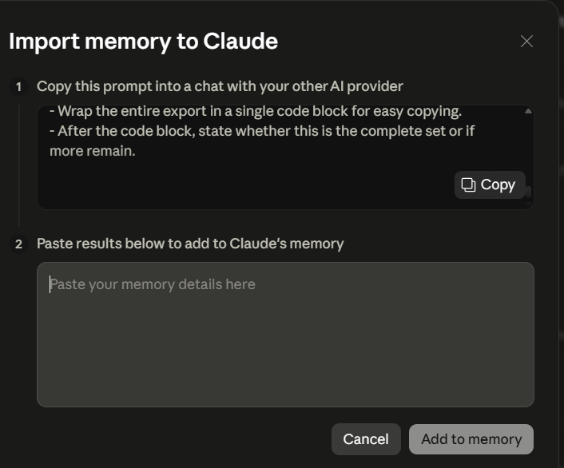

# **Prompt 1 — Brain**

Read EVERY attached document completely BEFORE writing anything.

Authority order:  
1\. Constitution.md  
2\. LawBook.md  
3\. PolicyManual.md  
4\. MasterArchitectureBlueprint.md  
5\. Organ\_Specification.md  
6\. Legacy\_Code\_Migration\_Guide.md  
7\. Upper Surface Diagram + Workflow
8\. Inner Depth Diagram + Workflow   
9\. Organ\_01\_Brain.md

Do NOT skip any document.

Understand the complete architecture before acting.

WE ARE NOW BUILDING THE ACTUAL NEW PYTHON IMPLEMENTATION FROM SCRATCH. Create a newly named Python file according to the architecture and organ specification. Use the previous automation/legacy files ONLY as reference for useful coding paradigms, techniques and implementations. DO NOT copy its architecture or let it change the logic defined by the attached .md files. The .md files remain the source of truth; legacy code is only for reference and ideas where the new specification does not fully define an implementation approach.

After creating the complete new Python code, add a large structured diagram at the bottom based on the actual code you created. Also include a large structured pre-code diagram showing how the organ is supposed to work according to the .md files before coding. Both diagrams must include all important and minor components, workflows, loops, sockets, pipelines, connections, dependencies and internal processes defined by the specifications, so the intended workflow and the actual implementation workflow can be clearly understood.

COMPILE ALL THE .PY CODES IN ONE SINGLE FILE SO THAT I CAN DIRECTLY IMMPORT ONE SINGLE FILE AND GET IT WORK.

Mine the legacy project for reusable implementations but DO NOT copy its architecture.

Output ONLY the final completed Organ\_01\_Brain.md.

No introductions.  
No acknowledgements.  
No summaries.  
No explanations.  
No conversational text.  
No markdown outside the requested document.

Generate the document directly as production-ready architecture.

STRICT OUTPUT MODE

Read ALL attached files completely before generating any output.

Do not ask questions.  
Do not explain your reasoning.  
Do not summarize.  
Do not acknowledge the prompt.  
Do not describe your plan.  
Do not produce conversational text.

Assume the attached documents are authoritative.

Generate the requested markdown document directly.

If information is missing, infer it only when consistent with the attached architecture and clearly label inferred sections if necessary.

Maximize engineering quality while minimizing output unrelated to the requested document.

 
---

# **Prompt 2 — CNS**

Read every attached document completely before acting.

Use the authority order exactly as provided.

Understand Brain, Memory and all system interactions before writing.

Generate ONLY Organ\_02\_CNS.md.

Authority order:  
1\. Constitution.md  
2\. LawBook.md  
3\. PolicyManual.md  
4\. MasterArchitectureBlueprint.md  
5\. Organ\_Specification.md  
6\. Legacy\_Code\_Migration\_Guide.md  
7\. Upper Surface Diagram + Workflow
8\. Inner Depth Diagram + Workflow   
9\. Organ\_02\_CNS.md

Document:  
\- Event Bus  
\- Session Bus  
\- Socket Manager  
\- Pipeline Manager  
\- Scheduler  
\- Router  
\- Synchronization  
\- Heartbeat  
\- Communication Contracts

Return ONLY the completed markdown.

No conversation.  
No explanations.  
No summaries.

WE ARE NOW BUILDING THE ACTUAL NEW PYTHON IMPLEMENTATION FROM SCRATCH. Create a newly named Python file according to the architecture and organ specification. Use the previous automation/legacy files ONLY as reference for useful coding paradigms, techniques and implementations. DO NOT copy its architecture or let it change the logic defined by the attached .md files. The .md files remain the source of truth; legacy code is only for reference and ideas where the new specification does not fully define an implementation approach.

After creating the complete new Python code, add a large structured diagram at the bottom based on the actual code you created. Also include a large structured pre-code diagram showing how the organ is supposed to work according to the .md files before coding. Both diagrams must include all important and minor components, workflows, loops, sockets, pipelines, connections, dependencies and internal processes defined by the specifications, so the intended workflow and the actual implementation workflow can be clearly understood.

COMPILE ALL THE .PY CODES IN ONE SINGLE FILE SO THAT I CAN DIRECTLY IMMPORT ONE SINGLE FILE AND GET IT WORK.

STRICT OUTPUT MODE

Read ALL attached files completely before generating any output.

Do not ask questions.  
Do not explain your reasoning.  
Do not summarize.  
Do not acknowledge the prompt.  
Do not describe your plan.  
Do not produce conversational text.

Assume the attached documents are authoritative.

Generate the requested markdown document directly.

If information is missing, infer it only when consistent with the attached architecture and clearly label inferred sections if necessary.

Maximize engineering quality while minimizing output unrelated to the requested document.  
---

# **Prompt 3 — Memory**

Read all attached documents completely before acting.

Authority order:  
1\. Constitution.md  
2\. LawBook.md  
3\. PolicyManual.md  
4\. MasterArchitectureBlueprint.md  
5\. Organ\_Specification.md  
6\. Legacy\_Code\_Migration\_Guide.md  
7\. Upper Surface Diagram + Workflow
8\. Inner Depth Diagram + Workflow   
9\. Organ\_03\_Memory.md

Generate ONLY Organ\_03\_Memory.md.

Include:  
Working Memory  
Session Memory  
Long-Term Memory  
Shared Memory  
Rooms  
Snapshots  
History  
Cache  
Persistence  
Compression  
Recovery

WE ARE NOW BUILDING THE ACTUAL NEW PYTHON IMPLEMENTATION FROM SCRATCH. Create a newly named Python file according to the architecture and organ specification. Use the previous automation/legacy files ONLY as reference for useful coding paradigms, techniques and implementations. DO NOT copy its architecture or let it change the logic defined by the attached .md files. The .md files remain the source of truth; legacy code is only for reference and ideas where the new specification does not fully define an implementation approach.

After creating the complete new Python code, add a large structured diagram at the bottom based on the actual code you created. Also include a large structured pre-code diagram showing how the organ is supposed to work according to the .md files before coding. Both diagrams must include all important and minor components, workflows, loops, sockets, pipelines, connections, dependencies and internal processes defined by the specifications, so the intended workflow and the actual implementation workflow can be clearly understood.

COMPILE ALL THE .PY CODES IN ONE SINGLE FILE SO THAT I CAN DIRECTLY IMMPORT ONE SINGLE FILE AND GET IT WORK.

Return only the markdown document.

No conversational output.

STRICT OUTPUT MODE

Read ALL attached files completely before generating any output.

Do not ask questions.  
Do not explain your reasoning.  
Do not summarize.  
Do not acknowledge the prompt.  
Do not describe your plan.  
Do not produce conversational text.

Assume the attached documents are authoritative.

Generate the requested markdown document directly.

If information is missing, infer it only when consistent with the attached architecture and clearly label inferred sections if necessary.

Maximize engineering quality while minimizing output unrelated to the requested document.  
---

# **Prompt 4 — Knowledge**

Read all attached documents first.

Authority order:  
1\. Constitution.md  
2\. LawBook.md  
3\. PolicyManual.md  
4\. MasterArchitectureBlueprint.md  
5\. Organ\_Specification.md  
6\. Legacy\_Code\_Migration\_Guide.md  
7\. Upper Surface Diagram + Workflow
8\. Inner Depth Diagram + Workflow   
9\. Organ\_04\_Knowledge.md

Generate ONLY Organ\_04\_Knowledge.md.

Include:  
Knowledge Base  
RAG  
Indexing  
Documents  
Search  
Embeddings  
Versioning  
Knowledge Update Flow

WE ARE NOW BUILDING THE ACTUAL NEW PYTHON IMPLEMENTATION FROM SCRATCH. Create a newly named Python file according to the architecture and organ specification. Use the previous automation/legacy files ONLY as reference for useful coding paradigms, techniques and implementations. DO NOT copy its architecture or let it change the logic defined by the attached .md files. The .md files remain the source of truth; legacy code is only for reference and ideas where the new specification does not fully define an implementation approach.

After creating the complete new Python code, add a large structured diagram at the bottom based on the actual code you created. Also include a large structured pre-code diagram showing how the organ is supposed to work according to the .md files before coding. Both diagrams must include all important and minor components, workflows, loops, sockets, pipelines, connections, dependencies and internal processes defined by the specifications, so the intended workflow and the actual implementation workflow can be clearly understood.

COMPILE ALL THE .PY CODES IN ONE SINGLE FILE SO THAT I CAN DIRECTLY IMMPORT ONE SINGLE FILE AND GET IT WORK.

Return only the final markdown.

No explanations.

STRICT OUTPUT MODE

Read ALL attached files completely before generating any output.

Do not ask questions.  
Do not explain your reasoning.  
Do not summarize.  
Do not acknowledge the prompt.  
Do not describe your plan.  
Do not produce conversational text.

Assume the attached documents are authoritative.

Generate the requested markdown document directly.

If information is missing, infer it only when consistent with the attached architecture and clearly label inferred sections if necessary.

Maximize engineering quality while minimizing output unrelated to the requested document.  
---

# **Prompt 5 — Controllers**

Read every attached file before writing.

Authority order:  
1\. Constitution.md  
2\. LawBook.md  
3\. PolicyManual.md  
4\. MasterArchitectureBlueprint.md  
5\. Organ\_Specification.md  
6\. Legacy\_Code\_Migration\_Guide.md  
7\. Upper Surface Diagram + Workflow
8\. Inner Depth Diagram + Workflow   
9\. Organ\_05\_Controllers.md

Generate ONLY Organ\_05\_Controllers.md.

Include:  
Domain Controller  
Environment Controller  
Execution Controller  
Scheduling  
Validation  
Decision Coordination  
Task Dispatch

WE ARE NOW BUILDING THE ACTUAL NEW PYTHON IMPLEMENTATION FROM SCRATCH. Create a newly named Python file according to the architecture and organ specification. Use the previous automation/legacy files ONLY as reference for useful coding paradigms, techniques and implementations. DO NOT copy its architecture or let it change the logic defined by the attached .md files. The .md files remain the source of truth; legacy code is only for reference and ideas where the new specification does not fully define an implementation approach.

After creating the complete new Python code, add a large structured diagram at the bottom based on the actual code you created. Also include a large structured pre-code diagram showing how the organ is supposed to work according to the .md files before coding. Both diagrams must include all important and minor components, workflows, loops, sockets, pipelines, connections, dependencies and internal processes defined by the specifications, so the intended workflow and the actual implementation workflow can be clearly understood.

COMPILE ALL THE .PY CODES IN ONE SINGLE FILE SO THAT I CAN DIRECTLY IMMPORT ONE SINGLE FILE AND GET IT WORK.

Return only the markdown.

No conversation.

STRICT OUTPUT MODE

Read ALL attached files completely before generating any output.

Do not ask questions.  
Do not explain your reasoning.  
Do not summarize.  
Do not acknowledge the prompt.  
Do not describe your plan.  
Do not produce conversational text.

WE ARE NOW BUILDING THE ACTUAL NEW PYTHON IMPLEMENTATION FROM SCRATCH. Create a newly named Python file according to the architecture and organ specification. Use the previous automation/legacy files ONLY as reference for useful coding paradigms, techniques and implementations. DO NOT copy its architecture or let it change the logic defined by the attached .md files. The .md files remain the source of truth; legacy code is only for reference and ideas where the new specification does not fully define an implementation approach.

After creating the complete new Python code, add a large structured diagram at the bottom based on the actual code you created. Also include a large structured pre-code diagram showing how the organ is supposed to work according to the .md files before coding. Both diagrams must include all important and minor components, workflows, loops, sockets, pipelines, connections, dependencies and internal processes defined by the specifications, so the intended workflow and the actual implementation workflow can be clearly understood.

COMPILE ALL THE .PY CODES IN ONE SINGLE FILE SO THAT I CAN DIRECTLY IMMPORT ONE SINGLE FILE AND GET IT WORK.

Assume the attached documents are authoritative.

Generate the requested markdown document directly.

If information is missing, infer it only when consistent with the attached architecture and clearly label inferred sections if necessary.

Maximize engineering quality while minimizing output unrelated to the requested document.  
---

# **Prompt 6 — Learning**

Read every attached document first.

Authority order:  
1\. Constitution.md  
2\. LawBook.md  
3\. PolicyManual.md  
4\. MasterArchitectureBlueprint.md  
5\. Organ\_Specification.md  
6\. Legacy\_Code\_Migration\_Guide.md  
7\. Upper Surface Diagram + Workflow
8\. Inner Depth Diagram + Workflow   
9\. Organ\_06\_Learning.md

Generate ONLY Organ\_06\_Learning.md.

Include:  
Learning Loop  
Feedback  
Self-Healing  
Knowledge Improvement  
Brain Improvement  
Failure Learning  
Optimization

WE ARE NOW BUILDING THE ACTUAL NEW PYTHON IMPLEMENTATION FROM SCRATCH. Create a newly named Python file according to the architecture and organ specification. Use the previous automation/legacy files ONLY as reference for useful coding paradigms, techniques and implementations. DO NOT copy its architecture or let it change the logic defined by the attached .md files. The .md files remain the source of truth; legacy code is only for reference and ideas where the new specification does not fully define an implementation approach.

After creating the complete new Python code, add a large structured diagram at the bottom based on the actual code you created. Also include a large structured pre-code diagram showing how the organ is supposed to work according to the .md files before coding. Both diagrams must include all important and minor components, workflows, loops, sockets, pipelines, connections, dependencies and internal processes defined by the specifications, so the intended workflow and the actual implementation workflow can be clearly understood.

COMPILE ALL THE .PY CODES IN ONE SINGLE FILE SO THAT I CAN DIRECTLY IMMPORT ONE SINGLE FILE AND GET IT WORK.

Return only the completed markdown.

No summaries.

STRICT OUTPUT MODE

Read ALL attached files completely before generating any output.

Do not ask questions.  
Do not explain your reasoning.  
Do not summarize.  
Do not acknowledge the prompt.  
Do not describe your plan.  
Do not produce conversational text.

Assume the attached documents are authoritative.

Generate the requested markdown document directly.

If information is missing, infer it only when consistent with the attached architecture and clearly label inferred sections if necessary.

Maximize engineering quality while minimizing output unrelated to the requested document.  
---

# **Prompt 7 — Automation**

Read every attached document before acting.

Authority order:  
1\. Constitution.md  
2\. LawBook.md  
3\. PolicyManual.md  
4\. MasterArchitectureBlueprint.md  
5\. Organ\_Specification.md  
6\. Legacy\_Code\_Migration\_Guide.md  
7\. Upper Surface Diagram + Workflow
8\. Inner Depth Diagram + Workflow   
9\. Organ\_07\_Automation.md

Generate ONLY Organ\_07\_Automation.md.

Include:  
Playwright  
CDP  
GUI Automation  
Browser Manager  
Downloads  
Uploads  
Clipboard  
Window Manager  
Child Windows  
Task Engine  
Retry Logic

WE ARE NOW BUILDING THE ACTUAL NEW PYTHON IMPLEMENTATION FROM SCRATCH. Create a newly named Python file according to the architecture and organ specification. Use the previous automation/legacy files ONLY as reference for useful coding paradigms, techniques and implementations. DO NOT copy its architecture or let it change the logic defined by the attached .md files. The .md files remain the source of truth; legacy code is only for reference and ideas where the new specification does not fully define an implementation approach.

After creating the complete new Python code, add a large structured diagram at the bottom based on the actual code you created. Also include a large structured pre-code diagram showing how the organ is supposed to work according to the .md files before coding. Both diagrams must include all important and minor components, workflows, loops, sockets, pipelines, connections, dependencies and internal processes defined by the specifications, so the intended workflow and the actual implementation workflow can be clearly understood.

COMPILE ALL THE .PY CODES IN ONE SINGLE FILE SO THAT I CAN DIRECTLY IMMPORT ONE SINGLE FILE AND GET IT WORK.

Reuse valuable legacy implementations.

Return only the markdown.

No explanations.

STRICT OUTPUT MODE

Read ALL attached files completely before generating any output.

Do not ask questions.  
Do not explain your reasoning.  
Do not summarize.  
Do not acknowledge the prompt.  
Do not describe your plan.  
Do not produce conversational text.

Assume the attached documents are authoritative.

Generate the requested markdown document directly.

If information is missing, infer it only when consistent with the attached architecture and clearly label inferred sections if necessary.

Maximize engineering quality while minimizing output unrelated to the requested document.  
---

# **Prompt 8 — Agents**

Read all attached files before writing.

Authority order:  
1\. Constitution.md  
2\. LawBook.md  
3\. PolicyManual.md  
4\. MasterArchitectureBlueprint.md  
5\. Organ\_Specification.md  
6\. Legacy\_Code\_Migration\_Guide.md  
7\. Upper Surface Diagram + Workflow
8\. Inner Depth Diagram + Workflow   
9\. Organ\_08\_Agents.md

Generate ONLY Organ\_08\_Agents.md.

Include:  
Agent Hierarchy  
Task Distribution  
Permissions  
Agent Communication  
Worker Model  
Execution Coordination

WE ARE NOW BUILDING THE ACTUAL NEW PYTHON IMPLEMENTATION FROM SCRATCH. Create a newly named Python file according to the architecture and organ specification. Use the previous automation/legacy files ONLY as reference for useful coding paradigms, techniques and implementations. DO NOT copy its architecture or let it change the logic defined by the attached .md files. The .md files remain the source of truth; legacy code is only for reference and ideas where the new specification does not fully define an implementation approach.

After creating the complete new Python code, add a large structured diagram at the bottom based on the actual code you created. Also include a large structured pre-code diagram showing how the organ is supposed to work according to the .md files before coding. Both diagrams must include all important and minor components, workflows, loops, sockets, pipelines, connections, dependencies and internal processes defined by the specifications, so the intended workflow and the actual implementation workflow can be clearly understood.

COMPILE ALL THE .PY CODES IN ONE SINGLE FILE SO THAT I CAN DIRECTLY IMMPORT ONE SINGLE FILE AND GET IT WORK.

Return only the markdown.

No conversation.

STRICT OUTPUT MODE

Read ALL attached files completely before generating any output.

Do not ask questions.  
Do not explain your reasoning.  
Do not summarize.  
Do not acknowledge the prompt.  
Do not describe your plan.  
Do not produce conversational text.

Assume the attached documents are authoritative.

Generate the requested markdown document directly.

If information is missing, infer it only when consistent with the attached architecture and clearly label inferred sections if necessary.

Maximize engineering quality while minimizing output unrelated to the requested document.  
---

# **Prompt 9 — Interface**

Read all attached documents first.

Authority order:  
1\. Constitution.md  
2\. LawBook.md  
3\. PolicyManual.md  
4\. MasterArchitectureBlueprint.md  
5\. Organ\_Specification.md  
6\. Legacy\_Code\_Migration\_Guide.md  
7\. Upper Surface Diagram + Workflow
8\. Inner Depth Diagram + Workflow   
9\. Organ\_09\_Interface.md

Generate ONLY Organ\_09\_Interface.md.

Include:  
CLI  
GUI  
API  
Notifications  
Reports  
Progress  
Status  
Error Messages

WE ARE NOW BUILDING THE ACTUAL NEW PYTHON IMPLEMENTATION FROM SCRATCH. Create a newly named Python file according to the architecture and organ specification. Use the previous automation/legacy files ONLY as reference for useful coding paradigms, techniques and implementations. DO NOT copy its architecture or let it change the logic defined by the attached .md files. The .md files remain the source of truth; legacy code is only for reference and ideas where the new specification does not fully define an implementation approach.

After creating the complete new Python code, add a large structured diagram at the bottom based on the actual code you created. Also include a large structured pre-code diagram showing how the organ is supposed to work according to the .md files before coding. Both diagrams must include all important and minor components, workflows, loops, sockets, pipelines, connections, dependencies and internal processes defined by the specifications, so the intended workflow and the actual implementation workflow can be clearly understood.

COMPILE ALL THE .PY CODES IN ONE SINGLE FILE SO THAT I CAN DIRECTLY IMMPORT ONE SINGLE FILE AND GET IT WORK.

Return only the markdown.

No explanations.

STRICT OUTPUT MODE

Read ALL attached files completely before generating any output.

Do not ask questions.  
Do not explain your reasoning.  
Do not summarize.  
Do not acknowledge the prompt.  
Do not describe your plan.  
Do not produce conversational text.

Assume the attached documents are authoritative.

Generate the requested markdown document directly.

If information is missing, infer it only when consistent with the attached architecture and clearly label inferred sections if necessary.

Maximize engineering quality while minimizing output unrelated to the requested document.  
---

# **Prompt 10 — Infrastructure**

Read every attached document before acting.
Authority order:  
1\. Constitution.md  
2\. LawBook.md  
3\. PolicyManual.md  
4\. MasterArchitectureBlueprint.md  
5\. Organ\_Specification.md  
6\. Legacy\_Code\_Migration\_Guide.md  
7\. Upper Surface Diagram + Workflow
8\. Inner Depth Diagram + Workflow   
9\. Organ\_10\_Infrastructure.md

Generate ONLY Organ\_10\_Infrastructure.md.

Include:  
Filesystem  
Configuration  
Logging  
Reports  
Monitoring  
Hardware Manager  
SSD Runtime  
External HDD  
Model Storage  
Resource Management

WE ARE NOW BUILDING THE ACTUAL NEW PYTHON IMPLEMENTATION FROM SCRATCH. Create a newly named Python file according to the architecture and organ specification. Use the previous automation/legacy files ONLY as reference for useful coding paradigms, techniques and implementations. DO NOT copy its architecture or let it change the logic defined by the attached .md files. The .md files remain the source of truth; legacy code is only for reference and ideas where the new specification does not fully define an implementation approach.

After creating the complete new Python code, add a large structured diagram at the bottom based on the actual code you created. Also include a large structured pre-code diagram showing how the organ is supposed to work according to the .md files before coding. Both diagrams must include all important and minor components, workflows, loops, sockets, pipelines, connections, dependencies and internal processes defined by the specifications, so the intended workflow and the actual implementation workflow can be clearly understood.

COMPILE ALL THE .PY CODES IN ONE SINGLE FILE SO THAT I CAN DIRECTLY IMMPORT ONE SINGLE FILE AND GET IT WORK.

Return only the markdown.

No conversation.  
STRICT OUTPUT MODE

Read ALL attached files completely before generating any output.

Do not ask questions.  
Do not explain your reasoning.  
Do not summarize.  
Do not acknowledge the prompt.  
Do not describe your plan.  
Do not produce conversational text.

Assume the attached documents are authoritative.

Generate the requested markdown document directly.

If information is missing, infer it only when consistent with the attached architecture and clearly label inferred sections if necessary.

Maximize engineering quality while minimizing output unrelated to the requested document.  
---

# **Prompt 11 — Security**

Read all attached documents before writing.

Authority order:  
1\. Constitution.md  
2\. LawBook.md  
3\. PolicyManual.md  
4\. MasterArchitectureBlueprint.md  
5\. Organ\_Specification.md  
6\. Legacy\_Code\_Migration\_Guide.md  
7\. Upper Surface Diagram + Workflow
8\. Inner Depth Diagram + Workflow   
9\. Organ\_11\_Security.md

Generate ONLY Organ\_11\_Security.md.

Include:  
Authentication  
Authorization  
Permissions  
Sandbox  
Plugin Validation  
Socket Validation  
Pipeline Validation  
Policy Enforcement  
Audit Logs

WE ARE NOW BUILDING THE ACTUAL NEW PYTHON IMPLEMENTATION FROM SCRATCH. Create a newly named Python file according to the architecture and organ specification. Use the previous automation/legacy files ONLY as reference for useful coding paradigms, techniques and implementations. DO NOT copy its architecture or let it change the logic defined by the attached .md files. The .md files remain the source of truth; legacy code is only for reference and ideas where the new specification does not fully define an implementation approach.

After creating the complete new Python code, add a large structured diagram at the bottom based on the actual code you created. Also include a large structured pre-code diagram showing how the organ is supposed to work according to the .md files before coding. Both diagrams must include all important and minor components, workflows, loops, sockets, pipelines, connections, dependencies and internal processes defined by the specifications, so the intended workflow and the actual implementation workflow can be clearly understood.

COMPILE ALL THE .PY CODES IN ONE SINGLE FILE SO THAT I CAN DIRECTLY IMMPORT ONE SINGLE FILE AND GET IT WORK.

Return only the markdown.

No summaries.  
STRICT OUTPUT MODE

Read ALL attached files completely before generating any output.

Do not ask questions.  
Do not explain your reasoning.  
Do not summarize.  
Do not acknowledge the prompt.  
Do not describe your plan.  
Do not produce conversational text.

Assume the attached documents are authoritative.

Generate the requested markdown document directly.

If information is missing, infer it only when consistent with the attached architecture and clearly label inferred sections if necessary.

Maximize engineering quality while minimizing output unrelated to the requested document.  
   
---

# **Prompt 12 — Integration**

Read every attached document before acting.

Authority order:  
1\. Constitution.md  
2\. LawBook.md  
3\. PolicyManual.md  
4\. MasterArchitectureBlueprint.md  
5\. Organ\_Specification.md  
6\. Legacy\_Code\_Migration\_Guide.md  
7\. Upper Surface Diagram + Workflow
8\. Inner Depth Diagram + Workflow   
9\. Organ\_12\_Integration.md

Generate ONLY Organ\_12\_Integration.md.

Include:  
System Integration  
Organ Connections  
Boot Sequence  
Shutdown Sequence  
Deployment  
Version Compatibility  
Future Extensions  
System Health

WE ARE NOW BUILDING THE ACTUAL NEW PYTHON IMPLEMENTATION FROM SCRATCH. Create a newly named Python file according to the architecture and organ specification. Use the previous automation/legacy files ONLY as reference for useful coding paradigms, techniques and implementations. DO NOT copy its architecture or let it change the logic defined by the attached .md files. The .md files remain the source of truth; legacy code is only for reference and ideas where the new specification does not fully define an implementation approach.

After creating the complete new Python code, add a large structured diagram at the bottom based on the actual code you created. Also include a large structured pre-code diagram showing how the organ is supposed to work according to the .md files before coding. Both diagrams must include all important and minor components, workflows, loops, sockets, pipelines, connections, dependencies and internal processes defined by the specifications, so the intended workflow and the actual implementation workflow can be clearly understood.

COMPILE ALL THE .PY CODES IN ONE SINGLE FILE SO THAT I CAN DIRECTLY IMMPORT ONE SINGLE FILE AND GET IT WORK.

Return only the markdown.

No explanations.

STRICT OUTPUT MODE

Read ALL attached files completely before generating any output.

Do not ask questions.  
Do not explain your reasoning.  
Do not summarize.  
Do not acknowledge the prompt.  
Do not describe your plan.  
Do not produce conversational text.

Assume the attached documents are authoritative.

Generate the requested markdown document directly.

If information is missing, infer it only when consistent with the attached architecture and clearly label inferred sections if necessary.

Maximize engineering quality while minimizing output unrelated to the requested document.  
   
---

## **One master instruction to prepend to every prompt**

STRICT OUTPUT MODE

Read ALL attached files completely before generating any output.

Do not ask questions.  
Do not explain your reasoning.  
Do not summarize.  
Do not acknowledge the prompt.  
Do not describe your plan.  
Do not produce conversational text.

Assume the attached documents are authoritative.

Generate the requested markdown document directly.

If information is missing, infer it only when consistent with the attached architecture and clearly label inferred sections if necessary.

Maximize engineering quality while minimizing output unrelated to the requested document.  
--

# For copy and pasting the conetnts of the whole claude from one chat to another

Export all of my stored memories and any context you've learned about me from past conversations. Preserve my words verbatim where possible, especially for instructions and preferences.

## Categories (output in this order):

1. **Instructions**: Rules I've explicitly asked you to follow going forward — tone, format, style, "always do X", "never do Y", and corrections to your behavior. Only include rules from stored memories, not from conversations.

2. **Identity**: Name, age, location, education, family, relationships, languages, and personal interests.

3. **Career**: Current and past roles, companies, and general skill areas.

4. **Projects**: Projects I meaningfully built or committed to. Ideally ONE entry per project. Include what it does, current status, and any key decisions. Use the project name or a short descriptor as the first words of the entry.

5. **Preferences**: Opinions, tastes, and working-style preferences that apply broadly.

## Format:

Use section headers for each category. Within each category, list one entry per line, sorted by oldest date first. Format each line as:

[YYYY-MM-DD] - Entry content here.

If no date is known, use [unknown] instead.

## Output:
- Wrap the entire export in a single code block for easy copying.
- After the code block, state whether this is the complete set or if more remain.

