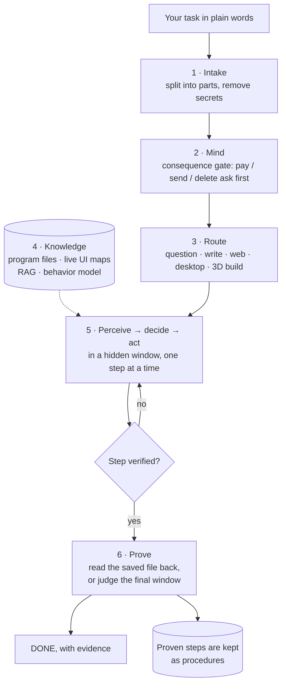
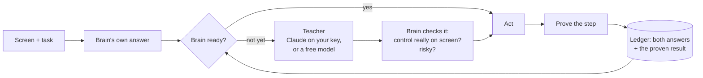

# Hojaiga

**A Windows assistant that learns any app on its own, does real work in it, and proves the result.**

Independent research project by **Dhruv Patel** · August to November 2026 · about 230k lines of Python · 29 test suites
**Status: archived.** This repository is the full record of the work: the plan, the code, the experiments, what worked, what did not, and how it ended. Take anything useful.

<p align="center"></p>

---

## In one minute

- **The idea:** hand Hojaiga any Windows app and it learns how the app works by itself (from the program's own files and from its screen), then does tasks in a hidden window without touching your mouse, and only says "done" when it can prove the result.
- **The bet:** do it with **its own intelligence**, local models running on a normal laptop, no paid AI API.
- **What happened:** the knowledge, scanning, background control, proof and safety layers worked. Small local models were not strong enough to be the eyes and brain, and fine-tuning made them worse. [HeyClicky](https://www.heyclicky.com/) already delivers the teaching experience I wanted.
- **How it ended:** the working core stays, and a large model (Claude on the user's own key, or a free Gemini / Groq / OpenAI / NVIDIA model) now teaches it. The local brain checks every step, keeps only what is proven, and turns the API off once it has learned enough.

---

## How it started, where it went, how it ended

```mermaid
flowchart LR
    subgraph S["START · Aug 2026"]
        A1["Blueprint: an automation<br/>operating system<br/>15 organs in 7 layers"]
        A2["Local LLM as the brain<br/>no API keys"]
    end
    subgraph M["MIDDLE · Sep to Oct 2026"]
        B1["Learn apps from their files<br/>menus, shortcuts, object models"]
        B2["Map the live screen<br/>UI Automation + vision"]
        B3["Virtual mouse<br/>works in hidden windows"]
        B4["Proof before 'done'<br/>+ safety gate"]
        B5["Professor: teach by pointing<br/>inspired by Clicky"]
        B6["RAG knowledge base<br/>+ fine-tuned local models"]
    end
    subgraph W["THE WALL · early Nov 2026"]
        C1["Local 4B model: 12.5% on<br/>pro-app screenshots"]
        C2["Fine-tuned: 39% vs 53% base<br/>on 630 held-out items"]
        C3["HeyClicky already does<br/>the teaching part, better"]
    end
    subgraph E["END · mid Nov 2026"]
        D1["Teacher + brain:<br/>big model teaches,<br/>local brain checks and learns"]
        D2["Archived and published<br/>as a research record"]
    end
    S --> M --> W --> E
```



---

## What it looks like inside

A task enters through one command, `hojaiga.bat "your task"`, and goes through six layers. Nothing counts as done until the last layer proves it.



And the final design of a single step (the exit build):



---

## The idea, the niche, the competition

| | Hojaiga aimed for | Who else does it |
|---|---|---|
| Any Windows app, no per-app code | learn the app itself | RPA tools (UiPath, Power Automate) need a recorded flow per app |
| Own intelligence, private | local models, data stays on the laptop | hosted computer-use agents from the big AI labs run in the cloud, per call |
| Teach by pointing at the screen | "Professor" layer for Windows | **HeyClicky** (Clicky by Farza): the direct competitor here, and the better product |
| Proof and an audit trail | every result checked | mostly left to the user |

**Credit:** Hojaiga's teaching layer was built after studying [Clicky](https://github.com/farzaa/clicky) by Farza (open source, MIT), now [HeyClicky](https://www.heyclicky.com/). Microsoft [UFO](https://github.com/microsoft/UFO) (MIT) was studied for multi-app hand-offs; OmniParser's icon detector (MIT) and Qwen3-VL models are used inside. Much of the code was written with AI coding assistants (Claude Code, Gemini).

---

## Results

| What worked | Measured |
|---|---|
| PowerPoint full ribbon map | 11 tabs, ~360 controls, ~980 menu items in ~5 min |
| A program never opened before | menus and shortcuts read from its file in ~1 s |
| Excel table into PowerPoint, invisibly | 24 of 24 cells verified from the saved files |
| Blender object from one sentence | table, chair, bookshelf, lamp built and checked from three views |
| Teacher-and-brain loop | 16 of 16 tests; first live step chose the right control where the local model alone had not |

| What did not | Measured |
|---|---|
| Small local model as the eyes | base 4B: 12.5% on ScreenSpot-Pro; fine-tuned: 0% |
| Fine-tuning on my own data | 39% vs 53% for the untouched model on 630 held-out items |
| Learning an app by self-practice | apps mapped well, but only 2 of 100 self-set tasks proven |
| Hidden Store apps and Paint drawing | windows stall when hidden; drawings arrive broken |

Full write-up with figures and both diagrams: [`reports/hojaiga_closing/HOJAIGA_REPORT.html`](reports/hojaiga_closing/HOJAIGA_REPORT.html) (download and open in a browser).

---

## Videos and pictures

- ▶ [A world built in Blender by Hojaiga, 12 s](media/hojaiga_world_build.mp4): every object built and rendered through Blender's own commands (the world's design was written by hand as data).
- ▶ [The video-editing route, 9 s](media/hojaiga_video_edit.mp4): "cut the silences and filler words", with captions, checked before done.
- [Blender deep scan: 288 controls found](media/fig_scan.jpg) · [Excel task proven from the saved file](media/fig_excel.jpg) · [Blender table, three views](media/fig_table.jpg)
- Honest failures: [the flowchart Paint mis-drew](media/fig_flow.jpg) · [a Calculator task the proof step refused](media/fig_calc.jpg)
- More proof images: [`photo_examples/`](photo_examples/) · earlier architecture diagrams: [`diagrams/`](diagrams/)

---

## Folder map

| Folder or file | What is in it |
|---|---|
| [`architechure standards-oragn files/`](architechure%20standards-oragn%20files/) | **The start:** the original blueprint, one specification per organ, grouped in the 7 layers |
| [`Master_Architecture_Blueprint.md`](Master_Architecture_Blueprint.md), `Constitution of Hojaiga.md`, `Hojaiga Law Book.md`, `Hojaiga Policy Manual.md` | the rules every organ had to follow |
| [`All codes/core_organs/`](All%20codes/core_organs/) | **The system:** 60+ organs and everything below |
| ↳ `hojaiga_run.py`, [`hojaiga.bat`](hojaiga.bat) | the front door: one command runs a task end to end |
| ↳ `mind/` | brain, consequence gate, persona, workflows, teacher-and-brain loop (`brain.py`) |
| ↳ `desktop_grounding.py`, `loop_first.py` | the perceive-decide-act loop and the step planner |
| ↳ `organ_48_app_behavior_model.py`, `organ_50_layout_map.py`, `organ_63_app_mastery.py`, `rea_native.py` | learning apps from their files and screens |
| ↳ `professor/` | vision, virtual mouse, overlay, voice, teaching ("Professor") |
| ↳ `office_om.py`, `web_executor.py`, `atlas/` | Office through its object model, the web through Playwright, full UI maps |
| ↳ `rag/`, `harvest/` | the knowledge base, and the scanners and guide/video harvesters that fill it |
| ↳ `organ_37_llm_gateway.py` | every hosted model in one place (Claude, Gemini, Groq, OpenAI, NVIDIA) with budgets |
| ↳ `si_tests_*.py`, `run_system_intelligence_tests.py` | the test suites |
| [`natural_intelligence/`](natural_intelligence/) | side research: a decision layer that learns from outcomes and picks between agent answers |
| [`claude_skills/`](claude_skills/) | design notes and rules written during development |
| [`diagrams/`](diagrams/) | architecture diagrams from the build |
| [`reports/`](reports/) | measured audits, morning reports, test-run outputs; [`reports/hojaiga_closing/`](reports/hojaiga_closing/) is the final report, LinkedIn post and resume entry |
| [`media/`](media/), [`photo_examples/`](photo_examples/) | videos and proof pictures |
| `hojaiga_pixel_automation/`, `final_hojaiga_tutor/`, `windows_ai_tutor/`, `visual_world/`, `hojaiga-workspace/` | earlier prototypes: pixel automation, the tutor apps, the "Sims-like" visualisation of the organs |
| `trajectories/`, `scratch/`, `brain/`, `benchmarks/`, `pipelines/` | recorded runs, experiments and benchmark scripts |
| Root `*.py` and `*.md` files | training and evaluation scripts and the reports written along the way |

Not in this repository (too large for GitHub, or private): downloaded datasets and models (~55 GB), app scans and browser profiles (`data/`), third-party tools (Ghidra, Java), personal recordings and keys.

---

## Run it

1. Windows 11 and Python 3.13. Create `hojaiga_env` in this folder and install the packages the modules ask for.
2. Copy `.env.example` to `.env` and add one key (Claude, or a free Gemini / Groq key).
3. Run a task:
   ```bat
   hojaiga.bat "open notepad, type hello and save as C:\temp\hello.txt"
   ```

The paths assume the project lives in `D:\new_automation` (set `HOJAIGA_ROOT` to change that). Offline tests: run `python -m core_organs.si_tests_mind` from `All codes` (22 groups, 365 checks).
