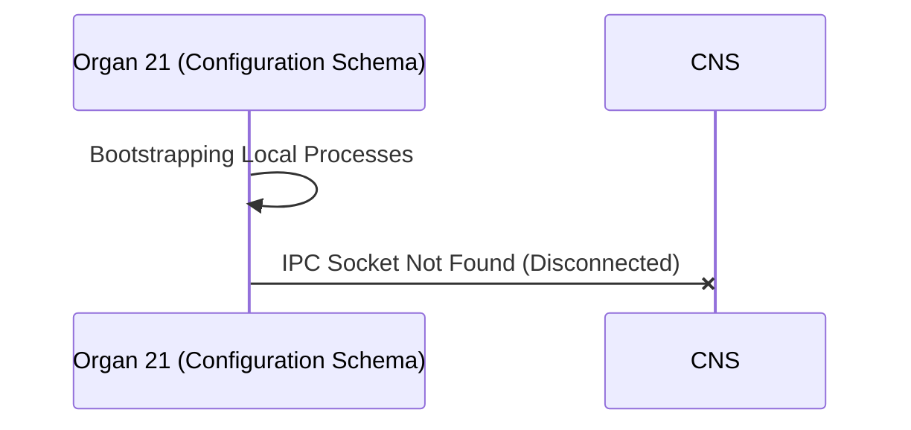
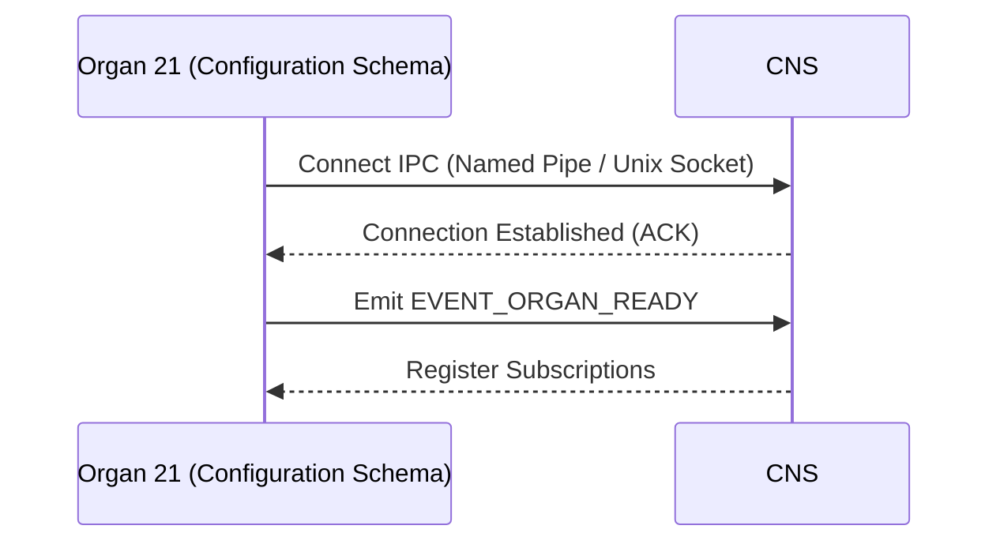

# HOJAIGA - PIPELINE 20 CONNECTION STATUS DIAGRAMS (Configuration Schema)

## DIAGRAM 1: BEFORE CONNECTION


## DIAGRAM 2: AFTER CONNECTION


## DIAGRAM 3: SYSTEM BUILD (CUMULATIVE ARCHITECTURE)
```mermaid
graph TD
    CNS((Organ 02: CNS Orchestrator))
    ORG[Configuration Schema (Organ 21)]
    CNS <-->|Bi-directional IPC| ORG
```
