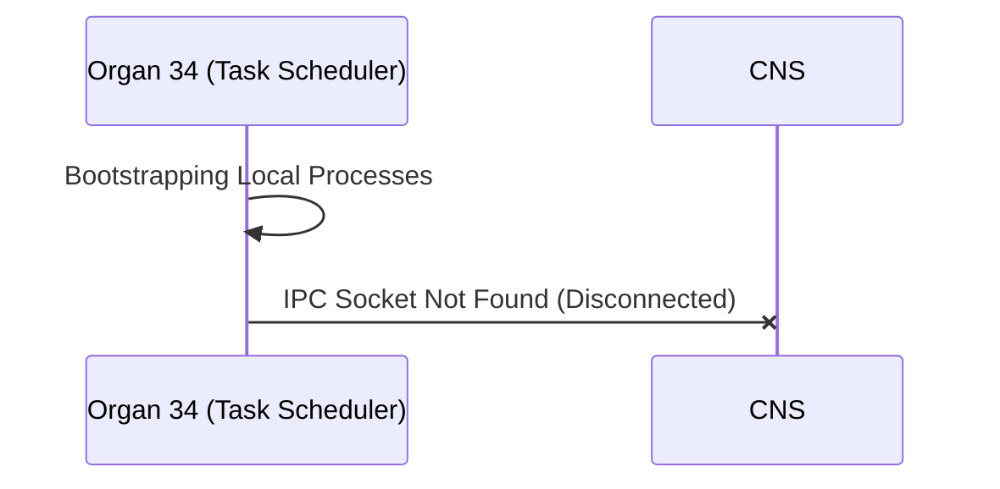
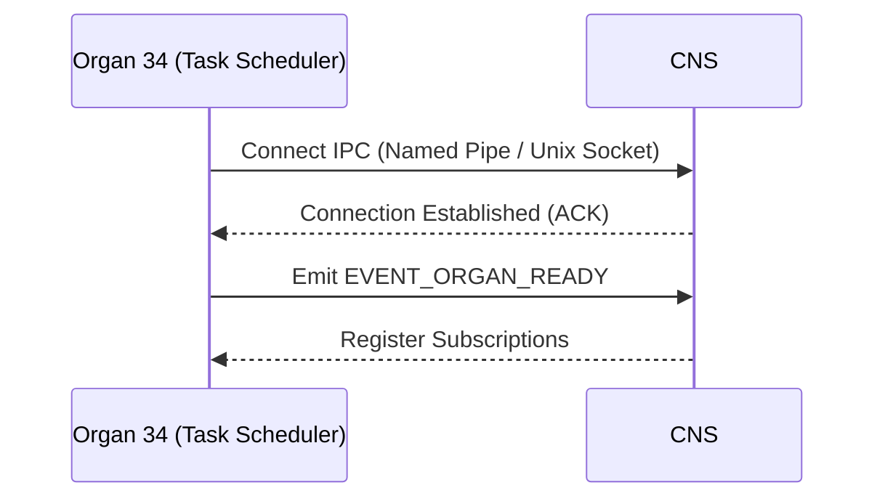

# HOJAIGA - PIPELINE 33 CONNECTION STATUS DIAGRAMS (Task Scheduler)

## DIAGRAM 1: BEFORE CONNECTION


## DIAGRAM 2: AFTER CONNECTION


## DIAGRAM 3: SYSTEM BUILD (CUMULATIVE ARCHITECTURE)
```mermaid
graph TD
    CNS((Organ 02: CNS Orchestrator))
    ORG[Task Scheduler (Organ 34)]
    CNS <-->|Bi-directional IPC| ORG
```
