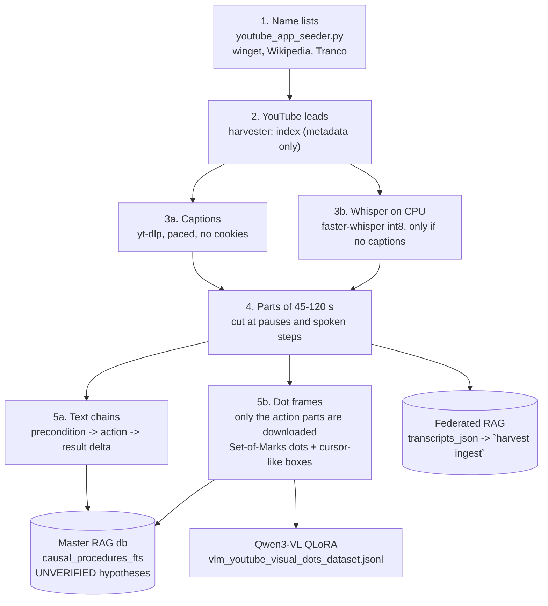

# YouTube -> Whisper -> RAG pipeline (written 2026-10-23, 01:30)

Goal: teach the RAG (and Qwen3-VL) how thousands of apps, web apps and websites really work, from tutorial videos, with the app's own patterns (and hybrids of patterns) learned from the data.

## The connection



Whisper sits between the video and the RAG: audio -> text with timestamps -> parts -> (text chains | frames aligned to the spoken step) -> RAG tables and the training JSONL.
A spoken instruction in the seconds BEFORE a screen change labels that change. Everything is stored as evidence, never as "verified": a live scan of the real app decides what may be replayed.

## Who owns which file (two sessions worked on this)

| file | role |
|---|---|
| `youtube_video_rag_harvester.py` + `test_youtube_video_rag_harvester.py` | index, captions/Whisper, parts, frames, dots, JSONL, FTS ingest (other session, 13/13 tests) |
| `youtube_pattern_mix_tagger.py` | hybrid-pattern hint per app from the saved transcripts (this session) |
| `youtube_app_seeder.py` | writes `apps_app.txt`, `apps_web_app.txt`, `apps_website.txt` into `data/ai_root/harvest/youtube_rag/` (this session) |

## Commands for the morning (separate terminal; CPU only; nothing steals focus)

```
hojaiga_env\Scripts\python.exe -X utf8 youtube_app_seeder.py --per-kind 10000
hojaiga_env\Scripts\python.exe -X utf8 youtube_video_rag_harvester.py index --apps-file data\ai_root\harvest\youtube_rag\apps_app.txt --kind app --budget-minutes 120
hojaiga_env\Scripts\python.exe -X utf8 youtube_video_rag_harvester.py index --apps-file data\ai_root\harvest\youtube_rag\apps_web_app.txt --kind web_app --budget-minutes 120
hojaiga_env\Scripts\python.exe -X utf8 youtube_video_rag_harvester.py index --apps-file data\ai_root\harvest\youtube_rag\apps_website.txt --kind website --budget-minutes 120
hojaiga_env\Scripts\python.exe -X utf8 youtube_video_rag_harvester.py process --no-frames --whisper --max-videos 200 --budget-minutes 120     (cheap tier: transcript chains only)
hojaiga_env\Scripts\python.exe -X utf8 youtube_video_rag_harvester.py process --whisper --max-videos 20 --budget-minutes 120     (frames + dots tier)
hojaiga_env\Scripts\python.exe -X utf8 youtube_video_rag_harvester.py stats
```
Notes (corrected by the harvester session):
* These start LIVE YouTube requests: run them only after the user says go. For the first real run use `--db <copy of the master RAG>` or `--no-ingest`.
* `index` walks the whole file unless `--budget-minutes` stops it (resumable: a searched name is never searched again). `process` handles only `--max-videos` (default 10) per call.
* A YouTube refusal (429 / bot check) stops the run and sets a cool-down in the ledger; re-running early does nothing until it ends. There is no cookie / account / IP rotation, by decision.
* `--whisper` only transcribes the first 4 minutes of a video that has no captions, on CPU.
* The harvester owns the flags: `youtube_video_rag_harvester.py --help`.

## What is real and what is not (be honest with yourself tomorrow)

* Names: ~10,000 desktop apps (winget), ~10,000 websites (Tranco top sites), web apps only a few hundred so far (Wikipedia is slow and polite-paced). Many website names are infrastructure and will simply find no tutorial.
* 10 lakh (1,000,000) finished training PAIRS is not reachable in a night or a week on one CPU: a pair needs a real downloaded part, a scene change, an OCR scan and a spoken step. 1,000,000 PARTS and text chains (cheap tier, no frames) is reachable over days, if YouTube keeps answering. Leads (video links) in the tens of thousands are reachable in a few nights.
* YouTube rate limits are real (an earlier run was refused after ~3 caption fetches per window). When refused, the harvester writes a cool-down and stops; it does not rotate accounts, use cookies or change address.
* Whisper on a CPU is slow (earlier measurement: ~1 short transcript per 4 minutes); use it only for videos without captions.
* Hybrid patterns: `youtube_pattern_mix_tagger.py` reads the saved transcripts and writes `app_pattern_mix.jsonl` (per app: the winning archetype, plus a 2nd/3rd only if it is >= 60% of the first AND clearly above what tutorials of any app give for it). On the 12 apps transcribed so far: the winner looked right for 11 of 12 by eye (Windows 11 Settings is the odd one: file_manager outranks settings_panel); 3 flagged hybrid (Paint = raster + vector is believable; WhatsApp's third pattern "terminal" is not). It is a HINT from narration words for the training set; a live scan of the real controls overrides it. Run it again after more transcripts exist (its baseline needs ~20+ apps to mean much).
