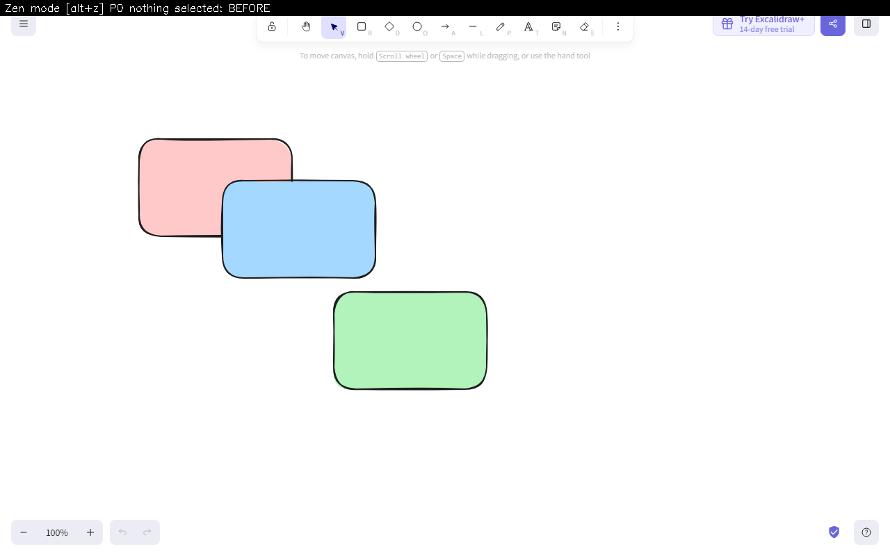
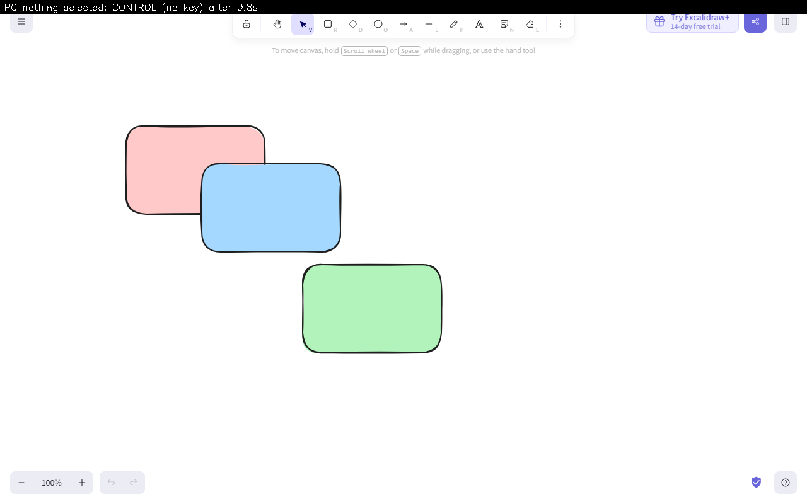
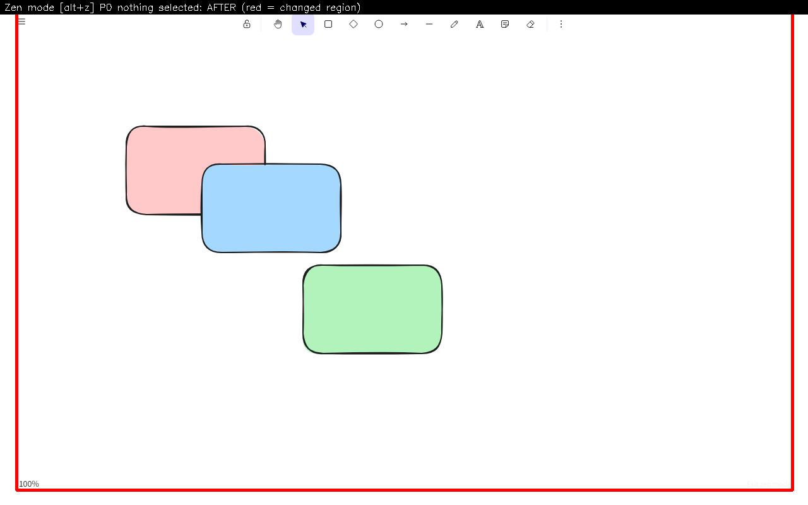
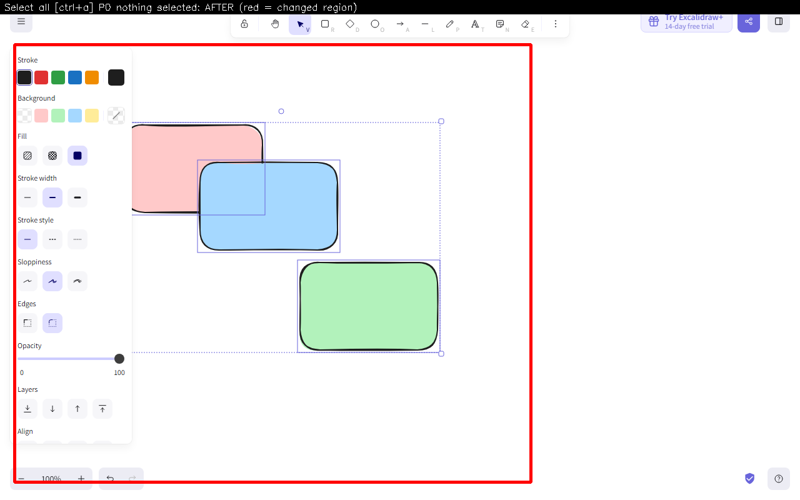

# Shortcut verification: `webapp:excalidraw.com` (https://excalidraw.com)

2 shortcuts, 17.6 s. Verdicts: {'VERIFIED': 2}

VERIFIED = an effect beyond the control's noise AND the effect matches the name. EFFECT_ONLY = it does something, what is not confirmed. MISMATCH / NO_EFFECT = do NOT promote.

## Zen mode - `alt+z` (shown as `option+z` by 4 authors): **VERIFIED**
- P0 nothing selected: tiers {'pixel': True, 'dom': True, 'semantic': True}, name check True, pixel 0.0057, dom -22/+11, scene ['state']
    

## Select all - `ctrl+a` (shown as `cmd+a` by 4 authors): **VERIFIED**
- P0 nothing selected: tiers {'pixel': True, 'dom': True, 'semantic': False}, name check True, pixel 0.0220, dom -2/+55, scene []
    
