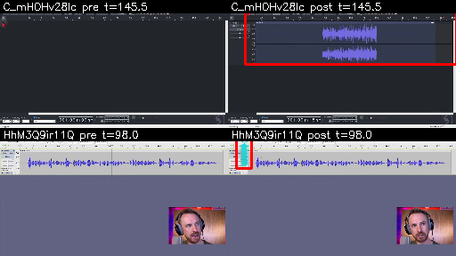
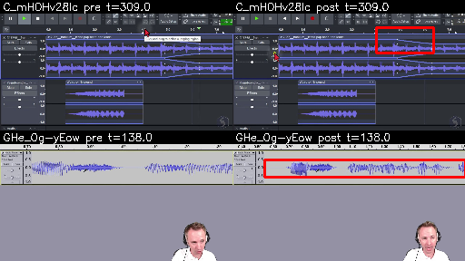
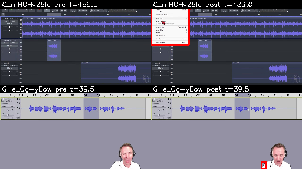

# What the videos taught about `audacity`

4 videos, 430 visual edges, 50 named concepts (3 shown by 2+ authors).

## Text that several authors' screens show at the same place

- edge 224 (support 2, top-centre, large region): Mono, 44100Hz

## Shortcuts read off the screens (>= 2 videos)

- `ctrl+z`  undo that  (1 videos)

## What authors said, confirmed by a visible change (named by >= 2 authors)

Speech is the noisier source: spontaneous narration gives fragments, so only names several authors agree on are listed.

## 1. click `stop`  (support 2/4 videos, usually 22% into a session)
- on screen: something appeared in the top-centre, large region
- authors: C_mHOHv28Ic, HhM3Q9ir11Q

## 2. click `zoom out`  (support 2/4 videos, usually 51% into a session)
- on screen: something went away in the top-right, medium region
- authors: C_mHOHv28Ic, GHe_Og-yEow

## 3. click `audio`  (support 2/4 videos, usually 54% into a session)
- on screen: something went away in the top-left, medium region
- authors: C_mHOHv28Ic, GHe_Og-yEow

