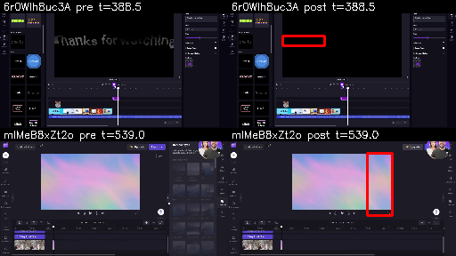

# What the videos taught about `webapp:clipchamp.com`

4 videos, 446 visual edges, 44 named concepts (1 shown by 2+ authors).

## Text that several authors' screens show at the same place

- edge 5 (support 2, middle-left, medium region): All content; Annotations >; Videos >

## Shortcuts read off the screens (>= 2 videos)

- `ctrl+z`  undo it  (1 videos)

## What authors said, confirmed by a visible change (named by >= 2 authors)

Speech is the noisier source: spontaneous narration gives fragments, so only names several authors agree on are listed.

## 1. drag `export`  (support 2/4 videos, usually 92% into a session)
- on screen: something went away in the top-centre, small region
- authors: 6r0Wlh8uc3A, mIMeB8xZt2o

