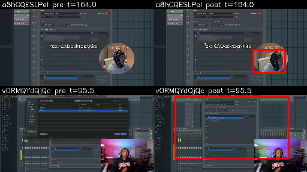
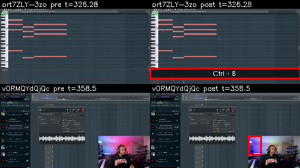
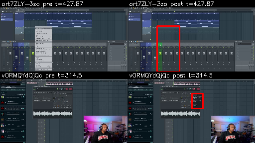

# What the videos taught about `fl_studio`

4 videos, 524 visual edges, 53 named concepts (3 shown by 2+ authors).

## Shortcuts read off the screens (>= 2 videos)

- `alt+left`  Move left  (2 videos)
- `ctrl+b`  paste them across into the next available bar  (2 videos)
- `shift+ctrl+left`  Rotate left  (2 videos)
- `shift+ctrl+right`  Replace Rotate right  (2 videos)
- `ctrl+g`  group them together  (1 videos)
- `ctrl+l`  send this sound to the mixer  (1 videos)

## What authors said, confirmed by a visible change (named by >= 2 authors)

Speech is the noisier source: spontaneous narration gives fragments, so only names several authors agree on are listed.

## 1. click `refresh`  (support 2/4 videos, usually 36% into a session)
- on screen: something went away in the bottom-right, medium region
- authors: a8hCQESLPeI, vORMQYdQjQc

## 2. click `ctrl`  (support 2/4 videos, usually 61% into a session)
- on screen: something appeared in the bottom-centre, medium region
- authors: ort7ZLY-3zo, vORMQYdQjQc

## 3. click `audio`  (support 2/4 videos, usually 66% into a session)
- on screen: something went away in the bottom-left, medium region
- authors: ort7ZLY-3zo, vORMQYdQjQc

