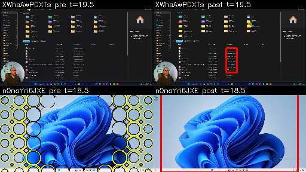
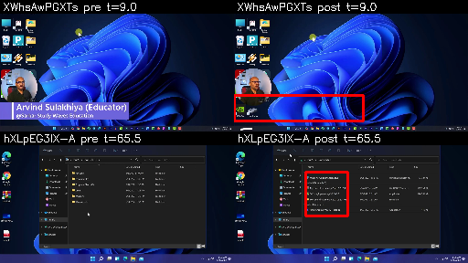

# What the videos taught about `explorer`

4 videos, 430 visual edges, 26 named concepts (2 shown by 2+ authors).

## Text that several authors' screens show at the same place

- edge 59 (support 2, top-left, medium region): ®3 Microsoft Excel Worksheet :
- edge 77 (support 2, middle-right, medium region): (& Share; Details; Date modified 11/1/2025 8:2:; Date accessed 1/1/2025 8:2!; Date last saved 6/5/2015

## Shortcuts read off the screens (>= 2 videos)

- `ctrl+w`  dabhayi or kam ho jaga  (1 videos)

## What authors said, confirmed by a visible change (named by >= 2 authors)

Speech is the noisier source: spontaneous narration gives fragments, so only names several authors agree on are listed.

## 1. drag `file explorer`  (support 2/4 videos, usually 1% into a session)
- on screen: the region changed in the bottom-centre, small region
- authors: XWhsAwPGXTs, n0naYri6JXE

## 2. drag `file`  (support 2/4 videos, usually 36% into a session)
- on screen: something went away in the bottom-left, medium region
- authors: XWhsAwPGXTs, hXLpEG3IX-A

