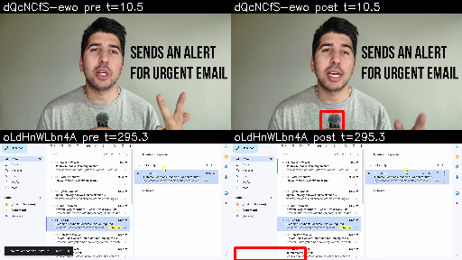

# What the videos taught about `webapp:mail.google.com`

4 videos, 253 visual edges, 24 named concepts (1 shown by 2+ authors).

## What authors said, confirmed by a visible change (named by >= 2 authors)

Speech is the noisier source: spontaneous narration gives fragments, so only names several authors agree on are listed.

## 1. drag `inbox`  (support 2/4 videos, usually 37% into a session)
- on screen: the region changed in the bottom-centre, small region
- authors: dQcNCfS-ewo, oLdHnWLbn4A

