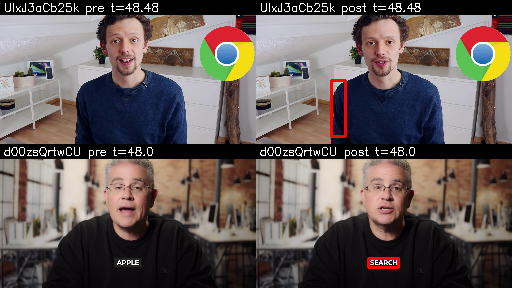

# What the videos taught about `chrome`

4 videos, 356 visual edges, 28 named concepts (1 shown by 2+ authors).

## Shortcuts read off the screens (>= 2 videos)

- `ctrl+t`  CG New tab  (2 videos)
- `ctrl+w`  Close  (2 videos)

## What authors said, confirmed by a visible change (named by >= 2 authors)

Speech is the noisier source: spontaneous narration gives fragments, so only names several authors agree on are listed.

## 1. click `google chrome`  (support 2/4 videos, usually 24% into a session)
- on screen: the region changed in the bottom-left, small region
- authors: UIxJ3aCb25k, d00zsQrtwCU

