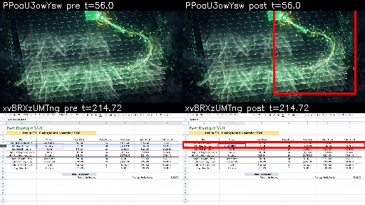
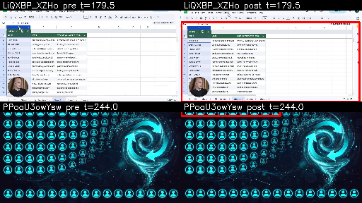
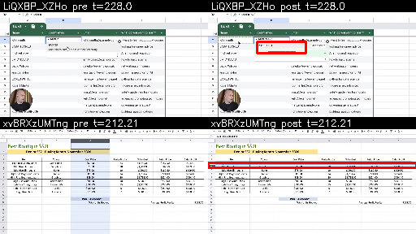

# What the videos taught about `webapp:sheets.google.com`

3 videos, 246 visual edges, 61 named concepts (3 shown by 2+ authors).

## What authors said, confirmed by a visible change (named by >= 2 authors)

Speech is the noisier source: spontaneous narration gives fragments, so only names several authors agree on are listed.

## 1. click `cell`  (support 2/3 videos, usually 46% into a session)
- on screen: something went away in the middle-right, large region
- authors: PPoaU3owYsw, xv8RXzUMTng

## 2. drag `data`  (support 2/3 videos, usually 57% into a session)
- on screen: something appeared in the middle-centre, large region
- authors: LiQXBP_XZHo, PPoaU3owYsw

## 3. click `enter`  (support 2/3 videos, usually 65% into a session)
- on screen: something appeared in the middle-centre, small region
- authors: LiQXBP_XZHo, xv8RXzUMTng

