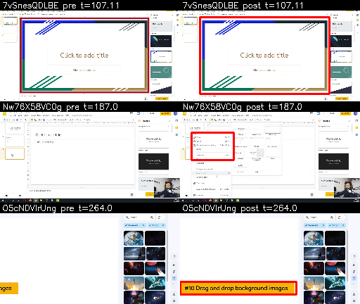
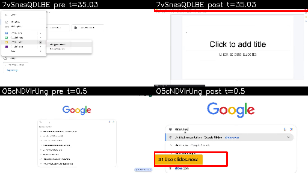

# What the videos taught about `webapp:slides.google.com`

4 videos, 367 visual edges, 48 named concepts (2 shown by 2+ authors).

## Text that several authors' screens show at the same place

- edge 27 (support 3, middle-centre, large region): Click to add title

## Shortcuts read off the screens (>= 2 videos)

- `alt+m`  Comment  (2 videos, shown as option+m by a Mac author)
- `ctrl+m`  New slide  (2 videos)
- `shift+v`  Paste without formatting  (2 videos)
- `ctrl+c`  copy  (1 videos)
- `ctrl+v`  paste  (1 videos)

## What authors said, confirmed by a visible change (named by >= 2 authors)

Speech is the noisier source: spontaneous narration gives fragments, so only names several authors agree on are listed.

## 1. drag `slide`  (support 3/4 videos, usually 44% into a session)
- on screen: something went away in the middle-centre, large region
- authors: 7vSnesQDLBE, Nw76X58VC0g, O5cNDVlrUng

## 2. drag `slides`  (support 2/4 videos, usually 5% into a session)
- on screen: something appeared in the top-centre, medium region
- authors: 7vSnesQDLBE, O5cNDVlrUng

