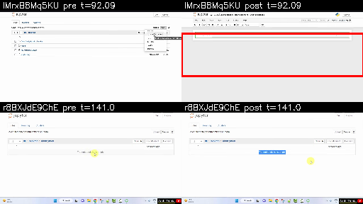

# What the videos taught about `jupyter_notebook`

4 videos, 209 visual edges, 14 named concepts (1 shown by 2+ authors).

## Shortcuts read off the screens (>= 2 videos)

- `shift+enter`  execute  (1 videos)

## What authors said, confirmed by a visible change (named by >= 2 authors)

Speech is the noisier source: spontaneous narration gives fragments, so only names several authors agree on are listed.

## 1. click `python`  (support 2/4 videos, usually 33% into a session)
- on screen: something appeared in the middle-centre, large region
- authors: IMrxB8Mq5KU, r8BXJdE9ChE

