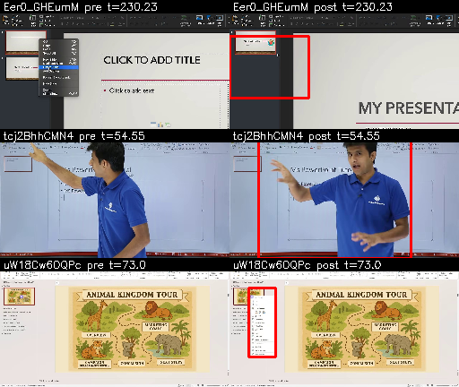

# What the videos taught about `powerpnt`

4 videos, 254 visual edges, 33 named concepts (1 shown by 2+ authors).

## Shortcuts read off the screens (>= 2 videos)

- `ctrl+a`  delete all  (1 videos)
- `ctrl+c`  copy  (1 videos)
- `ctrl+v`  paste our presenter notes  (1 videos)

## What authors said, confirmed by a visible change (named by >= 2 authors)

Speech is the noisier source: spontaneous narration gives fragments, so only names several authors agree on are listed.

## 1. drag `slide`  (support 3/4 videos, usually 36% into a session)
- on screen: something went away in the middle-left, large region
- authors: Eer0_GHEumM, tcj2BhhCMN4, uW18Cw6OQPc

