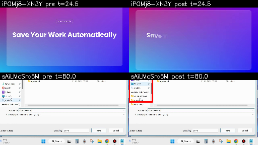

# What the videos taught about `notepad_plus_plus`

5 videos, 299 visual edges, 31 named concepts (1 shown by 2+ authors).

## Shortcuts read off the screens (>= 2 videos)

- `ctrl+f`  open the Find window  (1 videos)
- `ctrl+h`  directly open the Replace window  (1 videos)
- `ctrl+w`  Gartam again so you  (1 videos)
- `ctrl+z`  cutting into undo coefficient here find option here  (1 videos)

## What authors said, confirmed by a visible change (named by >= 2 authors)

Speech is the noisier source: spontaneous narration gives fragments, so only names several authors agree on are listed.

## 1. click `save`  (support 2/5 videos, usually 41% into a session)
- on screen: something appeared in the top-centre, medium region
- authors: iPOMj8-XN3Y, sAiLMcSrc6M

