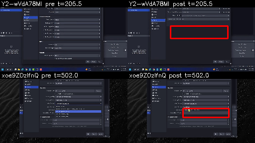
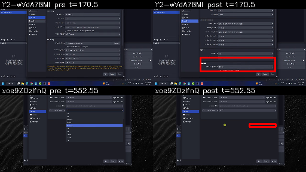

# What the videos taught about `obs64`

4 videos, 390 visual edges, 42 named concepts (2 shown by 2+ authors).

## Text that several authors' screens show at the same place

- edge 34 (support 2, bottom-left, medium region): @ Browser; ” Color Source; CJ Display Capture; ® Game Capture; @ Image Slide Show
- edge 60 (support 2, middle-centre, medium region): @ Create/Select Source x; Make source visible
- edge 75 (support 2, middle-centre, large region): @ Properties for ‘Window Capture x; Defaults OK Cancel

## What authors said, confirmed by a visible change (named by >= 2 authors)

Speech is the noisier source: spontaneous narration gives fragments, so only names several authors agree on are listed.

## 1. drag `video`  (support 2/4 videos, usually 60% into a session)
- on screen: something went away in the middle-centre, medium region
- authors: Y2-wVdA78MI, xoe9ZOzlfnQ

## 2. drag `apply`  (support 2/4 videos, usually 60% into a session)
- on screen: the region changed in the bottom-centre, medium region
- authors: Y2-wVdA78MI, xoe9ZOzlfnQ

