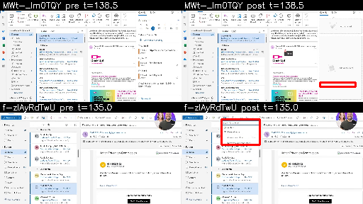

# What the videos taught about `outlook`

2 videos, 189 visual edges, 24 named concepts (1 shown by 2+ authors).

## Text that several authors' screens show at the same place

- edge 23 (support 2, middle-centre, large region): = Home View Help

## Shortcuts read off the screens (>= 2 videos)

- `ctrl+e`  new outlook Next is search bar You can  (1 videos)

## What authors said, confirmed by a visible change (named by >= 2 authors)

Speech is the noisier source: spontaneous narration gives fragments, so only names several authors agree on are listed.

## 1. drag `email`  (support 2/2 videos, usually 30% into a session)
- on screen: something went away in the bottom-right, small region
- authors: MWt-_Im0TQY, f-zIAyRdTwU

