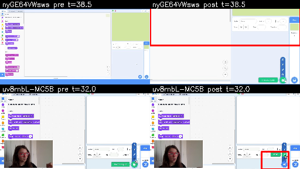

# What the videos taught about `webapp:scratch.mit.edu`

4 videos, 432 visual edges, 34 named concepts (1 shown by 2+ authors).

## Text that several authors' screens show at the same place

- edge 1 (support 2, middle-left, medium region): Events
- edge 155 (support 2, middle-left, medium region): Color 0; Saturation 0; Brightness 100
- edge 167 (support 2, middle-centre, large region): Show © @

## What authors said, confirmed by a visible change (named by >= 2 authors)

Speech is the noisier source: spontaneous narration gives fragments, so only names several authors agree on are listed.

## 1. drag `paint`  (support 2/4 videos, usually 4% into a session)
- on screen: something went away in the top-centre, large region
- authors: nyGE64VWsws, uv8mbL-MC58

