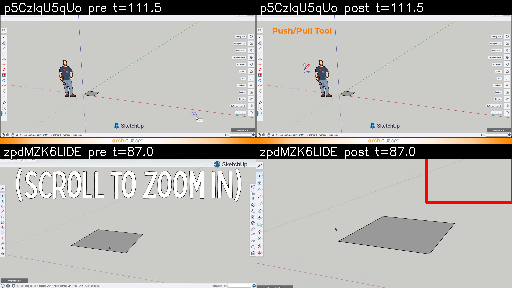
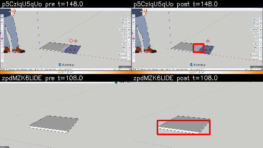
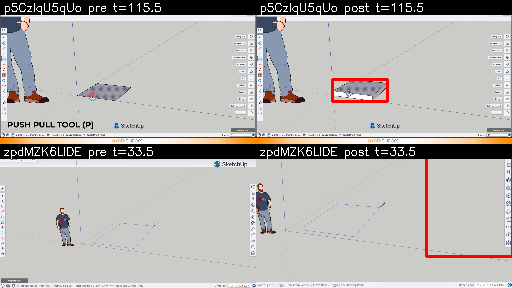
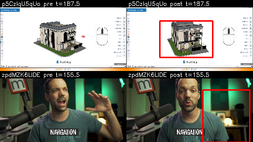
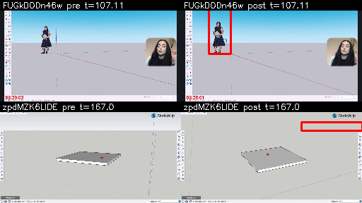
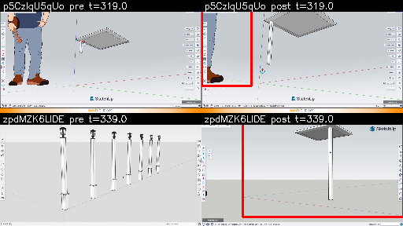
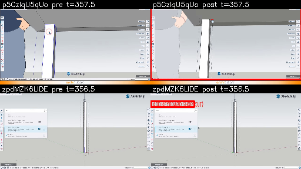
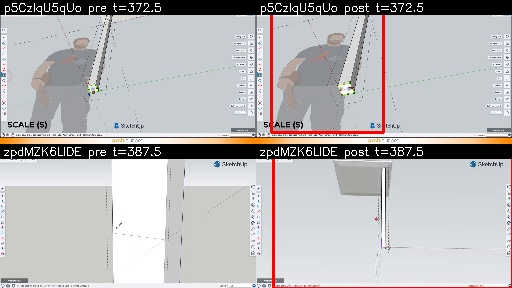
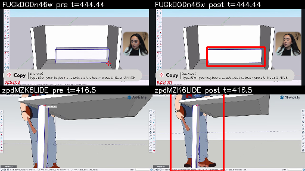

# What the videos taught about `sketchup`

4 videos, 559 visual edges, 55 named concepts (9 shown by 2+ authors).

## Text that several authors' screens show at the same place

- edge 111 (support 2, middle-centre, medium region): : Entity Info; Area »; Zoom Selection
- edge 272 (support 2, middle-centre, large region): SketchUp

## Shortcuts read off the screens (>= 2 videos)

- `ctrl+z`  to undo  (1 videos)

## What authors said, confirmed by a visible change (named by >= 2 authors)

Speech is the noisier source: spontaneous narration gives fragments, so only names several authors agree on are listed.

## 1. click `once`  (support 2/4 videos, usually 15% into a session)
- on screen: something went away in the top-centre, small region
- authors: p5CzIqU5qUo, zpdMZK6LlDE

## 2. click `make group`  (support 2/4 videos, usually 21% into a session)
- on screen: something went away in the middle-centre, small region
- authors: p5CzIqU5qUo, zpdMZK6LlDE

## 3. drag `enter`  (support 2/4 videos, usually 25% into a session)
- on screen: something appeared in the middle-centre, medium region
- authors: p5CzIqU5qUo, zpdMZK6LlDE

## 4. click `middle mouse`  (support 2/4 videos, usually 32% into a session)
- on screen: something went away in the middle-centre, large region
- authors: p5CzIqU5qUo, zpdMZK6LlDE

## 5. drag `mouse`  (support 2/4 videos, usually 44% into a session)
- on screen: something appeared in the top-left, medium region
- authors: FUGkDODn46w, zpdMZK6LlDE

## 6. drag `make component`  (support 2/4 videos, usually 64% into a session)
- on screen: something went away in the middle-left, large region
- authors: p5CzIqU5qUo, zpdMZK6LlDE

## 7. click `tape measure`  (support 2/4 videos, usually 68% into a session)
- on screen: something appeared in the middle-centre, large region
- authors: p5CzIqU5qUo, zpdMZK6LlDE

## 8. click `scale`  (support 2/4 videos, usually 74% into a session)
- on screen: the region changed in the middle-left, large region
- authors: p5CzIqU5qUo, zpdMZK6LlDE

## 9. click `control`  (support 2/4 videos, usually 84% into a session)
- on screen: something went away in the middle-centre, medium region
- authors: FUGkDODn46w, zpdMZK6LlDE

