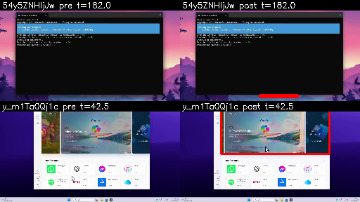
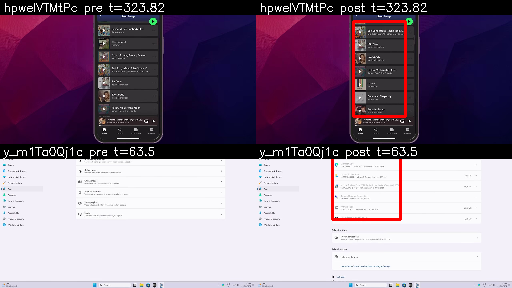
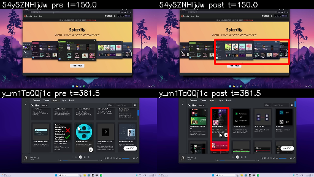
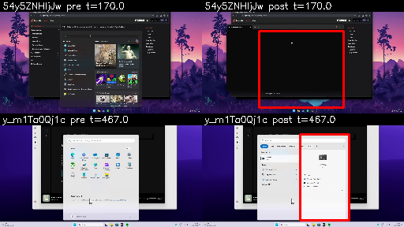

# What the videos taught about `spotify`

4 videos, 359 visual edges, 34 named concepts (4 shown by 2+ authors).

## Text that several authors' screens show at the same place

- edge 18 (support 2, middle-centre, large region): Recommended for you Show all
- edge 50 (support 2, middle-centre, large region): Extracting spicetify... > OK; Making spicetify available in the PATH... > OK; spicetify was successfully installed!; Run spicetify -h to get started; Do you also want to install Spicetify Marketplace?; easily install themes and extensions.
- edge 80 (support 2, middle-centre, large region): Beautiful Lyrics .; #. Starring the project helps this extension get s
- edge 81 (support 2, middle-centre, large region): / Installed
- edge 140 (support 2, middle-centre, medium region): spicetify v2.42.7

## What authors said, confirmed by a visible change (named by >= 2 authors)

Speech is the noisier source: spontaneous narration gives fragments, so only names several authors agree on are listed.

## 1. click `spotify`  (support 2/4 videos, usually 20% into a session)
- on screen: the region changed in the bottom-centre, small region
- authors: 54y5ZNHIjJw, y_m1Ta0Qj1c

## 2. click `three dots`  (support 2/4 videos, usually 47% into a session)
- on screen: something appeared in the middle-centre, large region
- authors: hpwelVTMtPc, y_m1Ta0Qj1c

## 3. drag `install`  (support 2/4 videos, usually 50% into a session)
- on screen: the region changed in the middle-centre, medium region
- authors: 54y5ZNHIjJw, y_m1Ta0Qj1c

## 4. drag `enter`  (support 2/4 videos, usually 57% into a session)
- on screen: something went away in the middle-centre, large region
- authors: 54y5ZNHIjJw, y_m1Ta0Qj1c

