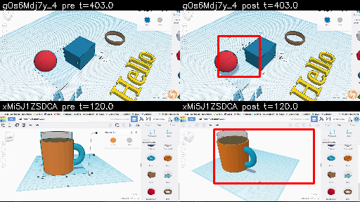

# What the videos taught about `webapp:tinkercad.com`

4 videos, 488 visual edges, 14 named concepts (1 shown by 2+ authors).

## What authors said, confirmed by a visible change (named by >= 2 authors)

Speech is the noisier source: spontaneous narration gives fragments, so only names several authors agree on are listed.

## 1. click `group`  (support 2/4 videos, usually 71% into a session)
- on screen: something appeared in the middle-left, medium region
- authors: gOs6Mdj7y_4, xMi5J1ZSDCA

