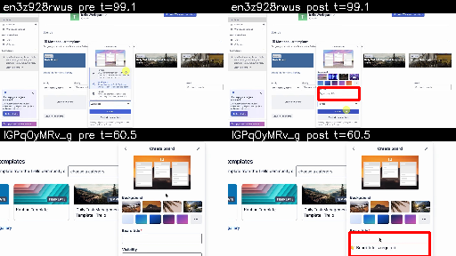
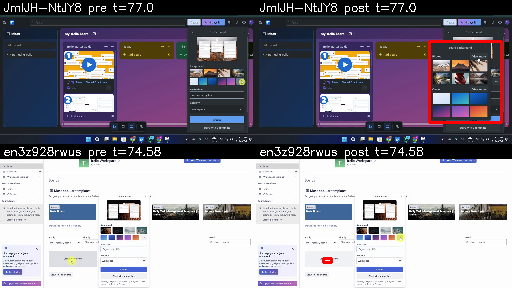
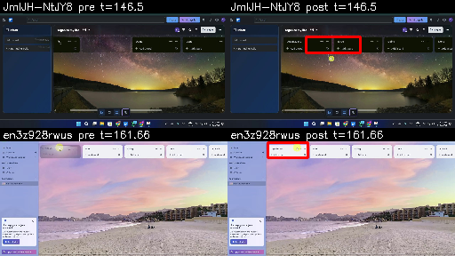
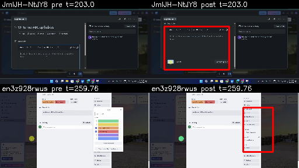
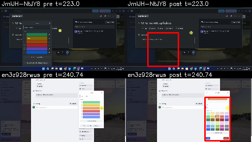
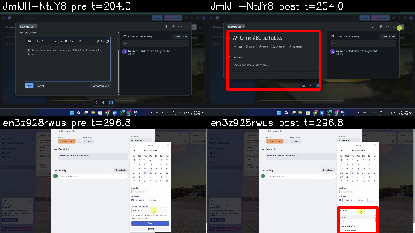
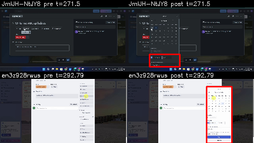

# What the videos taught about `webapp:trello.com`

4 videos, 367 visual edges, 46 named concepts (7 shown by 2+ authors).

## Text that several authors' screens show at the same place

- edge 10 (support 3, middle-right, large region): Keyword; Search cards, members, labels, and more.; []) & Nomembers; Due date; Activity
- edge 24 (support 2, middle-centre, medium region): Enter a title or paste a link

## What authors said, confirmed by a visible change (named by >= 2 authors)

Speech is the noisier source: spontaneous narration gives fragments, so only names several authors agree on are listed.

## 1. click `create`  (support 2/4 videos, usually 12% into a session)
- on screen: something went away in the bottom-centre, small region
- authors: en3z928rwus, lGPqOyMRv_g

## 2. click `see more next`  (support 2/4 videos, usually 15% into a session)
- on screen: something appeared in the middle-right, large region
- authors: JmIJH-NtJY8, en3z928rwus

## 3. drag `hold between`  (support 2/4 videos, usually 30% into a session)
- on screen: something appeared in the middle-centre, small region
- authors: JmIJH-NtJY8, en3z928rwus

## 4. click `outside`  (support 2/4 videos, usually 44% into a session)
- on screen: something went away in the middle-left, large region
- authors: JmIJH-NtJY8, en3z928rwus

## 5. click `box next`  (support 2/4 videos, usually 47% into a session)
- on screen: something went away in the bottom-left, medium region
- authors: JmIJH-NtJY8, en3z928rwus

## 6. click `save`  (support 2/4 videos, usually 52% into a session)
- on screen: something went away in the middle-left, large region
- authors: JmIJH-NtJY8, en3z928rwus

## 7. drag `dates`  (support 2/4 videos, usually 67% into a session)
- on screen: something appeared in the bottom-left, medium region
- authors: JmIJH-NtJY8, en3z928rwus

