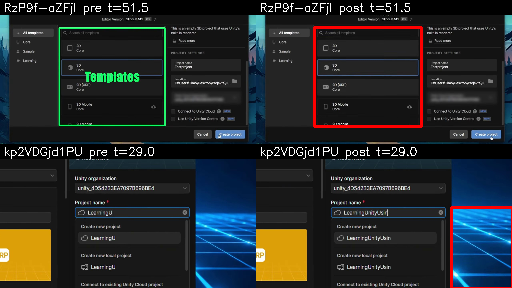

# What the videos taught about `unity`

4 videos, 454 visual edges, 35 named concepts (1 shown by 2+ authors).

## Text that several authors' screens show at the same place

- edge 80 (support 2, middle-left, large region): 3D Object >; Effects >; Light >; Video >

## What authors said, confirmed by a visible change (named by >= 2 authors)

Speech is the noisier source: spontaneous narration gives fragments, so only names several authors agree on are listed.

## 1. click `create project`  (support 2/4 videos, usually 6% into a session)
- on screen: something went away in the middle-centre, large region
- authors: RzP9f-aZFjI, kp2VDGjd1PU

