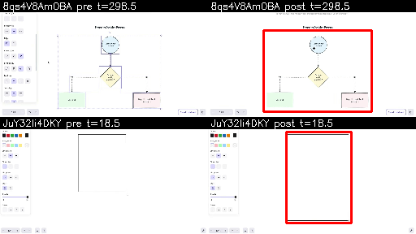
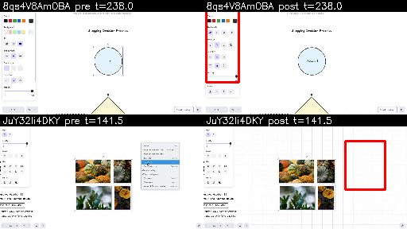
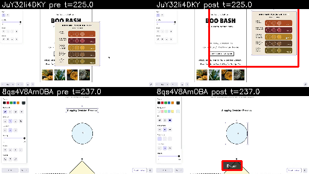

# What the videos taught about `webapp:excalidraw.com`

8 videos, 801 visual edges, 58 named concepts (3 shown by 2+ authors).

## Text that several authors' screens show at the same place

- edge 91 (support 4, middle-left, medium region): Stroke; Opacity; Stroke width; Stroke style; Sloppiness; Font size
- edge 140 (support 4, middle-right, medium region): Copy toclipboardasPNG _ Shift+Option+c; Copy to clipboard as SVG; Select all Cmd+A; Snap to objects Option+S; Zen mode Option+Z; Paste Cmd+V
- edge 104 (support 2, top-left, small region): Stroke
- edge 113 (support 2, middle-left, medium region): Stroke; Font family; Font size; Text align; Opacity
- edge 119 (support 2, bottom-left, small region): Opacity
- edge 127 (support 2, middle-right, large region): Cut Cmd+X; Copy Cmd+C; Paste Cmd+V; CopytoclipboardasPNG _ Shift+Option+c; Copy to clipboard as SVG; Copy to clipboard as text
- edge 136 (support 2, top-left, small region): stroke style
- edge 141 (support 2, middle-right, medium region): Shape properties a
- edge 156 (support 2, middle-left, medium region): Stroke; Background; Stroke width; Sloppiness
- edge 559 (support 2, middle-centre, large region): Stroke; Background
- edge 637 (support 2, middle-left, medium region): Colors; Shades; Hex code

## Shortcuts read off the screens (>= 2 videos)

- `alt+s`  Snap to objects  (4 videos, shown as option+s by a Mac author)
- `alt+z`  Zen mode  (4 videos, shown as option+z by a Mac author)
- `ctrl+a`  Select all  (4 videos, shown as cmd+a by a Mac author)
- `alt+/`  Canvas Shape properties  (3 videos, shown as option+/ by a Mac author)
- `alt+r`  View mode  (3 videos, shown as option+r by a Mac author)
- `ctrl+v`  Paste  (3 videos, shown as cmd+v by a Mac author)
- `shift+alt+c`  CopytoclipboardasPNG  (3 videos, shown as shift+option+c by a Mac author)
- `ctrl+]`  Bring forward  (2 videos, shown as cmd+] by a Mac author)
- `ctrl+alt+]`  Bring to front  (2 videos, shown as cmd+option+] by a Mac author)
- `ctrl+alt+c`  Copy styles  (2 videos, shown as cmd+option+c by a Mac author)
- `ctrl+alt+v`  Paste styles  (2 videos, shown as cmd+option+v by a Mac author)
- `ctrl+c`  Copy  (2 videos, shown as cmd+c by a Mac author)
- `ctrl+d`  Duplicate  (2 videos, shown as cmd+d by a Mac author)
- `ctrl+g`  Group selection  (2 videos, shown as cmd+g by a Mac author)
- `ctrl+shift+l`  Lock all  (2 videos, shown as cmd+shift+l by a Mac author)
- `ctrl+x`  Cut  (2 videos, shown as cmd+x by a Mac author)
- `shift+h`  Flip horizontal  (2 videos)
- `shift+v`  Flip vertical  (2 videos)

## What authors said, confirmed by a visible change (named by >= 2 authors)

Speech is the noisier source: spontaneous narration gives fragments, so only names several authors agree on are listed.

## 1. click `canvas`  (support 2/8 videos, usually 17% into a session)
- on screen: something went away in the middle-centre, large region
- authors: 8qs4V8AmOBA, JuY32li4DKY

## 2. click `enter`  (support 2/8 videos, usually 30% into a session)
- on screen: something went away in the middle-left, medium region
- authors: 8qs4V8AmOBA, JuY32li4DKY

## 3. click `any object`  (support 2/8 videos, usually 43% into a session)
- on screen: something appeared in the middle-centre, large region
- authors: JuY32li4DKY, 8qs4V8AmOBA

